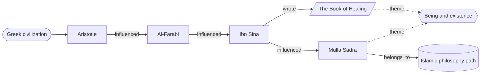

<h1 align="center">The Bayan Library</h1>

<p align="center">
  <b>عَلَّمَهُ الْبَيَانَ</b><br>
  <i>"He taught him clear expression."</i> — Qur'an 55:4
</p>

<p align="center">
  
  
  
  
  
  
  <br>
  
  
  
  
  
</p>

<p align="center">
  <b>A lifelong intellectual operating system and curated digital sanctuary
  for humanity's greatest knowledge.</b>
</p>

---

The Bayan Library exists to **preserve, organize, study, connect, and apply**
the best that humanity has thought and written. It brings great books, world
poetry, philosophy, history, science, and the Islamic intellectual tradition
into one connected library, and adds the learning systems that turn reading
into understanding and understanding into a changed life.

It is built for the curious beginner and the serious scholar alike, with
special care for **Islamic intellectual history, Islamic philosophy, Persianate
civilization, Urdu literature, world poetry, comparative religion, and the
history of ideas**.

> [!NOTE]
> The library is in its **foundation phase**. The governing specifications in
> [`docs/`](docs/) are complete; content folders, canons, and reading paths are
> being built on top of them. See the [Roadmap](#roadmap).

## Table of Contents

- 🔭 [Vision](#vision)
- 🏛️ [Core Pillars](#core-pillars)
- 🗂️ [Repository Structure](#repository-structure)
- ✨ [Featured Programs](#featured-programs)
- 📚 [Canon Projects](#canon-projects)
- 🧭 [Reading Paths](#reading-paths)
- 🕸️ [Knowledge Graph](#knowledge-graph)
- 🌅 [Daily Practice System](#daily-practice-system)
- 🤖 [AI-Native Architecture](#ai-native-architecture)
- 🤝 [Contribution Guide](#contribution-guide)
- 🗺️ [Roadmap](#roadmap)
- 🌱 [Philosophy](#philosophy)
- 🚪 [Get Started](#get-started)
- 📜 [License](#license)

## Vision

The Bayan Library aims to become, over decades, four things at once:

- **A digital Library of Alexandria:** a carefully curated home for the
  enduring works of every major civilization, from Mesopotamia to the modern
  world.
- **A House of Wisdom:** in the spirit of Abbasid Baghdad's *Bayt al-Hikma*, a
  place where traditions are translated, compared, and brought into
  conversation rather than kept apart.
- **A knowledge graph:** every book, author, civilization, concept, and theme
  linked to the ideas that shaped it and the ideas it shaped in turn.
- **A lifelong learning system:** not a shelf to admire but a practice to live
  by, with reading paths, study methods, and daily habits that compound into
  wisdom.

> [!IMPORTANT]
> The measure of success is not how much the library holds, but how much it
> helps a reader **understand, remember, connect, and act**.

## Core Pillars

| Pillar | What it offers |
| --- | --- |
| 📚 **Great Books** | A rigorously ranked global canon, with transparent methodology and bias audits. |
| 🕌 **Islamic Civilization** | Theology, philosophy, mysticism, jurisprudence, science, history, and literature across fourteen centuries. |
| 📖 **Quran Program** | A multi-decade study framework spanning language, tafsir, philosophy, comparative religion, and personal transformation. |
| 🪶 **World Poetry** | Arabic, Persian, Urdu, English, and other traditions, with poet profiles, anthologies, and comparative study. |
| 🧭 **Reading Paths** | Guided journeys at beginner, intermediate, and scholar levels. |
| 🕸️ **Knowledge Graph** | A navigable network of influence, lineage, and theme. |
| 🌅 **Daily Wisdom** | Small daily encounters with words, concepts, books, thinkers, and poems. |
| 🗃️ **Personal Knowledge Management** | Note systems, templates, and review cycles that make learning accumulate. |

## Repository Structure

> [!TIP]
> Today the repository contains [`docs/`](docs/), the governing
> specifications. The tree below is the planned layout defined in
> [Repository Architecture](docs/06-repository-architecture.md).

```text
the-bayan-library/
├── docs/             Charter, methodology, and program specifications
├── canon/            Ranked canons and curated collections
├── authors/          Philosophers, historians, scientists, and other thinkers
├── poetry/           Arabic, Persian, Urdu, English, and world poetry
├── civilizations/    Knowledge organized by historical tradition
├── summaries/        Structured analyses by book, author, and chapter
├── notes/            Reading, research, and permanent notes
├── themes/           Cross-disciplinary ideas such as justice and ethics
├── reading-paths/    Guided learning journeys by subject and level
├── study-guides/     Beginner, intermediate, and advanced guides
├── timelines/        Literary, philosophical, and civilizational history
├── quotations/       Excerpts by author, theme, and civilization
├── data/             Machine-readable records (books, authors, poets)
├── metadata/         Catalog, bibliography, and tag vocabularies
├── templates/        Book, author, poet, and note templates
├── scripts/          Index generation and validation tools
├── system/           Agent, skill, routing and budget registries
├── tests/            Tests for the tooling
├── book-lists/       Supplementary curated lists
├── ebooks/           Public-domain texts where licensing allows
├── assets/           Images and diagrams
└── .github/          Workflows, issue templates, and PR template
```

<details>
<summary><b>How the layers fit together</b></summary>

<br>

- **Content layers** (`canon/`, `authors/`, `poetry/`, `civilizations/`,
  `summaries/`, `quotations/`) hold what the library knows.
- **Learning layers** (`reading-paths/`, `study-guides/`, `notes/`,
  `themes/`, `timelines/`) shape how a reader moves through it.
- **Structure layers** (`data/`, `metadata/`, `templates/`) keep every record
  consistent and machine-readable.
- **Automation layers** (`scripts/`, `.github/`) validate links and metadata,
  build indexes, and generate the knowledge graph.

Every folder carries its own `README.md`, and every document links to related
works, authors, themes, and paths.

</details>

## Featured Programs

| Program | In one sentence |
| --- | --- |
| 📖 [Quran Lifelong Learning Program](docs/17-quran-lifelong-learning-program.md) | Eight study tracks and five levels, from reading to character formation. |
| 🧠 [Learning How to Learn Framework](docs/19-learning-how-to-learn-framework.md) | Primers, reading modes, and memory methods that make every book count. |
| 🗃️ [Study Notes and Knowledge Capture System](docs/21-study-notes-and-knowledge-capture-system.md) | Notes explained twice: once for an 8-year-old, once for a general reader. |
| 🌅 [Daily Wisdom and Intellectual Practice](docs/18-daily-wisdom-and-intellectual-practice.md) | Daily habits that compound into wisdom over years. |
| 📚 [Global Canon Project](docs/03-global-canon-methodology.md) | A weighted, audited method for identifying works of lasting significance. |
| 🕌 [Islamic Civilization Program](docs/04-islamic-civilization-program.md) | Scholarly, non-sectarian coverage of Islamic thought and culture. |
| 🪶 [World Poetry Program](docs/05-world-poetry-program.md) | Poetry treated as a core domain, not an afterthought. |

<details>
<summary><b>Inside the Quran Lifelong Learning Program</b></summary>

<br>

The Quran is studied as revelation, linguistic masterpiece, civilizational
text, philosophical source, spiritual guide, ethical framework, and lifelong
companion, through eight complementary tracks:

1. Traditional Quranic Study: tafsir, asbab al-nuzul, Quranic sciences
2. Quranic Arabic: roots, morphology, syntax, balagha
3. Comparative Religion: prophethood, revelation, and shared figures
4. Philosophical Study: knowledge, justice, human nature, consciousness
5. Scientific Reflection: observation and natural order, without forced
   interpretation
6. Civilizational Study: education, governance, economics, law, ethics
7. Future Studies: technology, stewardship, human flourishing
8. Personal Transformation: daily questions that lead to action

</details>

<details>
<summary><b>Inside the Study Notes System</b></summary>

<br>

Every note follows a capture workflow and a **two-layer explanation**:

- **Explain Like I'm 8:** the idea in the simplest honest words.
- **General Explanation:** the idea for an intelligent non-specialist, with
  technical terms placed in footnotes.

Notes are typed (source, summary, concept, permanent, question), compressed
into progressively shorter forms, linked into the knowledge graph, and revisited
on a spaced review schedule.

</details>

## Canon Projects

A canon here is **not** a bestseller list, a popularity ranking, or a list of
personal favorites. It is a documented attempt to identify works of lasting
significance.

| Canon | Scope |
| --- | --- |
| 🏆 **Top 100 Greatest Books Ever Written** | The flagship global canon across all civilizations and genres. |
| 📚 **Top 500 Books Project** | The broader canon for a lifetime of reading. |
| 🕌 **Islamic Canon** | Top 100 and Top 250 books of Islamic civilization, plus philosophy, spirituality, history, and science canons. |
| 🏺 **Philosophy Canon** | Ancient, Islamic, Eastern, and modern philosophy, traced through lines of influence. |
| 🪶 **Poetry Canon** | Top 100 poets, poems, and collections, plus the greatest epic, mystical, love, philosophical, and religious poems. |

<details>
<summary><b>How works are evaluated</b></summary>

<br>

| Criterion | Weight |
| --- | ---: |
| Civilizational influence | 25% |
| Literary and intellectual achievement | 20% |
| Endurance across time | 15% |
| Global reach and cross-cultural influence | 15% |
| Importance within its own tradition | 15% |
| Scholarly consensus and historical legacy | 10% |

Every canon also passes representation checks and a bias audit, and documents
its ranking rationale. See the
[Global Canon Methodology](docs/03-global-canon-methodology.md).

</details>

## Reading Paths

Every path supports three levels, so readers can enter wherever they are.

| Level | For | Focus | Length |
| --- | --- | --- | --- |
| 🌱 **Beginner** | Little or no background | Orientation, foundations, context | 5–15 works |
| 🌿 **Intermediate** | Foundational familiarity | Debates, development, comparison | 10–25 works |
| 🌳 **Scholar** | Advanced readers | Primary texts, original languages | 20+ works |

<details>
<summary><b>Philosophy path</b></summary>

<br>

Ancient, Islamic, Eastern, and modern philosophy, highlighting influence:

Plato → Aristotle → Al-Kindi → Al-Farabi → Ibn Sina → Mulla Sadra →
Descartes → Kant → Nietzsche

</details>

<details>
<summary><b>World literature path</b></summary>

<br>

Mesopotamian, Greek, Persian, Chinese, Japanese, European, African, and Latin
American literature, chosen for both historical influence and literary
excellence.

</details>

<details>
<summary><b>Islamic studies path</b></summary>

<br>

Beginner works may include the Qur'an, *Nahj al-Balagha*, and selections from
Al-Ghazali, Rumi, and Muhammad Iqbal. The Islamic philosophy path follows the
tradition's intellectual continuity:

Al-Kindi → Al-Farabi → Ibn Sina → Suhrawardi → Mulla Sadra →
Allamah Tabataba'i

</details>

<details>
<summary><b>Poetry paths</b></summary>

<br>

- **World poetry:** Arabic, Persian, Urdu, English, Chinese, and Japanese
  traditions in their historical and philosophical context.
- **Persian literature:** Ferdowsi, Saadi, Rumi, Hafez, Attar, Jami.
- **Urdu literature:** Mir Taqi Mir, Mirza Ghalib, Muhammad Iqbal, Faiz Ahmed
  Faiz, Ahmad Faraz, Jaun Elia, with their Persian heritage documented.

</details>

See the [Reading Path Framework](docs/09-reading-path-framework.md) for the full
catalog, including history, spirituality, and comparative religion.

## Knowledge Graph

Nothing in the library stands alone. Books, authors, poets, civilizations,
schools, concepts, themes, events, institutions, canons, and reading paths are
all **nodes**, joined by typed **relationships** such as `influenced`,
`studied`, `translated`, `critiqued`, `responds_to`, and `belongs_to`.



- **Influence chains** show how ideas travel across centuries and languages.
- **Evidence levels** (`high`, `moderate`, `tentative`) separate documented
  links from interpretive ones.
- **Bidirectional navigation** lets readers move from a poem to its poet, its
  tradition, its themes, and the paths that include it.

Details: [Knowledge Graph Specification](docs/08-knowledge-graph-specification.md).

## Daily Practice System

Small, daily encounters with great ideas, because consistency beats
intensity.

| Practice | Purpose |
| --- | --- |
| 🔤 **Word of the Day** | Expand vocabulary and conceptual awareness (*hikmah*, *logos*, *adab*). |
| 💡 **Concept of the Day** | Meet a powerful idea (*tawhid*, opportunity cost, entropy). |
| 📘 **Book of the Day** | Discover an important work and its core idea. |
| 🧑‍🏫 **Thinker of the Day** | Learn a life and its key ideas (Ibn Khaldun, Confucius, Ghalib). |
| 🪶 **Poem of the Day** | Cultivate literary appreciation (Rumi, Hafez, Iqbal, Neruda). |
| 📓 **Reflection Journal** | Record what you learned, what surprised you, and what to do next. |

<details>
<summary><b>More daily and seasonal practices</b></summary>

<br>

- Civilization, Quote, Verse, Question, and Life Principle of the Day
- Weekly themes, such as Wisdom Week or Justice Week
- Monthly themes, such as Rumi Month or Islamic Civilization Month

</details>

## AI-Native Architecture

The library is designed from the start to be maintained **with** AI, under
human scholarly judgment. AI acts as librarian, archivist, research assistant,
editor, and knowledge architect, never as an unquestionable authority.

> [!WARNING]
> All AI-generated content is treated as **draft material until reviewed**,
> especially historical claims, religious interpretation, philosophy, and
> canon rankings.

The architecture is designed around five building blocks:

- 🧩 **Subagents:** focused roles, such as canon curator, poetry analyst,
  metadata validator, and link checker, each with a narrow, auditable remit.
- 🛠️ **Skills:** reusable, documented procedures for recurring work, such as
  writing a book summary, building a primer, or auditing a canon.
- 🔎 **Retrieval:** answers grounded in the library's own notes, summaries,
  and structured data instead of unsourced recall.
- 🕸️ **Knowledge-graph grounding:** proposed relationships carry evidence
  levels and must cite credible scholarship.
- ⚙️ **Automation:** scripts and GitHub Actions validate metadata and links,
  rebuild indexes, and regenerate the graph.

Two efficiency principles guide the design:

- **Dynamic model routing:** routine tasks such as formatting, metadata, and
  link checks go to lightweight models, while scholarly synthesis and
  comparative analysis go to the most capable ones.
- **Token optimization:** compact metadata, layered summaries, and targeted
  retrieval keep context small and costs low without sacrificing accuracy.

Read the [AI Maintainer Operating Manual](docs/20-ai-maintainer-operating-manual.md).

The implementation lives in [`docs/architecture/`](docs/architecture/)
(seventeen architecture documents: agents, skills, permissions, model
routing, token budgets, memory, graph, workflows, QA, cost and risk) and in
the machine-readable registries under [`system/`](system/), which CI
validates on every pull request.

## Contribution Guide

Contributions from readers, students, and scholars are welcome.

1. **Read the standards:** the
   [Contribution Guide](docs/10-github-contribution-guide.md) and
   [Documentation Standards](docs/12-documentation-standards.md).
2. **Branch from `develop`** using a descriptive branch name.
3. **Use the templates** for books, authors, poets, and notes.
4. **Cite sources** and mark uncertainty honestly.
5. **Run markdownlint** and fix every finding before you open a pull request.
6. **Open a pull request** for review. `main` is protected.

<details>
<summary><b>Branch naming conventions</b></summary>

<br>

| Prefix | Use for |
| --- | --- |
| `feature/*` | New content or capabilities |
| `research/*` | Exploratory research and drafts |
| `docs/*` | Documentation and specifications |
| `refactor/*` | Restructuring without changing meaning |
| `automation/*` | Scripts and workflows |
| `fix/*` | Corrections and broken links |
| `release/*` | Release preparation |

</details>

<details>
<summary><b>Conventional Commits</b></summary>

<br>

```text
feat(book): add muqaddimah summary
feat(author): add mulla sadra profile
feat(poetry): add hafez collection
docs(spec): expand metadata requirements
fix(links): repair broken canon references
refactor(metadata): normalize author records
chore(index): regenerate master catalog
```

Each commit should make one logical, self-contained change. See
[Git Workflow and Branching](docs/11-git-workflow-and-branching.md).

</details>

## Roadmap

### Current Priorities

- [x] Foundation: charter, governance, methodology, and program specifications
- [ ] Repository scaffolding, templates, and metadata schema in practice
- [ ] Global Canon: publish the Top 100 Greatest Books with ranking rationale
- [ ] Islamic Civilization and World Poetry programs: first priority figures
      and poets

### Future Ambitions

- Author, thinker, and civilization archives
- A complete reading path system at all three levels
- A generated, visual knowledge graph
- Automation, research infrastructure, and analytics
- A mature, community-sustained library that lasts for generations

<details>
<summary><b>All thirteen roadmap phases</b></summary>

<br>

1. Foundation
2. Core Content Framework
3. Global Canon Project
4. Islamic Civilization Program
5. World Poetry Program
6. Author and Thinker Archive
7. Civilization Archive
8. Reading Path System
9. Knowledge Graph Generation
10. Automation Platform
11. Research Infrastructure
12. Advanced Analytics
13. Repository Maturity

Details: [Implementation Roadmap](docs/15-implementation-roadmap.md) and
[Risk Register](docs/16-risk-register.md).

</details>

## Philosophy

Every part of the library serves a single transformation:

```text
Information
    ↓
Knowledge
    ↓
Understanding
    ↓
Wisdom
    ↓
Action
    ↓
Character
```

Reading is not the goal; becoming is. A book has done its work when it has
changed how we judge, how we choose, and who we are.

## Get Started

New here? This order builds from purpose to practice:

1. 📜 [Charter](docs/00-charter.md): what the library is and why it exists
2. 🎯 [Mission and Principles](docs/01-mission-and-principles.md): the values
   behind every decision
3. 🧠 [Learning How to Learn](docs/19-learning-how-to-learn-framework.md): how
   to get the most from any book
4. 🗃️ [Study Notes System](docs/21-study-notes-and-knowledge-capture-system.md):
   how to capture what you learn
5. 🧭 [Reading Path Framework](docs/09-reading-path-framework.md): choose your
   first journey
6. 📚 [Global Canon Methodology](docs/03-global-canon-methodology.md): how great
   works are chosen
7. 🕌 [Islamic Civilization](docs/04-islamic-civilization-program.md) and
   🪶 [World Poetry](docs/05-world-poetry-program.md): the library's two great
   emphases
8. 📖 [Quran Program](docs/17-quran-lifelong-learning-program.md) and
   🌅 [Daily Wisdom](docs/18-daily-wisdom-and-intellectual-practice.md): begin
   a daily practice
9. 🤝 [Contribution Guide](docs/10-github-contribution-guide.md): join the work

> [!TIP]
> Short on time? Read the **Charter**, then **Learning How to Learn**, then
> pick one **reading path**. That is enough to begin.

## License

Released under the [MIT License](LICENSE).

---

<p align="center">
  <i>Read widely. Think deeply. Connect generously. Live wisely.</i><br><br>
  <b>The Bayan Library</b> is a lifelong journey from information to
  character, one book, one poem, and one reflection at a time.
</p>
