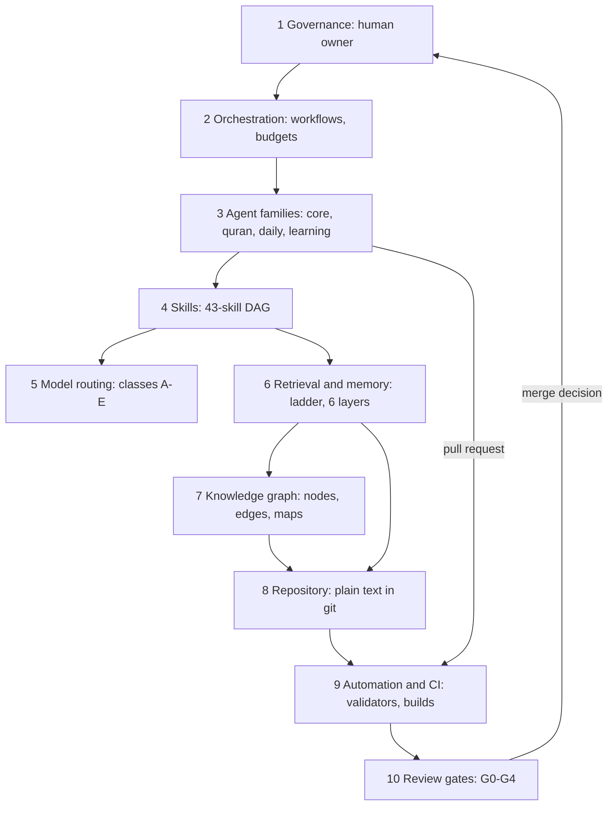
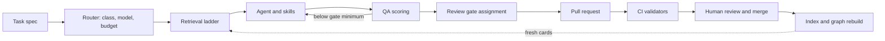

# System Architecture Overview

## Purpose

This document describes the multi-agent architecture that maintains The Bayan
Library: its layers, how a single request travels through them, how the
layers serve the guiding principle, and the decisions that let the system
run for fifty years under human supervision.

It is the entry point to the architecture set. Every other document in
`docs/architecture/` expands one layer described here.

Source of truth: `system/registry/` as a whole, in particular
`models.yaml`, `routing.yaml`, `permissions.yaml`, `review-gates.yaml`,
`agents/*.yaml`, `skills.yaml`, `memory.yaml`, `knowledge-graph.yaml`,
`workflows.yaml` and `budgets.yaml`. Where this overview and a registry
disagree, the registry wins and this document is corrected.

## Scope and Scale Targets

The architecture is sized for the library's long-run targets, not its first
year:

| Dimension | Target |
| --- | --- |
| Books | 10,000+ |
| Authors | 5,000+ |
| Notes | 100,000+ |
| Concepts | 20,000+ |
| Graph relationships | many thousands, typed and evidenced |
| Operating horizon | 50 years |
| Monthly model spend | USD 60 cap (`budgets.yaml`) |
| Supervision | one human owner, final approval on every merge |

Golden rule: use the smallest model with the smallest context that can
reliably solve the task.

## Architectural Layers

The system has ten layers. Each layer has one job and one registry or
directory that defines it.

| # | Layer | Job | Defined in |
| --- | --- | --- | --- |
| 1 | Governance (human owner) | Final approval, merges, policy | [Governance Model](../02-governance-model.md), `permissions.yaml` |
| 2 | Orchestration | Run workflows, hand off between agents, enforce budgets | `workflows.yaml`, `budgets.yaml` |
| 3 | Agent families | 44 agents in four families (core, quran, daily, learning) | `agents/*.yaml` |
| 4 | Skills | 43 reusable procedures forming a dependency DAG | `skills.yaml` |
| 5 | Model routing | Classes A-E to haiku, sonnet or opus; escalation and downgrade | `routing.yaml`, `models.yaml` |
| 6 | Retrieval and memory | Retrieval ladder and six memory layers | `memory.yaml`, `metadata/index.yaml` |
| 7 | Knowledge graph | Typed, evidenced relationships and named maps | `knowledge-graph.yaml`, `build/graph/` |
| 8 | Repository | Plain-text content, metadata and docs in git | [Repository Architecture](../06-repository-architecture.md) |
| 9 | Automation and CI | Deterministic validators, builds and drift checks | `scripts/`, `.github/workflows/` |
| 10 | Review gates | G0-G4 human review before any merge | `review-gates.yaml`, `.github/CODEOWNERS` |



### Layer Notes

- **Governance.** The repository owner (Editor-in-Chief) sits above every
  agent tier. No agent merges, approves or dismisses a review. See
  [Permission Model](04-permission-model.md) and
  [Human Review Framework](15-human-review-framework.md).
- **Orchestration.** A workflow is an ordered list of steps, each naming
  one agent and its skills. It carries a trigger (schedule, event or
  manual), a review gate and a per-run budget cap. See
  [Workflow Architecture](09-workflow-architecture.md).
- **Agents.** An agent is a role with a purpose, tier, complexity class,
  default and fallback model, skills, memory grants and evaluation metrics.
  See [Agent Registry](02-agent-registry.md).
- **Skills.** A skill is a procedure with a fixed input and output
  contract, executed as `script`, `hybrid` or `model`. See
  [Skill Registry](03-skill-registry.md).
- **Routing.** Agents and skills name model classes, never dated model
  IDs. `scripts/route-task.py` resolves a task to a class, model, effort
  and budget. See [Model Routing Framework](05-model-routing-framework.md).
- **Retrieval and memory.** Context is assembled by
  `scripts/build-context.py` down the retrieval ladder under a token
  budget. See [Memory Architecture](07-memory-architecture.md) and
  [Token Optimization Framework](06-token-optimization-framework.md).
- **Knowledge graph.** Edges are stored once in metadata, validated by
  `scripts/validate-knowledge-graph.py`, and built with inverses by
  `scripts/generate-knowledge-graph.py`. See
  [Knowledge Graph Architecture](08-knowledge-graph-architecture.md).
- **Automation and CI.** Every check is a deterministic script. No CI
  workflow calls a paid model API or merges. See
  [GitHub Architecture](10-github-architecture.md) and
  [Automation Architecture](11-automation-architecture.md).
- **Review gates.** Every output starts at its agent's declared gate and
  is raised (never lowered) by its change classes or a degraded fallback;
  the workflow's gate is the PR's minimum. See
  [Quality Assurance Framework](12-quality-assurance-framework.md).

## Request Lifecycle

Every unit of work, from a Word of the Day to a canon revision, follows the
same path.



| Step | Component | What happens | Record |
| --- | --- | --- | --- |
| 1 Task | Workflow step or owner request | Task type, target IDs, agent | run log |
| 2 Route | `scripts/route-task.py` | Task type to class; class to model, effort, budget; escalation needs a justification; forbidden-on-opus downgrade; batch eligibility; gate | run log |
| 3 Retrieve | `scripts/build-context.py`, `source-retrieval` | Metadata card, then summary, then executive summary, then full text, stopping when the task can be done | token count in run log |
| 4 Execute | Agent plus skills | Skills run in dependency order; script skills first | ledger line per model call |
| 5 QA | `quality-assurance`, `evaluation-scoring` | Rubric score; below the gate minimum returns to step 4 (two failures trigger escalation) | QA report |
| 6 Gate | `review-gates.yaml` | Agent gate, raised (never lowered) by change classes or a degraded fallback; workflow gate is the PR minimum | PR provenance block |
| 7 PR | Branch from the agent | Conventional commit, PR template with AI provenance | pull request |
| 8 CI | `.github/workflows/validate.yml` | Lint, validators, drift checks, unit tests | check runs |
| 9 Merge | Human owner or delegated editor | Review per gate, then merge | PR approval |
| 10 Rebuild | `scripts/build-index.py`, `scripts/generate-knowledge-graph.py` | New cards and edges become retrievable | index and graph artifacts |

The loop closes at step 10: merged knowledge becomes cheaper context for
the next task, because agents read cards and summaries rather than files.

## From Information to Character

The guiding principle is Information, Knowledge, Understanding, Wisdom,
Action, Character. Each stage has agents and skills whose job is to move
material one stage forward.

| Stage | Question it answers | Agents | Skills |
| --- | --- | --- | --- |
| Information | What exists, and is it recorded correctly? | `metadata`, `knowledge-capture`, `documentation` | `metadata-validation`, `duplicate-detection`, `tag-generation`, `source-retrieval` |
| Knowledge | What does it say, and how does it connect? | `study-notes`, `knowledge-graph`, `poetry`, `quran-arabic`, `quran-root-analysis`, `quran-traditional-study` | `book-summarization`, `study-note-generation`, `knowledge-graph-generation`, `arabic-root-extraction`, `tafsir-comparison` |
| Understanding | Why does it matter, and how do I grasp it? | `learning-coach`, `reading-guide`, `author-decoder`, `language-analyst`, `voice-analyst`, `register-analyst`, `difficulty-assessor`, `research`, `islamic-civilization`, `canon-editor` | `concept-explanation`, `author-decoding`, `reading-path-generation`, `comparative-analysis`, `research-synthesis`, `canon-ranking` |
| Wisdom | What is true, useful and worth keeping? | `wisdom-extractor`, `daily-life-principle`, `quran-philosophical-reflection`, `quran-civilizational-study`, `quran-future-studies`, `quran-scientific-reflection`, `quran-comparative-religion` | `wisdom-extraction`, `quran-theme-mapping`, `civilizational-analysis` |
| Action | What will I do with it? | `application-tracker`, `quran-personal-transformation`, `daily-question` | `reflection-prompting`, `spaced-repetition-scheduling` |
| Character | Who am I becoming over years? | `reflection-journal`, `memory-retention`, `daily-wisdom`, `quran-learning`, `learning-how-to-learn` | `reflection-prompting`, `knowledge-compression`, `spaced-repetition-scheduling` |

Oversight agents (`chief-librarian`, `quality-assurance`,
`risk-management`, `automation`) serve every stage rather than one.

The last two stages are deliberately private: Action and Character
material lives in personal-reflection memory and never enters the public
repository except as pseudonymous aggregates (`memory.yaml`).

## Design Principles

Each principle is delivered by a concrete mechanism, not by intention.

| Principle | Mechanism that delivers it |
| --- | --- |
| Scalable | Agents read one index card per record (`metadata/index/<type>.jsonl`), not files; graph queries are bounded to depth 2 and one named map; sharded metadata (`metadata/<type>/**/*.yaml`); batch API for batch-eligible tasks |
| Modular | Agents compose skills; skills compose skills through an acyclic `dependencies` list; a new agent is a YAML entry, not code |
| Explainable | Every escalation carries a written justification; every model call is a ledger line; every PR carries an AI provenance block; every high or moderate graph edge carries a citation |
| Maintainable | Registries validated against JSON Schemas by `scripts/validate-registry.py`; catalogs generated by `scripts/generate-registry-docs.py` with `--check` drift detection; stdlib `unittest` suite |
| Cost and token efficient | Classes A-E with per-model token caps; `script` execution wherever possible; forbidden-on-opus downgrade list; USD 60 monthly cap split into six envelopes; per-run caps per workflow |
| Retrieval-first | Retrieval ladder (card, summary, executive summary, full text); overflow compresses context before any escalation; daily agents select reviewed records and only frame them |
| Human-supervised | Five agent tiers below the owner; G0-G4 gates; CODEOWNERS on G4 paths; no agent merges; 72-hour cooling-off on G4 |

## Repository Layout Added by This Architecture

The content folders of [Repository Architecture](../06-repository-architecture.md)
are unchanged. This architecture adds the following:

```text
the-bayan-library/
├── system/
│   ├── registry/        # source of truth: models, routing, agents, ...
│   │   └── agents/      # core, quran, daily, learning
│   ├── schemas/
│   │   ├── registry/    # JSON Schemas for every registry file
│   │   └── metadata/    # JSON Schemas for metadata records
│   ├── generated/       # agent-catalog.md, skill-catalog.md,
│   │                    # routing-matrix.md (never hand-edited)
│   ├── memory/
│   │   └── projects/    # project memory, one <id>.md per project
│   └── reports/
│       └── cost/        # monthly cost reports, YYYY-MM.md
├── scripts/
│   ├── bayan/           # shared library: common, registry, metadata,
│   │                    # links, graph, index, router, retrieval,
│   │                    # cost, catalog
│   └── *.py             # validate-*, build-*, generate-*, route-task,
│                        # build-context, cost-report, check-permissions
├── tests/
│   └── fixtures/        # unittest fixtures
├── metadata/
│   ├── index.yaml       # generated retrieval manifest
│   └── index/           # generated cards, <type>.jsonl
├── drafts/              # Tier 2 drafts awaiting review
├── .github/
│   ├── workflows/       # validate, metadata, knowledge-graph, index,
│   │                    # release
│   ├── CODEOWNERS
│   └── pull_request_template.md
├── build/graph/         # generated graph.json, maps, previews
└── .bayan/              # runtime only, git-ignored
    ├── runs/<run-id>/   # run logs and session memory
    └── ledger/          # usage ledger, YYYY-MM.jsonl
```

Committed versus runtime state:

| Location | Committed | Reason |
| --- | --- | --- |
| `system/registry/`, `system/schemas/` | yes | Source of truth, reviewed at G4 |
| `system/generated/`, `metadata/index*` | yes | Generated, but checked for drift in CI |
| `system/memory/projects/` | yes | Durable decisions, under 1,500 tokens each |
| `system/reports/cost/` | yes | Auditable monthly spend |
| `build/graph/` | no | Rebuilt from metadata; uploaded as a CI artifact |
| `.bayan/runs/`, `.bayan/ledger/` | no | Volatile, may contain private context |

## Longevity Decisions

The system must outlive every model, tool and vendor it uses today.

| Decision | Rule | Why it survives |
| --- | --- | --- |
| Model classes, not IDs | Agents and skills name `haiku`, `sonnet`, `opus`; only `models.yaml` maps classes to IDs such as `claude-sonnet-5-5` | A model generation change is a one-file edit |
| Plain-text formats | Markdown, YAML, JSON, JSONL and Mermaid only | Readable without any tool in 2075 |
| Stable IDs | `<prefix>-<slug>` IDs are immutable; the prefix fixes the type (`knowledge-graph.yaml`) | Links and edges never break on rename |
| Tool independence | Validators are plain Python 3.11 with PyYAML and jsonschema; no workflow depends on a paid API | CI keeps working with no model at all |
| Registry over code | Agents, skills, routing and budgets are data | Behaviour changes are reviewable diffs |
| Human merge | The owner is the only approver | Authority never migrates to a model |
| Degrade gracefully | Every agent has a fallback model; every script runs offline | An outage delays work, never corrupts it |

If every model became unavailable tomorrow, the library would remain fully
readable, validated and navigable; only new drafting would pause.

## Related Documents

- [Agent Registry](02-agent-registry.md)
- [Skill Registry](03-skill-registry.md)
- [Permission Model](04-permission-model.md)
- [Model Routing Framework](05-model-routing-framework.md)
- [Token Optimization Framework](06-token-optimization-framework.md)
- [Memory Architecture](07-memory-architecture.md)
- [Knowledge Graph Architecture](08-knowledge-graph-architecture.md)
- [Workflow Architecture](09-workflow-architecture.md)
- [GitHub Architecture](10-github-architecture.md)
- [Automation Architecture](11-automation-architecture.md)
- [Quality Assurance Framework](12-quality-assurance-framework.md)
- [Evaluation Framework](13-evaluation-framework.md)
- [Cost Governance Framework](14-cost-governance-framework.md)
- [Human Review Framework](15-human-review-framework.md)
- [Risk Analysis](16-risk-analysis.md)
- [Future Roadmap](17-future-roadmap.md)
- [AI Maintainer Operating Manual](../20-ai-maintainer-operating-manual.md)

## System Architecture Summary

The Bayan Library is maintained by 44 agents composing 43 skills, routed to
the smallest capable model, fed by a retrieval ladder over a typed
knowledge graph, and checked by deterministic CI. Every output becomes a
pull request, and only the human owner merges. Registries, not code or
model IDs, define the system, so it can be inspected, changed and carried
forward for decades.
