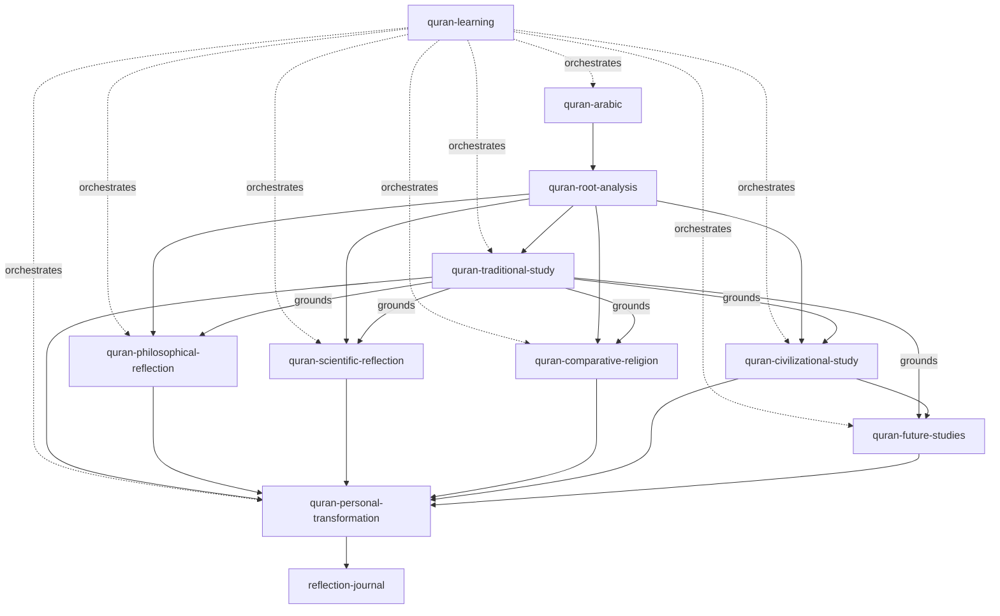
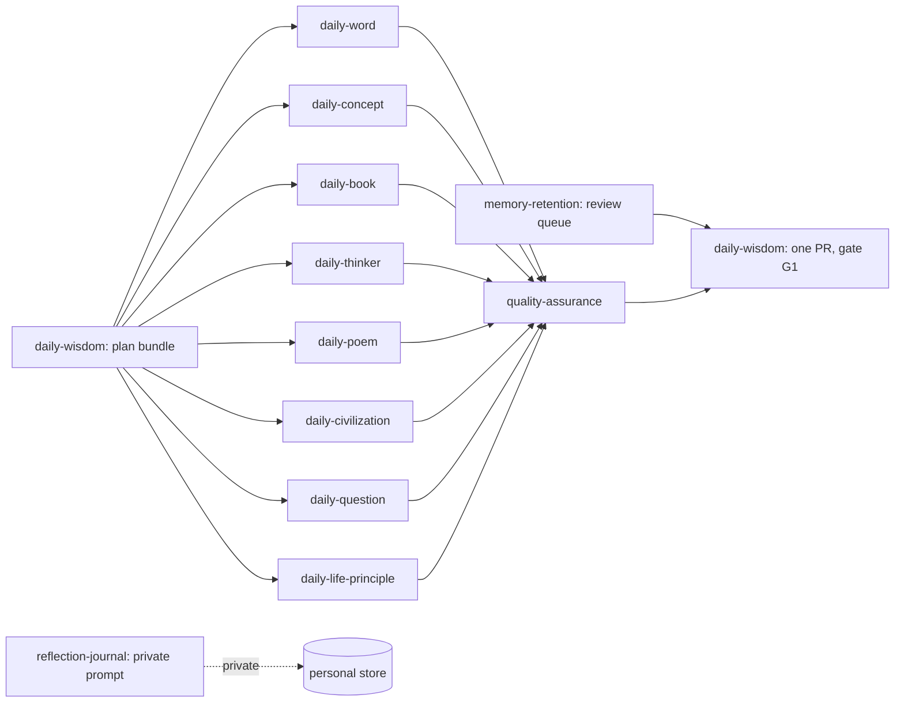
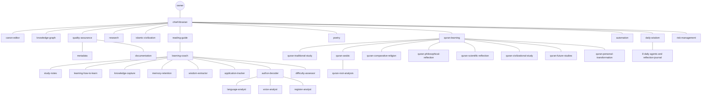

# Agent Registry

## Purpose

This document explains how agents are defined, lists all 44 agents of The
Bayan Library by family, and shows how they relate: who orchestrates whom,
who grounds whom, and who reports to whom. It ends with the procedure for
adding an agent.

Source of truth: `system/registry/agents/core.yaml`, `quran.yaml`,
`daily.yaml` and `learning.yaml`, validated against
`system/schemas/registry/agent.schema.json`. Per-agent detail
(responsibilities, metrics, escalation rules) is generated into
`system/generated/agent-catalog.md` by `scripts/generate-registry-docs.py`;
this document does not repeat it.

## What an Agent Is

An agent is a named role with a bounded purpose. It is data, not code: the
orchestrator reads the registry entry and gives the role its skills, model,
memory grants and token budget. An agent never chooses its own tier, model
or gate. The agent's `default_model` covers its own work; each skill it
invokes runs on the skill's `recommended_model`, so a class A agent using a
class B skill (for example `daily-word` with `vocabulary-analysis`) pays
for one sonnet call for that step. That is the skill's class, not an
escalation, and it draws on no escalation budget. See
[System Architecture Overview](01-system-architecture-overview.md)
for where agents sit among the layers.

## Agent Schema

Each registry file has a top-level `family` and an `agents` list. Every
agent entry has the fields below.

| Field | Type | Meaning | Validation |
| --- | --- | --- | --- |
| `agent_id` | kebab-case string | Stable, unique ID; never renamed | Unique across all files |
| `name` | string | Display name, ends in "Agent" | Required |
| `purpose` | string | One sentence: why the agent exists | Required |
| `responsibilities` | list | What it owns | Non-empty |
| `inputs` | list | What it consumes | Non-empty |
| `outputs` | list | What it produces | Non-empty |
| `complexity_class` | A-E | Default task class ([Model Routing Framework](05-model-routing-framework.md)) | Must exist in `routing.yaml` |
| `default_model` | haiku, sonnet, opus | Model class for its own work; skills it invokes run on their own `recommended_model` | A to haiku, B and C to sonnet, D and E to opus |
| `fallback_model` | model class | Used on outage or repeated failure | Must exist in `models.yaml` |
| `permission_level` | 1-5 | Permission tier ([Permission Model](04-permission-model.md)) | Exactly one tier |
| `required_skills` | list of skill IDs | Skills it may invoke | Each exists in `skills.yaml` |
| `memory.read`, `memory.write` | lists of layer IDs | Memory grants ([Memory Architecture](07-memory-architecture.md)) | Each exists in `memory.yaml` |
| `token_budget` | `{input, output}` | Per-call cap | Within the default model's cap |
| `explanation_levels` | list, optional | `eli8`, `general`, `technical` | Learning-system agents only |
| `escalation_rules` | list | When work moves up a model or to another agent or gate | Free text, reviewed |
| `evaluation_metrics` | list of `{metric, target}` | How the agent is judged ([Evaluation Framework](13-evaluation-framework.md)) | At least one |
| `quality.validation` | list | Checks the output must pass | Non-empty |
| `quality.failure_handling` | list | What happens on failure | Non-empty |
| `quality.review_gate` | G0-G4 | Agent's declared gate | Exists in `review-gates.yaml` |
| `quality.human_approval` | none, sampled, every_item, required | Human involvement | Consistent with the gate |
| `reports_to` | agent ID or `owner` | Supervisor in the hierarchy | Exists; no cycles |
| `collaborates_with` | list of agent IDs | Usual hand-off partners | Each exists |

### Full Example

The Study Notes Agent, exactly as registered in `core.yaml` (list values
wrapped onto several lines for readability):

```yaml
- agent_id: study-notes
  name: Study Notes Agent
  purpose: Extract knowledge from reading into typed, linked study notes.
  responsibilities:
    - Knowledge extraction
    - Note generation (source, summary, concept, permanent, question)
    - Summarization at every compression level
    - Two-layer explanation with glossed terminology
  inputs: [Source passages, summaries, reading notes]
  outputs: [Typed notes, book summaries, compression levels]
  complexity_class: B
  default_model: sonnet
  fallback_model: opus
  permission_level: 2
  required_skills:
    - study-note-generation
    - book-summarization
    - knowledge-compression
    - concept-explanation
  memory:
    read: [working, session, repository, canonical]
    write: [session]
  token_budget: {input: 30000, output: 5000}
  explanation_levels: [eli8, general, technical]
  escalation_rules:
    - >-
      Notes on works classed D (theology, philosophy) are reviewed by
      the domain agent.
  evaluation_metrics:
    - {metric: fidelity_score, target: ">= 0.9 (rubric)"}
    - {metric: link_density, target: ">= 3 graph links per permanent note"}
  quality:
    validation:
      - Template conformance
      - citations to pages or sections
    failure_handling:
      - Return to draft
      - flag unsupported statements
    review_gate: G2
    human_approval: every_item
  reports_to: learning-coach
  collaborates_with: [knowledge-capture, knowledge-graph, metadata]
```

## Agents by Family

Columns: tier is `permission_level`; class is `complexity_class`; models
are default and fallback; gate is `quality.review_gate`.

### Core Family

Sixteen agents for oversight, curation, structure and operations
(`core.yaml`).

| ID | Name | Tier | Class | Default / fallback | Gate | Reports to |
| --- | --- | --- | --- | --- | --- | --- |
| `chief-librarian` | Chief Librarian Agent | 5 | E | opus / sonnet | G4 | owner |
| `canon-editor` | Canon Editor Agent | 4 | D | opus / sonnet | G4 | `chief-librarian` |
| `metadata` | Metadata Agent | 3 | A | haiku / sonnet | G1 | `quality-assurance` |
| `knowledge-graph` | Knowledge Graph Agent | 3 | C | sonnet / opus | G2 | `chief-librarian` |
| `reading-guide` | Reading Guide Agent | 4 | C | sonnet / opus | G4 | `chief-librarian` |
| `documentation` | Documentation Agent | 3 | B | sonnet / opus | G1 | `quality-assurance` |
| `research` | Research Agent | 2 | C | sonnet / opus | G2 | `chief-librarian` |
| `learning-coach` | Learning Coach Agent | 2 | C | sonnet / opus | G2 | `reading-guide` |
| `study-notes` | Study Notes Agent | 2 | B | sonnet / opus | G2 | `learning-coach` |
| `islamic-civilization` | Islamic Civilization Agent | 2 | D | opus / sonnet | G3 | `chief-librarian` |
| `quran-learning` | Quran Learning Agent | 4 | D | opus / sonnet | G4 | `chief-librarian` |
| `poetry` | Poetry Agent | 2 | B | sonnet / opus | G2 | `chief-librarian` |
| `daily-wisdom` | Daily Wisdom Agent | 3 | B | sonnet / opus | G1 | `chief-librarian` |
| `automation` | Automation Agent | 3 | B | sonnet / opus | G2 | `chief-librarian` |
| `quality-assurance` | Quality Assurance Agent | 1 | A | haiku / sonnet | G0 | `chief-librarian` |
| `risk-management` | Risk Management Agent | 1 | C | sonnet / opus | G2 | `chief-librarian` |

### Quran Family

Nine track agents of the
[Quran Lifelong Learning Program](../17-quran-lifelong-learning-program.md),
coordinated by `quran-learning` (`quran.yaml`).

| ID | Name | Tier | Class | Default / fallback | Gate | Reports to |
| --- | --- | --- | --- | --- | --- | --- |
| `quran-traditional-study` | Traditional Study Agent | 2 | D | opus / sonnet | G3 | `quran-learning` |
| `quran-arabic` | Quranic Arabic Agent | 2 | B | sonnet / opus | G2 | `quran-learning` |
| `quran-root-analysis` | Root Analysis Agent | 2 | B | sonnet / opus | G1 | `quran-arabic` |
| `quran-comparative-religion` | Comparative Religion Agent | 2 | D | opus / sonnet | G3 | `quran-learning` |
| `quran-philosophical-reflection` | Philosophical Reflection Agent | 2 | D | opus / sonnet | G3 | `quran-learning` |
| `quran-scientific-reflection` | Scientific Reflection Agent | 2 | C | sonnet / opus | G3 | `quran-learning` |
| `quran-civilizational-study` | Civilizational Study Agent | 2 | C | sonnet / opus | G3 | `quran-learning` |
| `quran-future-studies` | Future Studies Agent | 2 | C | sonnet / opus | G3 | `quran-learning` |
| `quran-personal-transformation` | Personal Transformation Agent | 2 | B | sonnet / opus | G1 | `quran-learning` |

### Daily Family

Nine agents of the
[Daily Wisdom and Intellectual Practice](../18-daily-wisdom-and-intellectual-practice.md)
program, orchestrated by `daily-wisdom` (`daily.yaml`).

| ID | Name | Tier | Class | Default / fallback | Gate | Reports to |
| --- | --- | --- | --- | --- | --- | --- |
| `daily-word` | Word of the Day Agent | 2 | A | haiku / sonnet | G1 | `daily-wisdom` |
| `daily-concept` | Concept of the Day Agent | 2 | B | sonnet / opus | G1 | `daily-wisdom` |
| `daily-book` | Book of the Day Agent | 2 | A | haiku / sonnet | G1 | `daily-wisdom` |
| `daily-thinker` | Thinker of the Day Agent | 2 | A | haiku / sonnet | G1 | `daily-wisdom` |
| `daily-poem` | Poem of the Day Agent | 2 | B | sonnet / opus | G1 | `daily-wisdom` |
| `daily-civilization` | Civilization of the Day Agent | 2 | A | haiku / sonnet | G1 | `daily-wisdom` |
| `daily-question` | Question of the Day Agent | 2 | B | sonnet / opus | G1 | `daily-wisdom` |
| `daily-life-principle` | Life Principle of the Day Agent | 2 | B | sonnet / opus | G1 | `daily-wisdom` |
| `reflection-journal` | Reflection Journal Agent | 2 | B | sonnet / opus | G2 | `daily-wisdom` |

### Learning Family

Ten agents of the
[Learning How to Learn Framework](../19-learning-how-to-learn-framework.md),
coordinated by `learning-coach` (`learning.yaml`).

| ID | Name | Tier | Class | Default / fallback | Gate | Reports to |
| --- | --- | --- | --- | --- | --- | --- |
| `learning-how-to-learn` | Learning How To Learn Agent | 2 | C | sonnet / opus | G2 | `learning-coach` |
| `knowledge-capture` | Knowledge Capture Agent | 2 | B | sonnet / opus | G2 | `learning-coach` |
| `memory-retention` | Memory Retention Agent | 2 | A | haiku / sonnet | G0 | `learning-coach` |
| `wisdom-extractor` | Wisdom Extraction Agent | 2 | C | sonnet / opus | G2 | `learning-coach` |
| `application-tracker` | Application Tracking Agent | 2 | A | haiku / sonnet | G0 | `learning-coach` |
| `author-decoder` | Author Decoding Agent | 2 | C | sonnet / opus | G2 | `learning-coach` |
| `language-analyst` | Language Analysis Agent | 2 | B | sonnet / opus | G2 | `author-decoder` |
| `voice-analyst` | Voice Analysis Agent | 2 | B | sonnet / opus | G2 | `author-decoder` |
| `register-analyst` | Register Analysis Agent | 2 | B | sonnet / opus | G1 | `author-decoder` |
| `difficulty-assessor` | Difficulty Assessment Agent | 2 | A | haiku / sonnet | G1 | `learning-coach` |

### Distribution

| Measure | A | B | C | D | E | Total |
| --- | --- | --- | --- | --- | --- | --- |
| Agents by class | 9 | 17 | 11 | 6 | 1 | 44 |

| Measure | Tier 1 | Tier 2 | Tier 3 | Tier 4 | Tier 5 | Total |
| --- | --- | --- | --- | --- | --- | --- |
| Agents by tier | 2 | 33 | 5 | 3 | 1 | 44 |

Seven agents default to opus, all of class D or E. Most of them carry an
escalation rule that downgrades routine sub-tasks to sonnet or haiku.

## Quran Program Relationships

`quran-learning` orchestrates eight study tracks. Two dependencies are
structural: language comes before interpretation, and tradition grounds
reflection.



| Relationship | Rule in the registry |
| --- | --- |
| Arabic before roots | `quran-root-analysis` reports to `quran-arabic`; root cards feed every interpretive track |
| Tradition grounds reflection | `quran-philosophical-reflection` must cite `quran-traditional-study` grounding before reflecting |
| Civilization before future | `quran-civilizational-study` collaborates with `quran-future-studies`; future studies asks questions only, never rulings |
| All tracks to transformation | `quran-personal-transformation` turns track output into questions and actions |
| Transformation to journal | Journal content stays in personal-reflection memory via `reflection-journal` |

Every interpretive output in this family is G3; methodology changes made by
`quran-learning` are G4 (`quran_methodology_change`).

## Daily Practice Orchestration

`daily-wisdom` runs the `daily-cycle` workflow at 04:00 UTC through the
Batch API and opens one pull request per day.



The daily agents are retrieval-first: each item is selected from reviewed
records with `daily-selection` (cheap) and only framed by a model. Books
need a reviewed executive summary, thinkers a reviewed profile, and
principles a reviewed wisdom card. `daily-wisdom` enforces non-repetition
over 365 days and no tradition above 40 percent per month.

## Learning System

The learning system is coordinated by `learning-coach` and includes
`study-notes` and `learning-coach` from the core family plus the ten
learning agents.

### Explanation Levels

Agents that declare `explanation_levels` produce the same idea at three
levels:

| Level | Reader | Rule |
| --- | --- | --- |
| `eli8` | Explain Like I'm 8 | The idea in the simplest honest words; no false simplification |
| `general` | Intelligent non-specialist | Default level; full argument, everyday vocabulary |
| `technical` | Specialist | Precise terminology, sources and distinctions |

Declared by: `learning-coach`, `study-notes`, `quran-arabic`,
`quran-philosophical-reflection`, `daily-concept`,
`learning-how-to-learn`, `knowledge-capture`, `wisdom-extractor`,
`author-decoder`, `language-analyst`, `voice-analyst`,
`register-analyst`. `concept-explanation` builds the three levels and calls
`language-simplification` for `eli8`.

### Automatic Terminology Glossing

Every technical term in a learning output is footnoted with a plain
language gloss by the `terminology-glossing` skill (class A, haiku), per
[Study Notes and Knowledge Capture](../21-study-notes-and-knowledge-capture-system.md).
The skill also returns new glossary candidates, which enter the glossary
only through review. Because `concept-explanation`, `vocabulary-analysis`
and `language-simplification` all depend on it, glossing happens without
any agent asking for it.

### Learning Agent Roles

| Agent | Stage it serves | Key output |
| --- | --- | --- |
| `learning-how-to-learn` | Understanding | Reading mode and method per book |
| `knowledge-capture` | Information | Inbox to typed, linked permanent notes |
| `memory-retention` | Character | Reviews at 1, 7, 30, 90 and 365 days (no model for scheduling) |
| `wisdom-extractor` | Wisdom | Wisdom cards from reviewed sources only |
| `application-tracker` | Action | Private application log and follow-ups |
| `author-decoder` | Understanding | Author problem, audience, method, assumptions |
| `language-analyst`, `voice-analyst`, `register-analyst` | Understanding | Vocabulary, voice and register notes for `author-decoder` |
| `difficulty-assessor` | Understanding | Difficulty scores that set reading-path entry points |

## Reporting Hierarchy

`reports_to` forms a tree rooted at the owner. Escalations and disputes
travel up this tree; nothing travels past the owner.



Reporting is about supervision, not permission: a Tier 2 agent reporting to
a Tier 4 agent gains no write access from it.

## Adding a New Agent

An agent is added by pull request, at gate G4 (it changes `system/`).

1. Confirm no existing agent can absorb the role; prefer a new skill.
2. Choose the family file and a kebab-case `agent_id` that will never
   change.
3. Pick the lowest `complexity_class` that reliably does the work; the
   `default_model` follows from it.
4. Pick the lowest `permission_level` that lets it deliver its outputs.
5. List only existing skills in `required_skills`; add missing skills to
   `skills.yaml` first ([Skill Registry](03-skill-registry.md)).
6. Grant the fewest memory layers; `personal-reflection` needs an explicit
   reason in the PR.
7. Set `token_budget` within the model cap in `models.yaml`.
8. Write escalation rules, at least one evaluation metric with a target,
   validation checks, failure handling and a `review_gate`.
9. Set `reports_to` and `collaborates_with` to existing agents.
10. Add the agent to a budget envelope in `budgets.yaml` if its family is
    not already covered; an agent whose family envelope does not fit (as
    for the core agents `daily-wisdom`, `learning-coach`, `quran-learning`)
    is listed by `agent_id`, which takes precedence over family.
11. Run `python scripts/validate-registry.py`.
12. Run `python scripts/generate-registry-docs.py` and commit the updated
    `system/generated/agent-catalog.md`.

## Agent Registry Summary

Forty-four agents in four families cover oversight, curation, the Quran
program, daily practice and learning. Each is a registry entry with one
tier, one class, a fallback model, explicit memory grants and a review
gate. Orchestrators (`chief-librarian`, `quran-learning`, `daily-wisdom`,
`learning-coach`) coordinate their families, and every line of the
reporting hierarchy ends at the human owner.
