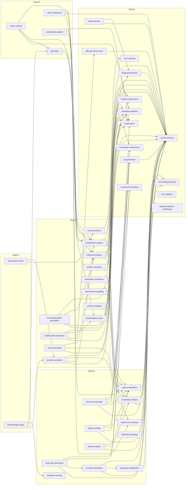

# Skill Registry

## Purpose

This document explains how skills are defined and executed, lists all 43
skills, and draws the dependency tree of every major skill so that the
cost and reach of any invocation can be read at a glance.

Source of truth: `system/registry/skills.yaml`, validated against
`system/schemas/registry/` by `scripts/validate-registry.py`. Per-skill
detail is generated into `system/generated/skill-catalog.md` by
`scripts/generate-registry-docs.py`.

## What a Skill Is

A skill is a reusable procedure with a fixed input and output contract.
Agents compose skills ([Agent Registry](02-agent-registry.md)); skills
compose other skills through `dependencies`, which must form a directed
acyclic graph. A skill names a model class, never a model ID, so the
[Model Routing Framework](05-model-routing-framework.md) decides the
concrete model at run time.

Skills are where the golden rule becomes concrete: the smallest model
with the smallest context that can reliably solve the task, and no model
at all when a script can.

## Skill Schema

| Field | Meaning | Validation |
| --- | --- | --- |
| `skill_id` | Stable kebab-case ID | Unique; never renamed |
| `name` | Display name | Required |
| `purpose` | One sentence | Required |
| `input` | Input contract | Required |
| `output` | Output contract | Required |
| `dependencies` | Skill IDs this skill invokes | Each exists; graph is acyclic |
| `complexity_class` | A-E | Exists in `routing.yaml` |
| `execution` | `script`, `hybrid` or `model` | Enum |
| `recommended_model` | Model class for the model part | Exists in `models.yaml` |
| `fallback_model` | Model class on outage or repeated QA failure | Exists in `models.yaml` |
| `token_budget` | `{input, output}` per invocation | Within the recommended model's cap |

### Example

```yaml
- skill_id: concept-explanation
  name: Concept Explanation
  purpose: Explain a concept at ELI8, general and technical levels.
  input: Concept ID, requested levels, source context.
  output: Three-level explanation with glossed terms.
  dependencies:
    - source-retrieval
    - language-simplification
    - terminology-glossing
  complexity_class: B
  execution: model
  recommended_model: sonnet
  fallback_model: opus
  token_budget: {input: 10000, output: 2500}
```

## Execution Modes

| Mode | What runs | Model call | Count | Examples |
| --- | --- | --- | --- | --- |
| `script` | Deterministic Python in `scripts/` | Never | 5 | `graph-query`, `link-validation`, `metadata-validation`, `spaced-repetition-scheduling`, `cost-reporting` |
| `hybrid` | Script first; model only for what the script cannot decide | Sometimes | 9 | `source-retrieval`, `duplicate-detection`, `daily-selection`, `citation-verification`, `knowledge-graph-generation` |
| `model` | Model call with the recommended class | Always | 29 | `book-summarization`, `canon-ranking`, `tafsir-comparison` |

Rules for each mode:

- **script.** Output is reproducible from inputs. Token budget is `0 / 0`
  for pure scripts. A script skill is tested under `tests/`.
- **hybrid.** The script part runs first and narrows the question. For
  example, `duplicate-detection` computes similarity over index cards and
  sends only ambiguous pairs to the model; `citation-verification` checks
  that cited works exist in the bibliography before asking the model
  whether the claim is supported. The model part is skipped entirely when
  the script resolves every case.
- **model.** The router resolves the class to a model, effort level and
  budget; context comes from `source-retrieval` down the retrieval ladder
  ([Token Optimization Framework](06-token-optimization-framework.md)).

## All Skills

Token budget is input / output tokens per invocation. Fourteen skills are
class A, eleven B, twelve C, four D and two E.

| Skill | Class | Execution | Model | Fallback | Budget in / out | Direct dependencies |
| --- | --- | --- | --- | --- | --- | --- |
| `source-retrieval` | A | hybrid | haiku | sonnet | 6,000 / 800 | - |
| `graph-query` | A | script | haiku | sonnet | 0 / 0 | - |
| `context-compression` | A | model | haiku | sonnet | 10,000 / 2,000 | - |
| `knowledge-compression` | A | model | haiku | sonnet | 4,000 / 600 | - |
| `terminology-glossing` | A | model | haiku | sonnet | 6,000 / 1,500 | - |
| `markdown-formatting` | A | hybrid | haiku | sonnet | 8,000 / 2,000 | - |
| `link-validation` | A | script | haiku | haiku | 0 / 0 | - |
| `metadata-validation` | A | script | haiku | sonnet | 0 / 0 | - |
| `tag-generation` | A | model | haiku | sonnet | 3,000 / 200 | `source-retrieval` |
| `duplicate-detection` | A | hybrid | haiku | sonnet | 4,000 / 500 | `source-retrieval` |
| `difficulty-assessment` | A | model | haiku | sonnet | 5,000 / 600 | `source-retrieval` |
| `spaced-repetition-scheduling` | A | script | haiku | haiku | 0 / 0 | - |
| `daily-selection` | A | hybrid | haiku | sonnet | 3,000 / 300 | `source-retrieval`, `duplicate-detection` |
| `cost-reporting` | A | script | haiku | haiku | 0 / 0 | - |
| `citation-verification` | B | hybrid | sonnet | opus | 15,000 / 2,000 | `source-retrieval` |
| `vocabulary-analysis` | B | model | sonnet | opus | 6,000 / 1,200 | `source-retrieval`, `terminology-glossing` |
| `language-simplification` | B | model | sonnet | opus | 5,000 / 1,000 | `terminology-glossing` |
| `concept-explanation` | B | model | sonnet | opus | 10,000 / 2,500 | `source-retrieval`, `language-simplification`, `terminology-glossing` |
| `book-summarization` | B | model | sonnet | opus | 30,000 / 5,000 | `source-retrieval`, `citation-verification`, `knowledge-compression`, `markdown-formatting`, `tag-generation` |
| `author-profiling` | B | model | sonnet | opus | 20,000 / 4,000 | `source-retrieval`, `graph-query`, `citation-verification`, `tag-generation` |
| `study-note-generation` | B | model | sonnet | opus | 20,000 / 4,000 | `source-retrieval`, `concept-explanation`, `knowledge-compression`, `markdown-formatting` |
| `poetry-analysis` | B | model | sonnet | opus | 15,000 / 3,000 | `source-retrieval`, `vocabulary-analysis`, `citation-verification` |
| `arabic-root-extraction` | B | hybrid | sonnet | opus | 8,000 / 2,000 | `source-retrieval` |
| `reflection-prompting` | B | model | sonnet | opus | 4,000 / 800 | `source-retrieval` |
| `evaluation-scoring` | B | model | sonnet | opus | 12,000 / 1,500 | - |
| `influence-analysis` | C | model | sonnet | opus | 25,000 / 4,000 | `source-retrieval`, `graph-query`, `citation-verification` |
| `comparative-analysis` | C | model | sonnet | opus | 30,000 / 5,000 | `source-retrieval`, `citation-verification`, `context-compression` |
| `research-synthesis` | C | model | sonnet | opus | 30,000 / 5,000 | `source-retrieval`, `comparative-analysis`, `citation-verification`, `context-compression` |
| `knowledge-graph-generation` | C | hybrid | sonnet | opus | 20,000 / 3,000 | `metadata-validation`, `graph-query`, `influence-analysis`, `duplicate-detection` |
| `representation-check` | C | hybrid | sonnet | opus | 10,000 / 2,000 | `metadata-validation`, `graph-query` |
| `reading-path-generation` | C | model | sonnet | opus | 25,000 / 4,000 | `graph-query`, `difficulty-assessment`, `representation-check`, `metadata-validation` |
| `wisdom-extraction` | C | model | sonnet | opus | 10,000 / 1,500 | `source-retrieval`, `knowledge-compression` |
| `author-decoding` | C | model | sonnet | opus | 20,000 / 3,000 | `source-retrieval`, `vocabulary-analysis`, `influence-analysis` |
| `translation-comparison` | C | model | sonnet | opus | 15,000 / 3,000 | `source-retrieval`, `vocabulary-analysis` |
| `quran-theme-mapping` | C | model | sonnet | opus | 20,000 / 3,000 | `arabic-root-extraction`, `graph-query`, `citation-verification` |
| `risk-assessment` | C | model | sonnet | opus | 15,000 / 2,500 | `source-retrieval`, `cost-reporting` |
| `schema-migration` | C | hybrid | sonnet | opus | 20,000 / 4,000 | `metadata-validation` |
| `bias-audit` | D | model | opus | sonnet | 40,000 / 6,000 | `representation-check`, `comparative-analysis` |
| `canon-ranking` | D | model | opus | sonnet | 80,000 / 10,000 | `metadata-validation`, `bias-audit`, `influence-analysis`, `comparative-analysis` |
| `tafsir-comparison` | D | model | opus | sonnet | 40,000 / 6,000 | `source-retrieval`, `arabic-root-extraction`, `citation-verification` |
| `civilizational-analysis` | D | model | opus | sonnet | 60,000 / 8,000 | `comparative-analysis`, `influence-analysis`, `graph-query` |
| `governance-review` | E | model | opus | sonnet | 60,000 / 8,000 | `risk-assessment`, `research-synthesis` |
| `methodology-design` | E | model | opus | sonnet | 80,000 / 10,000 | `research-synthesis`, `bias-audit`, `evaluation-scoring` |

`source-retrieval` is the most reused skill (21 direct dependants),
followed by `citation-verification` (8) and `graph-query` (7). Those three
are therefore the first candidates for caching and for script-level
optimisation.

## Dependency Overview

The full DAG by class. Arrows point from a skill to the skills it
depends on. Every dependency points to the same or a lower class, which
keeps expensive reasoning at the top and cheap retrieval at the bottom.



## Dependency Trees

Each tree expands transitive dependencies. A skill that appears twice in a
tree runs once per run; see [Runtime Dependency Resolution](#runtime-dependency-resolution).

### Class B Skills With Dependencies

`evaluation-scoring` is the only class B skill with no dependencies.

```text
Citation Verification
└── Source Retrieval

Vocabulary Analysis
├── Source Retrieval
└── Terminology Glossing

Language Simplification
└── Terminology Glossing

Concept Explanation
├── Source Retrieval
├── Language Simplification
│   └── Terminology Glossing
└── Terminology Glossing

Book Summarization
├── Source Retrieval
├── Citation Verification
│   └── Source Retrieval
├── Knowledge Compression
├── Markdown Formatting
└── Tag Generation
    └── Source Retrieval

Author Profiling
├── Source Retrieval
├── Graph Query
├── Citation Verification
│   └── Source Retrieval
└── Tag Generation
    └── Source Retrieval

Study Note Generation
├── Source Retrieval
├── Concept Explanation
│   ├── Source Retrieval
│   ├── Language Simplification
│   │   └── Terminology Glossing
│   └── Terminology Glossing
├── Knowledge Compression
└── Markdown Formatting

Poetry Analysis
├── Source Retrieval
├── Vocabulary Analysis
│   ├── Source Retrieval
│   └── Terminology Glossing
└── Citation Verification
    └── Source Retrieval

Arabic Root Extraction
└── Source Retrieval

Reflection Prompting
└── Source Retrieval
```

### Class C Skills

```text
Influence Analysis
├── Source Retrieval
├── Graph Query
└── Citation Verification
    └── Source Retrieval

Comparative Analysis
├── Source Retrieval
├── Citation Verification
│   └── Source Retrieval
└── Context Compression

Research Synthesis
├── Source Retrieval
├── Comparative Analysis
│   ├── Source Retrieval
│   ├── Citation Verification
│   │   └── Source Retrieval
│   └── Context Compression
├── Citation Verification
│   └── Source Retrieval
└── Context Compression

Knowledge Graph Generation
├── Metadata Validation
├── Graph Query
├── Influence Analysis
│   ├── Source Retrieval
│   ├── Graph Query
│   └── Citation Verification
│       └── Source Retrieval
└── Duplicate Detection
    └── Source Retrieval

Representation Check
├── Metadata Validation
└── Graph Query

Reading Path Generation
├── Graph Query
├── Difficulty Assessment
│   └── Source Retrieval
├── Representation Check
│   ├── Metadata Validation
│   └── Graph Query
└── Metadata Validation

Wisdom Extraction
├── Source Retrieval
└── Knowledge Compression

Author Decoding
├── Source Retrieval
├── Vocabulary Analysis
│   ├── Source Retrieval
│   └── Terminology Glossing
└── Influence Analysis
    ├── Source Retrieval
    ├── Graph Query
    └── Citation Verification
        └── Source Retrieval

Translation Comparison
├── Source Retrieval
└── Vocabulary Analysis
    ├── Source Retrieval
    └── Terminology Glossing

Quran Theme Mapping
├── Arabic Root Extraction
│   └── Source Retrieval
├── Graph Query
└── Citation Verification
    └── Source Retrieval

Risk Assessment
├── Source Retrieval
└── Cost Reporting

Schema Migration
└── Metadata Validation
```

### Class D Skills

```text
Bias Audit
├── Representation Check
│   ├── Metadata Validation
│   └── Graph Query
└── Comparative Analysis
    ├── Source Retrieval
    ├── Citation Verification
    │   └── Source Retrieval
    └── Context Compression

Canon Ranking
├── Metadata Validation
├── Bias Audit
│   ├── Representation Check
│   │   ├── Metadata Validation
│   │   └── Graph Query
│   └── Comparative Analysis
│       ├── Source Retrieval
│       ├── Citation Verification
│       │   └── Source Retrieval
│       └── Context Compression
├── Influence Analysis
│   ├── Source Retrieval
│   ├── Graph Query
│   └── Citation Verification
│       └── Source Retrieval
└── Comparative Analysis
    ├── Source Retrieval
    ├── Citation Verification
    │   └── Source Retrieval
    └── Context Compression

Tafsir Comparison
├── Source Retrieval
├── Arabic Root Extraction
│   └── Source Retrieval
└── Citation Verification
    └── Source Retrieval

Civilizational Analysis
├── Comparative Analysis
│   ├── Source Retrieval
│   ├── Citation Verification
│   │   └── Source Retrieval
│   └── Context Compression
├── Influence Analysis
│   ├── Source Retrieval
│   ├── Graph Query
│   └── Citation Verification
│       └── Source Retrieval
└── Graph Query
```

### Class E Skills

```text
Governance Review
├── Risk Assessment
│   ├── Source Retrieval
│   └── Cost Reporting
└── Research Synthesis
    ├── Source Retrieval
    ├── Comparative Analysis
    │   ├── Source Retrieval
    │   ├── Citation Verification
    │   │   └── Source Retrieval
    │   └── Context Compression
    ├── Citation Verification
    │   └── Source Retrieval
    └── Context Compression

Methodology Design
├── Research Synthesis
│   ├── Source Retrieval
│   ├── Comparative Analysis
│   │   ├── Source Retrieval
│   │   ├── Citation Verification
│   │   │   └── Source Retrieval
│   │   └── Context Compression
│   ├── Citation Verification
│   │   └── Source Retrieval
│   └── Context Compression
├── Bias Audit
│   ├── Representation Check
│   │   ├── Metadata Validation
│   │   └── Graph Query
│   └── Comparative Analysis
│       ├── Source Retrieval
│       ├── Citation Verification
│       │   └── Source Retrieval
│       └── Context Compression
└── Evaluation Scoring
```

## Runtime Dependency Resolution

The orchestrator expands a skill invocation into an execution plan before
any model is called.

```text
resolve(skill, task):
  plan = topological_order(closure(skill.dependencies))  # leaves first
  stable-sort plan so execution == script comes first, then hybrid,
    then model, without breaking dependency order
  results = run_cache(run_id)          # results already produced in run
  for s in plan + [skill]:
    key = (s.skill_id, hash(inputs_for(s, task)))
    if key in results: continue        # reuse, no new tokens
    route = router.route(s, task)      # class, model, effort, budget
    ctx = build_context(s, task, route.input_budget)
    if ctx.tokens > route.input_budget:
      ctx = compress_or_split(ctx)     # never escalate for context size
    results[key] = execute(s, ctx, route)
    ledger.append(call_record(s, route, usage))
  return results[(skill.skill_id, ...)]
```

| Rule | Effect |
| --- | --- |
| Topological order | Every dependency finishes before its dependant starts |
| Run-scoped cache | A dependency is computed once per run (`.bayan/runs/<run-id>/`); `canon-ranking` runs `comparative-analysis` once although it appears twice in its tree |
| Script skills first | Deterministic checks fail fast and cheaply; a `metadata-validation` critical finding stops the plan before any model spends tokens |
| Budget per skill | Each skill gets its own token budget; a parent never inherits a child's context |
| Hand-off by result | A dependant receives the dependency's output contract, not its transcript |
| Failure | A failed dependency fails the plan; the run log names the failing skill; QA failure twice escalates one rung per `routing.yaml` |
| Model per skill | A skill always runs on its own `recommended_model`, whatever the invoking agent's class: a class D skill uses class A helpers on haiku, and a class A agent that invokes a class B skill pays for one sonnet call for that step only. The router records it under the skill's class, not as an escalation |

Cost estimates for a run are the sum over the de-duplicated plan, which
`scripts/route-task.py` can report before execution.

## Rules for Adding Skills

1. Prefer extending an existing skill's input options over a new skill.
2. Give it the lowest class and the cheapest `execution` that is reliable:
   `script` if the output is decidable, `hybrid` if most of it is.
3. Write precise `input` and `output` contracts; dependants rely on them.
4. Depend only on existing skills; no cycles; prefer depending on lower
   classes.
5. Keep `token_budget` within the recommended model's cap in
   `models.yaml`; script skills use `0 / 0`.
6. Never assign opus to a task type in `routing.yaml`
   `forbidden_on_opus`.
7. Add a test under `tests/` for any script or hybrid part.
8. Reference the skill from at least one agent's `required_skills`.
9. Run `python scripts/validate-registry.py`, then
   `python scripts/generate-registry-docs.py` and commit
   `system/generated/skill-catalog.md`.
10. Update this document's table and trees in the same pull request (G4,
    because it changes `system/` and `docs/`).

## Skill Registry Summary

Forty-three skills turn agent roles into concrete, budgeted procedures.
Five run as pure scripts and nine as hybrids, so deterministic work never
spends tokens. Dependencies form an acyclic graph rooted in cheap
retrieval and validation; at run time it is resolved leaves first, scripts
first, with each dependency computed once per run.
