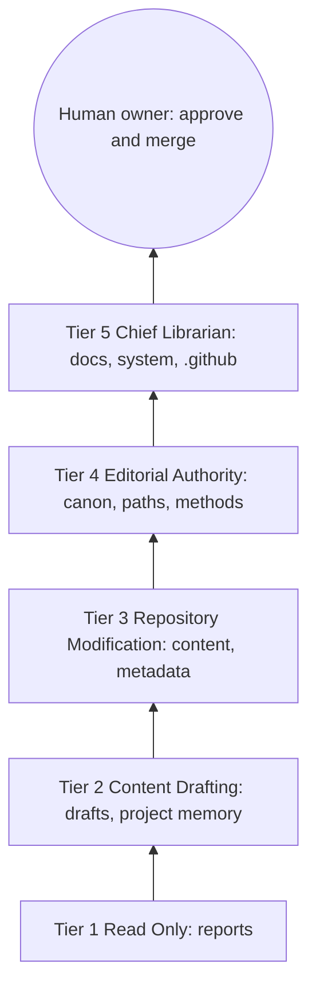
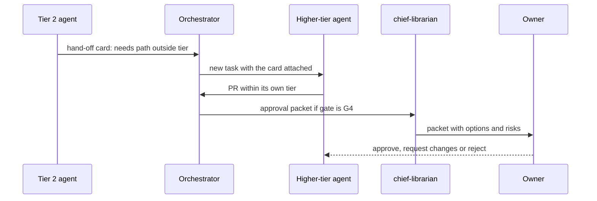

# Permission Model

## Purpose

This document defines what each agent may do and where it may write, how
those limits are enforced on GitHub, and how work moves to a higher tier
when it must. It places the human owner above every agent tier and draws
the boundary around personal reflection.

Source of truth: `system/registry/permissions.yaml` (tiers, write paths,
mandatory review) and the `permission_level` and `memory` fields of
`system/registry/agents/*.yaml`. Gates referenced here are defined in
`system/registry/review-gates.yaml` and explained in the
[Human Review Framework](15-human-review-framework.md).

## Principles

- **Least privilege.** Each agent gets the lowest tier that lets it deliver
  its outputs; 35 of 46 agents are Tier 2 and can only write drafts.
- **Cumulative tiers.** Each tier inherits every action and path of the
  tier below it (`inherits`).
- **One tier per agent.** `scripts/validate-registry.py` rejects an agent
  with no tier or with more than one.
- **Proposal, not decision.** Even Tier 5 only proposes. Every change
  reaches `main` through a human merge.

## The Five Tiers

| Tier | Name | Allowed actions (added at this tier) | Write paths (added) | Default gate (new agents) | Escalates to |
| --- | --- | --- | --- | --- | --- |
| 1 | Read Only | `search`, `retrieve`, `analyse`, `report` | none | G0 | 2 |
| 2 | Content Drafting | `draft_note`, `draft_summary`, `suggest_metadata`, `suggest_relationship` | `drafts/**`, `system/memory/projects/**` (project memory) | G2 | 3 |
| 3 | Repository Modification | `update_content`, `update_metadata`, `update_graph`, `regenerate_index` | `authors/**`, `book-lists/**`, `civilizations/**`, `daily/**`, `metadata/**`, `notes/**`, `poetry/**`, `quotations/**`, `quran/**`, `scripts/**`, `study-guides/**`, `summaries/**`, `system/generated/**` (regenerated catalogs only), `templates/**`, `tests/**`, `themes/**`, `timelines/**` | G1 | 4 |
| 4 | Editorial Authority | `propose_canon_change`, `propose_ranking_change`, `propose_reading_path_change`, `propose_methodology_change` | `canon/**`, `reading-paths/**`, and the program methodology docs 03, 04, 05, 09, 17, 18, 19, 21 | G4 | 5 |
| 5 | Chief Librarian | `propose_governance_change`, `propose_architecture_change`, `prepare_final_approval` | `docs/**`, `system/**`, `.github/**`, `README.md` | G4 | human owner |

Tier 3 also declares a protected path, `notes/reflections/**`, which no
agent at any tier may write: it is personal reflection memory and belongs
to the owner alone.



### What Each Tier Means in Practice

- **Tier 1** produces reports in the run log or as PR comments. It never
  creates files. `quality-assurance` scores outputs and flags them;
  `risk-management` raises alerts.
- **Tier 2** writes only under `drafts/`, mirroring the target path (for
  example `drafts/summaries/...`). A draft becomes library content only
  when it is promoted after review.
- **Tier 3** edits the content and metadata folders directly in a pull
  request and may regenerate the index.
- **Tier 4** proposes changes to canons, reading paths and the program
  methodology documents. All of these are G4.
- **Tier 5** proposes governance and architecture changes and prepares the
  approval packet for the owner. It cannot approve.

## The Human Owner

The repository owner (Editor-in-Chief in the
[Governance Model](../02-governance-model.md)) sits above Tier 5. The owner
is not an entry in any registry and has no budget or model. The owner
alone can:

- approve and merge any pull request (or delegate merge rights for G0-G2
  to a named human editor);
- satisfy a G4 gate through CODEOWNERS;
- waive a degraded packet, an exhausted escalation reserve or a
  cooling-off period, in writing on the PR;
- change `permissions.yaml`, `review-gates.yaml` or `CODEOWNERS`;
- read and write personal reflection memory without restriction.

## Universal Rules

These hold for every agent, whatever its tier:

1. No agent pushes to `main` or `develop`. All writes arrive as a pull
   request from a conventional branch as defined in
   [Git Workflow and Branching](../11-git-workflow-and-branching.md)
   (`feature/*`, `docs/*`, `research/*`, `automation/*`, `refactor/*` or
   `fix/*`).
2. No agent merges, approves or dismisses a review.
3. No agent reads or writes secrets or `.env` files.
4. No agent reads or writes the private reflection store unless its memory
   grant names `personal-reflection`, and no agent writes it to a public
   path.
5. No agent changes its own tier, gate, model, budget or memory grant;
   those are registry edits at G4.
6. Every agent PR carries the AI Provenance block from
   `.github/pull_request_template.md`: `agent_id`, `workflow_id`, `run_id`,
   model, permission tier, tokens, estimated cost and escalations.

## Tier Assignment

| Tier | Count | Agents |
| --- | --- | --- |
| 1 | 2 | `quality-assurance`, `risk-management` |
| 2 | 35 | Core: `research`, `learning-coach`, `study-notes`, `islamic-civilization`, `poetry`. Quran: `quran-traditional-study`, `quran-arabic`, `quran-root-analysis`, `quran-comparative-religion`, `quran-philosophical-reflection`, `quran-scientific-reflection`, `quran-civilizational-study`, `quran-future-studies`, `quran-personal-transformation`. Daily: `daily-word`, `daily-concept`, `daily-book`, `daily-thinker`, `daily-poem`, `daily-civilization`, `daily-question`, `daily-life-principle`, `daily-quote`, `daily-verse`, `reflection-journal`. Learning: `learning-how-to-learn`, `knowledge-capture`, `memory-retention`, `wisdom-extractor`, `application-tracker`, `author-decoder`, `language-analyst`, `voice-analyst`, `register-analyst`, `difficulty-assessor` |
| 3 | 5 | `metadata`, `knowledge-graph`, `documentation`, `daily-wisdom`, `automation` |
| 4 | 3 | `canon-editor`, `reading-guide`, `quran-learning` |
| 5 | 1 | `chief-librarian` |

Why some notable agents sit where they do:

| Agent | Tier | Reason |
| --- | --- | --- |
| `quality-assurance` | 1 | A judge must not edit what it judges |
| `islamic-civilization` | 2 | Class D scholarship, but interpretation must stay a draft until G3 review |
| `study-notes` | 2 | Highest-volume producer; drafts keep every summary reviewable |
| `daily-wisdom` | 3 | Assembles reviewed daily entries into `daily/**` |
| `knowledge-graph` | 3 | Edits relationship records in `metadata/**` |
| `quran-learning` | 4 | Custodian of Quran program methodology (docs/17) |
| `chief-librarian` | 5 | Only agent that may propose governance or architecture changes |

## Mandatory Review by Change Class

Some changes carry a fixed gate regardless of the proposing agent's tier
or the files touched. An output starts at its agent's declared gate
(`quality.review_gate`) and is raised to the strictest gate demanded by its
change classes below or by a degraded fallback; gates are only raised at
run time, never lowered. A tier's `default_review_gate` is only the
starting point when a new agent is registered. The PR takes the strictest
gate of its items, with the workflow's `review_gate` as a minimum.
Separately, CODEOWNERS requires owner approval on protected paths.

| Change class | Gate | Typical trigger |
| --- | --- | --- |
| `canon_change` | G4 | Any file under `canon/` |
| `ranking_change` | G4 | Any rank movement in a canon |
| `governance_change` | G4 | `docs/02-governance-model.md`, `permissions.yaml`, `review-gates.yaml` |
| `quran_methodology_change` | G4 | `docs/17-quran-lifelong-learning-program.md`, Quran track rules |
| `architecture_change` | G4 | `system/**`, `.github/**`, `docs/architecture/**` |
| `religious_interpretation` | G3 | Tafsir, theology, Quranic reflection |
| `historical_claim` | G3 | Dated events, attributions, transmissions |

## Enforcement

Permissions are enforced by GitHub and CI, not by agent good behaviour.

| Layer | Mechanism | What it stops |
| --- | --- | --- |
| Identity | Agents push through a separate machine identity (GitHub App or bot account), never the owner's token | Self-approval; GitHub forbids authors approving their own PRs |
| Branch protection | `main` and `develop` require a PR, passing checks, one approval, Code Owner review; no force push, no auto-merge | Direct pushes and unattended merges |
| Path check | `scripts/check-permissions.py`, run as the `agent permissions` job of `validate.yml` on every PR labelled `ai-generated`: takes the agent from `--agent` or the `agent_id:` line of the PR body (`--pr-body-env`), the changed files from arguments or a `--base` git diff, expands the tier's cumulative `write_paths`, fails on any out-of-tier or protected write and notes G4 paths | Writes beyond tier |
| CODEOWNERS | `@mtafseerhaider` owns `canon/`, `reading-paths/`, `docs/`, `system/`, `.github/`, `scripts/`, `README.md`, `LICENSE` | Any protected path merging without the owner |
| Gate labels | Orchestrator applies `gate:Gn`; the reviewer may raise it, never lower it | Under-reviewed changes |
| Workflow permissions | All workflows use read-only `contents`, except `release.yml` | CI itself modifying the repository |
| No paid API in CI | No workflow calls a model; future model automation needs `workflow_dispatch`, a protected environment with a required reviewer and a spend cap | Unapproved model spend |
| Registry validation | `scripts/validate-registry.py` checks one tier per agent and valid memory grants | Silent privilege creep in the registry |

Path check algorithm (`scripts/check-permissions.py`):

```text
check_paths(pr):
  # the `agent permissions` job runs only on PRs labelled ai-generated
  agent = args.agent or agent_id_line(pr.body)     # FAIL if missing
  tier  = registry.agent(agent).permission_level
  allowed = union(write_paths[t] for t in 1..tier)
  denied  = union(protected_paths[t] for t in 1..5)
  for path in pr.changed_files:
    if matches(path, denied):      FAIL(path, "protected")
    if not matches(path, allowed): FAIL(path, "outside tier", tier)
    if matches(path, g4_paths):    NOTE(path, "G4 path: owner approval")
  return PASS
```

## Privilege Escalation

An agent never gains a tier. When a task needs more authority than the
agent holds, the work is handed upward, not the permission.

| Need | Procedure |
| --- | --- |
| Tier 2 draft must become content | Draft PR under `drafts/` passes its gate; on approval the draft is promoted to its target path by a Tier 3 agent or by the owner, citing the approved PR |
| Content change touches canon or paths | Agent records the need in its hand-off card; `canon-editor` or `reading-guide` (Tier 4) opens the proposal |
| Change touches `system/`, `.github/` or governance docs | `chief-librarian` (Tier 5) prepares the proposal and approval packet |
| Tier 5 needs a decision | Escalates to the owner; `escalate_to_tier: null` |
| Permanent tier change for an agent | Registry PR changing `permission_level`, with rationale and risk note, gate G4, 72-hour cooling-off |



## Personal Reflection Boundary

The `personal-reflection` memory layer (`memory.yaml`) holds the owner's
journal, reflections, applications and review history. It lives in
`notes/reflections/` in a private repository or an encrypted store that is
never published.

| Grant | Agents |
| --- | --- |
| Read | `learning-coach`, `quran-learning`, `quran-arabic`, `quran-personal-transformation`, `reflection-journal`, `learning-how-to-learn`, `memory-retention`, `application-tracker` |
| Write | `reflection-journal`, `memory-retention`, `application-tracker` |

Rules:

- Readers receive the digest by default, not raw entries, and only for
  the owner's own learning tasks.
- Writers append; no agent edits or deletes the owner's raw entries.
- Digests require owner approval.
- Nothing from this layer enters the public repository except
  pseudonymous aggregates the owner approves.
- Run logs that touched this layer stay in git-ignored `.bayan/runs/` and
  are deleted after 30 days.
- `notes/reflections/**` is a protected path in the public repository; the
  path check fails any agent PR that touches it.

## Permission Model Summary

Five cumulative tiers give each of the 46 agents exactly the authority its
outputs need, and most agents can only write drafts. The human owner sits
above every tier as the sole approver. Branch protection, a separate
machine identity, a CI path check against `permissions.yaml` and
CODEOWNERS on G4 paths enforce the model mechanically, and personal
reflection stays private by grant, by path protection and by storage.
