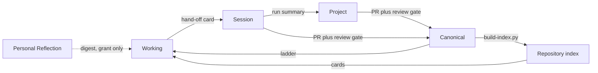

# Memory Architecture

## Purpose

This document defines how The Bayan Library remembers: what each memory
layer holds, where it is stored, how long it is kept, how it is compressed
and retrieved, who may read or write it, and how knowledge moves from a
single model call to the permanent, reviewed library.

The design serves a library meant to be operated for fifty years. Memory must
stay small enough to load, durable enough to trust, and private where it
concerns the owner's inner life.

Source of truth: `system/registry/memory.yaml` (six layers) and the `memory`
grants in `system/registry/agents/*.yaml`. Grants to undeclared layers are
rejected by `scripts/validate-registry.py`.

Related documents:
[Token Optimization Framework](06-token-optimization-framework.md),
[Permission Model](04-permission-model.md),
[Workflow Architecture](09-workflow-architecture.md),
[Human Review Framework](15-human-review-framework.md) and the
[Security and Privacy Guidelines](../14-security-and-privacy-guidelines.md).

## Memory Principles

| Principle | Rule |
| --- | --- |
| Small by construction | Every layer has a token limit; memory is summarised, never accumulated raw |
| Cards, not transcripts | Agents pass hand-off cards, never conversation transcripts |
| Review is the only door to permanence | Nothing becomes canonical memory without a human-merged PR at the right gate |
| Git is the memory of record | Durable layers are versioned files; volatile layers are git-ignored |
| The owner's inner life stays private | Personal reflection memory never enters the public repository |

## The Six Layers

| Layer | Scope | Storage | Retention | Max tokens | Privacy |
| --- | --- | --- | --- | --- | --- |
| Working | One model call or one tool loop | Model context window only | Discarded when the call ends | per model budget | inherits from loaded sources |
| Session | One task run | `.bayan/runs/<run_id>/` (git-ignored) | 30 days, then summarised into project memory or deleted | 2,000 | private |
| Project | A multi-week initiative | `system/memory/projects/<project-id>.md` | Life of the project, then archived as a decision record | 1,500 | repository |
| Repository | Facts about the repository | `metadata/index.yaml` and `metadata/index/`, `system/registry/*`, `docs/` | Permanent, versioned in git | 4,000 | public |
| Canonical | Approved durable knowledge | Reviewed content in `canon/`, `reading-paths/`, `metadata/`, `docs/`, plus the generated graph | Permanent; changes only through G4 with a changelog | per model budget | public |
| Personal Reflection | Owner's journal, reflections, applications, review history | `notes/reflections/` in a private repository or an encrypted store, never published | Owner-controlled; never deleted or rewritten by an agent | 2,000 | private |

### Compression and Retrieval per Layer

| Layer | Compression | Retrieval |
| --- | --- | --- |
| Working | Assembled by the retrieval ladder and capped by the model budget | Assembled fresh by the orchestrator for each call |
| Session | Outgoing agent writes a hand-off card of at most 300 tokens: goal, decisions, open questions, files touched | The current run's cards, newest first |
| Project | Kept under 1,500 tokens; superseded decisions struck through and moved to the archive section on the next rewrite | Loaded whole when an agent is assigned to the project |
| Repository | One index card per record (id, type, title, 1-line summary, tags, path, token estimates) | Filtered index lookups by type, tag, civilization or ID |
| Canonical | Every record carries a 1-line summary and an executive summary | Retrieval ladder plus graph neighbourhood queries (depth <= 2) |
| Personal Reflection | Monthly and annual digests written by `reflection-journal` and approved by the owner; raw entries untouched | Explicit grant only, digest by default, owner's own learning tasks only |

The layers map onto the context layers of the
[Token Optimization Framework](06-token-optimization-framework.md): Working
memory is the assembled call; Session memory feeds the Local layer; Project
memory is the Project layer; Repository memory is the Repository layer; and
Canonical memory is the Document layer.



## File Formats

### Hand-off Card

Stored as `.bayan/runs/<run_id>/cards/NN.md` (the run folder layout is
defined in [Workflow Architecture](09-workflow-architecture.md)). At most
300 tokens. The body is a YAML block so that scripts can parse it.

```yaml
run_id: book-ingestion-20261013T091500Z-7c1e
step: 3
agent: study-notes
model: sonnet
goal: Layered summaries for book-<slug>
inputs: [book-<slug> card, 15 chunk digests]
decisions:
  - Executive summary follows the chapter order, not the thematic order.
  - Two digests disagreed on chapter 9; both readings kept and flagged.
open_questions:
  - Confirm the translation used for the quoted passages.
files_touched: [drafts/summaries/book-<slug>.md]
qa_flags: []
tokens: {input: 10700, output: 3000}
next: study-notes step 4 (concept notes)
```

Rules: no raw model output, no quotations longer than one sentence, no
personal reflection content, and no secrets. The next agent reads only the
newest cards that fit in 2,000 tokens.

### Project Memory

Stored as `system/memory/projects/<project-id>.md`. Kept under 1,500 tokens,
rewritten (not appended) by the owning agent at the end of each run.

```markdown
# Project: <project-id>

## Objective

One paragraph: what the project must deliver and by when.

## Decisions

- 2026-10-13: Decision text. Reason: one line. Run: <run_id>.
- ~~2026-09-02: Superseded decision.~~ See archive.

## Conventions

- Naming, sources and style rules specific to this project.

## Open Questions

- Question, owner, due date.

## Links

- Registry entries, PRs and documents this project touches.

## Archive

- Superseded decisions, moved here on the next rewrite.
```

When a project closes, the file is condensed into a decision record and
moved into the archive section of the same file; the project ID is never
reused.

## Promotion and Decay

Knowledge moves up only through review; it decays down by summarisation.

| From | To | Mechanism | Condition |
| --- | --- | --- | --- |
| Working | Session | Hand-off card written at the end of the step | Every step |
| Session | Project | Owning agent rewrites the project file in the run's PR (`system/memory/projects/**` is a tier 2 write path) | Run belongs to a project; decision worth keeping |
| Session | Repository or Canonical | Agent opens a PR from the run's drafts | Passes CI and the route's review gate; a human merges |
| Project | Canonical | Decisions that change method or canon go into a PR | G4 for canon, ranking, governance, Quran methodology, architecture |
| Canonical | Repository | `scripts/build-index.py` regenerates cards | Every merge to `metadata/` |
| Personal Reflection | Public repository | Pseudonymous aggregate only | Owner approval of the aggregate |

```text
function end_of_run(run):
    write hand-off card for the final step
    if run.project_id:
        rewrite system/memory/projects/<id>.md   # <= 1,500 tokens
    if run.outputs: open PR with provenance block (run_id, gate)

nightly decay (session layer):
    for run in .bayan/runs/* older than 30 days:
        if run.project_id and not yet summarised: summarise to project
        delete run folder                        # ledger lines are kept

project decay:
    on each rewrite: strike superseded decisions, move to Archive
    if file > 1,500 tokens: compress Archive to one line per decision
```

Canonical memory never decays. It changes only by a new reviewed PR, and
git history preserves every earlier version. Usage ledger lines in
`.bayan/ledger/` outlive session folders because cost reports depend on them.

## Access by Agent

Read (R) and write (W) grants as declared in the agent registry. No agent
writes Working memory (it is the call itself), and no agent writes the
Repository or Canonical layers directly: those change only through a PR that
a human merges.

| Agent | Family | Tier | working | session | project | repository | canonical | personal-reflection |
| --- | --- | --- | --- | --- | --- | --- | --- | --- |
| `chief-librarian` | core | 5 | R | RW | RW | R | R | - |
| `canon-editor` | core | 4 | R | RW | RW | R | R | - |
| `metadata` | core | 3 | R | RW | - | R | - | - |
| `knowledge-graph` | core | 3 | R | RW | - | R | R | - |
| `reading-guide` | core | 4 | R | RW | RW | R | R | - |
| `documentation` | core | 3 | R | RW | - | R | - | - |
| `research` | core | 2 | R | RW | RW | R | R | - |
| `learning-coach` | core | 2 | R | RW | RW | R | R | R |
| `study-notes` | core | 2 | R | RW | - | R | R | - |
| `islamic-civilization` | core | 2 | R | RW | RW | R | R | - |
| `quran-learning` | core | 4 | R | RW | RW | R | R | R |
| `poetry` | core | 2 | R | RW | - | R | R | - |
| `daily-wisdom` | core | 3 | R | RW | RW | R | R | - |
| `automation` | core | 3 | R | RW | - | R | - | - |
| `quality-assurance` | core | 1 | R | RW | - | R | R | - |
| `risk-management` | core | 1 | R | RW | R | R | - | - |
| `daily-word` | daily | 2 | R | RW | - | R | R | - |
| `daily-concept` | daily | 2 | R | RW | - | R | R | - |
| `daily-book` | daily | 2 | R | RW | - | R | R | - |
| `daily-thinker` | daily | 2 | R | RW | - | R | R | - |
| `daily-poem` | daily | 2 | R | RW | - | R | R | - |
| `daily-civilization` | daily | 2 | R | RW | - | R | R | - |
| `daily-question` | daily | 2 | R | RW | - | R | - | - |
| `daily-life-principle` | daily | 2 | R | RW | - | R | R | - |
| `reflection-journal` | daily | 2 | R | RW | - | - | - | RW |
| `learning-how-to-learn` | learning | 2 | R | RW | R | R | - | R |
| `knowledge-capture` | learning | 2 | R | RW | - | R | - | - |
| `memory-retention` | learning | 2 | R | RW | - | R | - | RW |
| `wisdom-extractor` | learning | 2 | R | RW | - | R | R | - |
| `application-tracker` | learning | 2 | R | RW | - | - | - | RW |
| `author-decoder` | learning | 2 | R | RW | - | R | R | - |
| `language-analyst` | learning | 2 | R | RW | - | R | - | - |
| `voice-analyst` | learning | 2 | R | RW | - | R | - | - |
| `register-analyst` | learning | 2 | R | RW | - | R | - | - |
| `difficulty-assessor` | learning | 2 | R | RW | - | R | - | - |
| `quran-traditional-study` | quran | 2 | R | RW | - | R | R | - |
| `quran-arabic` | quran | 2 | R | RW | - | R | R | R |
| `quran-root-analysis` | quran | 2 | R | RW | - | R | - | - |
| `quran-comparative-religion` | quran | 2 | R | RW | - | R | R | - |
| `quran-philosophical-reflection` | quran | 2 | R | RW | - | R | R | - |
| `quran-scientific-reflection` | quran | 2 | R | RW | - | R | R | - |
| `quran-civilizational-study` | quran | 2 | R | RW | - | R | R | - |
| `quran-future-studies` | quran | 2 | R | RW | R | R | R | - |
| `quran-personal-transformation` | quran | 2 | R | RW | - | R | R | R |

Summary of grants:

| Layer | Readers | Writers |
| --- | --- | --- |
| Working | all 44 | none (assembled by the orchestrator) |
| Session | all 44 | all 44 (own run only) |
| Project | 11 agents | 8 agents: `chief-librarian`, `canon-editor`, `reading-guide`, `research`, `learning-coach`, `islamic-civilization`, `quran-learning`, `daily-wisdom` |
| Repository | 42 agents (all but `reflection-journal`, `application-tracker`) | none directly; PR only |
| Canonical | 29 agents | none directly; PR only |
| Personal Reflection | 8 agents | 3 agents: `reflection-journal`, `memory-retention`, `application-tracker` |

## Personal Reflection Privacy

Personal reflection memory holds the owner's journal, reflections,
applications of what was learned and review history. Its guarantees:

| Guarantee | How it is enforced |
| --- | --- |
| Never public | Stored in a private repository or encrypted store; `notes/reflections/**` is a protected path in `permissions.yaml` for tier 3 |
| Grant required | Only the eight agents with a `personal-reflection` read grant can load it; `validate-registry.py` checks grants |
| Digest by default | Readers receive the owner-approved monthly or annual digest, not raw entries, unless the owner asks for a specific entry |
| Purpose-bound | Used only for the owner's own learning tasks (journal prompts, review queues, coaching), never for public content |
| Raw entries immutable | No agent deletes or rewrites an entry; writers append new entries or digests only |
| No leakage through cards | Hand-off cards, ledger lines, PR bodies and commit messages never contain reflection content; a run that loaded it marks its session folder `privacy: private` |
| Aggregates only | Anything that reaches the public repository is a pseudonymous aggregate (for example "12 reflections this month") approved by the owner |
| Model calls | Reflection context is sent only to the model needed for the task, never cached in a shared semantic cache, and never included in batch jobs with other content |
| Retention | Owner-controlled; session folders that loaded reflection content are deleted at 30 days without summarisation into project memory |

## Memory Summary

Six layers run from the volatile call context to the permanent, reviewed
library. Each has a size limit and a compression rule, so memory stays
loadable at any scale. Knowledge is promoted only through PRs and review
gates and decays downward by summarisation. Every agent's access is declared
in the registry and validated. The owner's personal reflection memory is
private, grant-bound, digest-first and never published.
