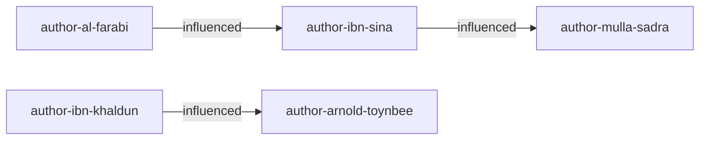
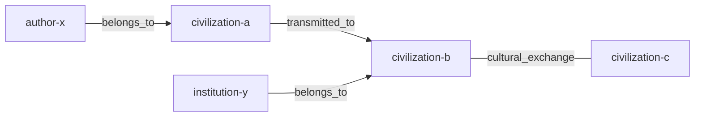
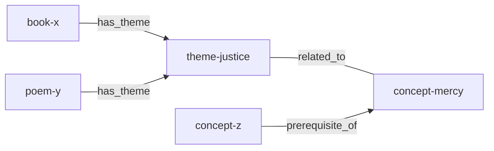
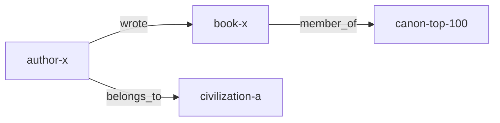
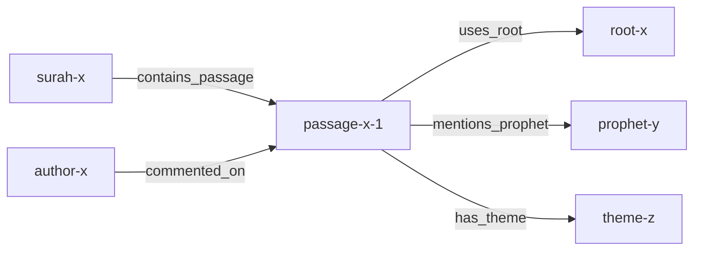
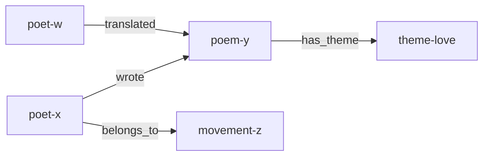
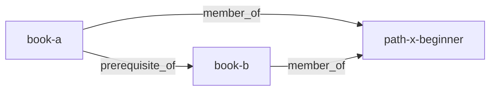
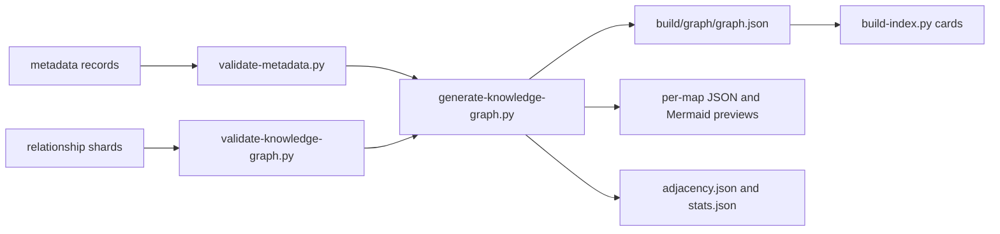

# Knowledge Graph Architecture

## Purpose

This document turns the
[Knowledge Graph Specification](../08-knowledge-graph-specification.md)
into an implementable architecture: node types and ID prefixes, typed
relationship signatures with inverses, evidence levels, the storage format,
the named maps that agents load instead of the whole graph, retrieval
efficiency, validation and the build pipeline. It is designed for 20,000+
concepts, 10,000+ books, 5,000+ authors and hundreds of thousands of edges.

Source of truth: `system/registry/knowledge-graph.yaml` (evidence levels,
node types, relationship types, maps). Record schemas are in
`system/schemas/metadata/`; the field-level metadata rules are in the
[Metadata Schema](../07-metadata-schema.md).

Related documents:
[Token Optimization Framework](06-token-optimization-framework.md),
[Memory Architecture](07-memory-architecture.md),
[Quality Assurance Framework](12-quality-assurance-framework.md) and
[GitHub Architecture](10-github-architecture.md).

## Node Types

Every node ID is `<prefix>-<slug>`; the prefix fixes the type and IDs are
immutable once merged.

| Type | Prefix | Metadata directory | Type | Prefix | Metadata directory |
| --- | --- | --- | --- | --- | --- |
| book | `book-` | `metadata/books` | event | `event-` | `metadata/events` |
| author | `author-` | `metadata/authors` | institution | `institution-` | `metadata/institutions` |
| poet | `poet-` | `metadata/poets` | canon | `canon-` | `metadata/canons` |
| poem | `poem-` | `metadata/poems` | reading_path | `path-` | `metadata/reading-paths` |
| civilization | `civilization-` | `metadata/civilizations` | quotation | `quote-` | `metadata/quotations` |
| movement | `movement-` | `metadata/movements` | language | `language-` | `metadata/languages` |
| school | `school-` | `metadata/schools` | surah | `surah-` | `metadata/quran/surahs` |
| theme | `theme-` | `metadata/themes` | passage | `passage-` | `metadata/quran/passages` |
| concept | `concept-` | `metadata/concepts` | quranic_root | `root-` | `metadata/quran/roots` |
| note | `note-` | `metadata/notes` | prophet | `prophet-` | `metadata/quran/prophets` |

Each directory may be a single list file (`metadata/<type>.yaml`) while
small, or sharded one record per file (`metadata/<type>/**/*.yaml`) once it
grows. `scripts/validate-metadata.py` accepts both.

## Relationship Types

Edges are stored in the forward direction only. The inverse is materialised
at build time; symmetric edges are their own inverse and are stored once
with the lexicographically smaller ID as `source`.

| Type | Inverse | Symmetric | Source types | Target types |
| --- | --- | --- | --- | --- |
| `influenced` | `influenced_by` | no | author, poet, book, school, movement, civilization | author, poet, book, school, movement, civilization |
| `studied_under` | `taught` | no | author, poet | author, poet |
| `inspired` | `inspired_by` | no | author, poet, book, poem, event | author, poet, book, poem |
| `preceded` | `succeeded` | no | author, poet, book, event, school | author, poet, book, event, school |
| `wrote` | `written_by` | no | author, poet | book, poem |
| `translated` | `translated_by` | no | author, poet | book, poem |
| `critiqued` | `critiqued_by` | no | author, poet, book, school | author, poet, book, school, concept |
| `responds_to` | `responded_to_by` | no | book, poem, author, poet | book, poem, author, poet, concept |
| `references` | `referenced_by` | no | book, poem, note, quotation | book, poem, author, poet, passage, concept |
| `expands` | `expanded_by` | no | book | book |
| `debated` | `debated` | yes | author, poet | author, poet |
| `collaborated_with` | `collaborated_with` | yes | author, poet | author, poet |
| `belongs_to` | `has_member` | no | author, poet, book, poem, school, movement, concept, event, institution | civilization, school, movement, theme, language |
| `member_of` | `includes` | no | book, poem, author, poet | canon, reading_path |
| `has_theme` | `theme_of` | no | book, poem, passage, surah, author, poet, note, quotation | theme, concept |
| `related_to` | `related_to` | yes | theme, concept | theme, concept |
| `prerequisite_of` | `requires` | no | book, concept | book, concept |
| `cultural_exchange` | `cultural_exchange` | yes | civilization | civilization |
| `transmitted_to` | `received_from` | no | civilization | civilization |
| `contains_passage` | `in_surah` | no | surah | passage |
| `uses_root` | `root_in` | no | passage, concept | quranic_root |
| `mentions_prophet` | `prophet_in` | no | passage, surah | prophet |
| `commented_on` | `commentary_by` | no | author, book | surah, passage |

20 node types, 23 relationship types (4 symmetric), 42 navigable directions
after inverse materialisation.

## Evidence Levels

| Level | Meaning | Citation required | Reader label |
| --- | --- | --- | --- |
| `high` | Documented in primary sources or broad scholarly consensus | yes | none |
| `moderate` | Supported by credible scholarship; some debate exists | yes | "debated" where relevant |
| `tentative` | Interpretive or thematic link | no | always shown as interpretive |

Evidence also feeds retrieval authority (see
[Token Optimization Framework](06-token-optimization-framework.md)):
tentative edges are weighted 0.5 and are never followed at depth 2 unless a
task asks for them.

## Storage Format

While the graph is small, edges live in `metadata/relationships.yaml` as a
list. At scale they are sharded by source node, one file per source:
`metadata/relationships/<source-type>/<first-letter-of-slug>/<source-id>.yaml`.
Each edge has the same fields in either layout. Reference fields on records
(for example an author ID on a book, or canon memberships) are also turned
into edges at build time and marked `derived: true`; they are not stored
twice.

```yaml
# metadata/relationships/author/i/author-ibn-sina.yaml (illustrative)
- source: author-ibn-sina
  relationship: influenced
  target: author-mulla-sadra
  evidence: high
  citations:
    - {ref: bib-key-or-record-id, locator: "pp. 12-15"}
  note: Optional one-line explanation shown to readers.
  provenance:
    run_id: graph-enrichment-20261013T080000Z-91ab
    agent: knowledge-graph
    model: sonnet
    reviewed_gate: G2
    added: 2026-10-13
```

| Field | Required | Rule |
| --- | --- | --- |
| `source`, `target` | yes | Existing node IDs whose types match the signature |
| `relationship` | yes | A forward type from the table above |
| `evidence` | yes | `high`, `moderate` or `tentative` |
| `citations` | for high and moderate | At least one resolvable citation |
| `note` | no | One line, at most 200 characters |
| `provenance` | yes for agent-proposed edges | Run, agent, model, gate, date |

The specification's earlier example field `confidence` is superseded by
`evidence`.

## Maps

Maps are named subgraphs from `knowledge-graph.yaml`. Generators emit one
file per map, and retrieval loads one map at a time. The diagrams use
illustrative IDs.

| Map | Purpose | Node types | Relationship types |
| --- | --- | --- | --- |
| `influence-map` | Who and what shaped whom | author, poet, book, school, movement | influenced, studied_under, inspired, preceded, responds_to, critiqued |
| `civilization-map` | Civilizations, figures and exchanges | civilization, author, poet, book, institution, event | belongs_to, cultural_exchange, transmitted_to |
| `theme-map` | Themes, concepts and the works that carry them | theme, concept, book, poem, passage | has_theme, related_to, prerequisite_of |
| `canon-map` | Canons, members and context | canon, book, poem, author, poet, civilization | member_of, wrote, belongs_to |
| `quran-map` | Surahs, passages, roots, prophets, themes, commentary | surah, passage, quranic_root, prophet, theme, concept, author, book | contains_passage, uses_root, mentions_prophet, has_theme, commented_on |
| `poetry-map` | Poets, poems, movements and languages | poet, poem, movement, language, theme, civilization | wrote, influenced, belongs_to, has_theme, translated, inspired |
| `reading-path-map` | Paths and prerequisite order | reading_path, book, concept | member_of, prerequisite_of |

### Influence Map



### Civilization Map



### Theme Map



### Canon Map



### Quran Map



### Poetry Map



### Reading-Path Map



## Retrieval Efficiency

| Technique | Design |
| --- | --- |
| Adjacency at build time | `scripts/generate-knowledge-graph.py` writes `build/graph/adjacency.json`, forward and inverse lists keyed by node ID; queries never scan edge files |
| Map shards | `build/graph/<map-id>.json` and `<map-id>.mmd`; a query names a map and loads only that shard |
| Bounded neighbourhood | `graph-query` skill: depth at most 2, one map, optional relationship filter |
| Degree caps | At most 50 neighbours per node per relationship type, ranked by evidence, then authority, then degree; at most 200 nodes per query |
| Hub handling | High-degree targets (civilizations, languages, large themes) are returned as a count plus top members, not expanded |
| Precomputed influence chains | Planned: influence paths up to length 4 between canon members, precomputed at build time so agents read chains instead of traversing |
| Node cards | Results return index cards (<= 80 tokens), not records |
| Tentative edges | Excluded at depth 2 unless requested |

```text
function neighbourhood(seeds, map_id, depth=1, rel_filter=None):
    assert depth <= 2
    adj = load_map_adjacency(map_id)               # one shard
    frontier = seeds; seen = set(seeds); edges = []
    for d in 1..depth:
        next = []
        for n in frontier:
            for (rel, m, ev) in adj[n]:
                if rel_filter and rel not in rel_filter: continue
                if d == 2 and ev == "tentative": continue
                take top 50 per (n, rel) by (ev, authority, degree)
                edges.add((n, rel, m, ev)); next.add(m)
        frontier = next - seen; seen |= frontier
        if len(seen) > 200: truncate by score; break
    return cards(seen), edges
```

## Validation Rules

`scripts/validate-knowledge-graph.py` runs in CI (see
[Quality Assurance Framework](12-quality-assurance-framework.md)).

| Rule | Severity |
| --- | --- |
| Source and target exist as metadata records | critical |
| ID prefix matches the record type | critical |
| Relationship type exists and source/target types match its signature | critical |
| `evidence` present and one of high, moderate, tentative | critical |
| `high` or `moderate` edge without a citation | major |
| Duplicate edge (same source, type, target), including a stored inverse of a stored forward edge | major |
| Self loop (source equals target) | major |
| Symmetric edge stored in both directions | minor |
| Dangling node (record with no edges) | minor; reported, not blocking |
| `prerequisite_of` cycle | major |
| Agent-proposed edge without `provenance` | major |

## Scaling

| Quantity | Target | Approach |
| --- | --- | --- |
| Nodes | 150,000+ (books, authors, concepts, notes, passages) | Sharded metadata, one record per file |
| Edges | Hundreds of thousands | Edge files sharded by source node; diffs stay small in review |
| Build time | Minutes in CI | Single pass: load records, load edges, validate, emit adjacency and maps |
| Query cost | Constant per query | Depth <= 2, degree caps, map shards, node cards |
| Review load | Human-scale | Edges arrive in PRs grouped by run; G2 for proposals, G3 for historical claims |

Rough sizes at 300,000 edges: about 60 MB of YAML across shards, a
`graph.json` of roughly 40 MB and map shards of 2 to 15 MB each. Agents
never load these whole; they receive at most 200 node cards (about 16,000
tokens) per query and typically far fewer.

## Build Pipeline



1. A `graph-enrichment` run (triggered when metadata records merge) proposes
   edges through `knowledge-graph` with `knowledge-graph-generation` and
   `citation-verification`; drafts arrive as a PR.
2. CI (`knowledge-graph.yml`) validates records and edges.
3. `scripts/generate-knowledge-graph.py` derives edges from record
   reference fields, materialises inverses and writes `graph.json`,
   `adjacency.json`, one JSON and one Mermaid preview per map and
   `stats.json` under `build/graph/` (git-ignored); CI uploads them as an
   artifact, and the weekly schedule rebuilds them as a health check.
4. A human merges at the route's gate. Releases (`release.yml`) attach the
   built graph to the GitHub release.

## Knowledge Graph Summary

The graph has 20 typed nodes with fixed ID prefixes and 23 typed,
signature-checked relationships whose inverses are materialised at build
time. Every edge carries an evidence level, with citations for high and
moderate claims, and provenance when proposed by an agent. Seven named maps
let agents load one subgraph at a time, and bounded, degree-capped
neighbourhood queries over prebuilt adjacency keep retrieval constant-cost
as the graph grows to hundreds of thousands of edges.
