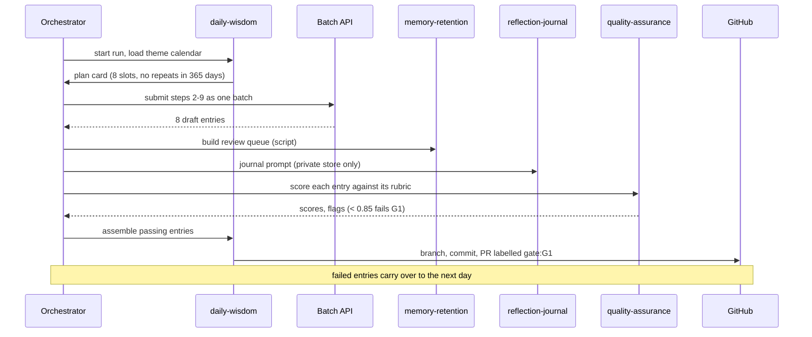
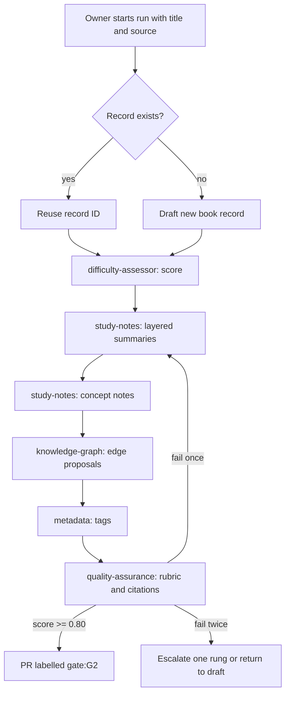
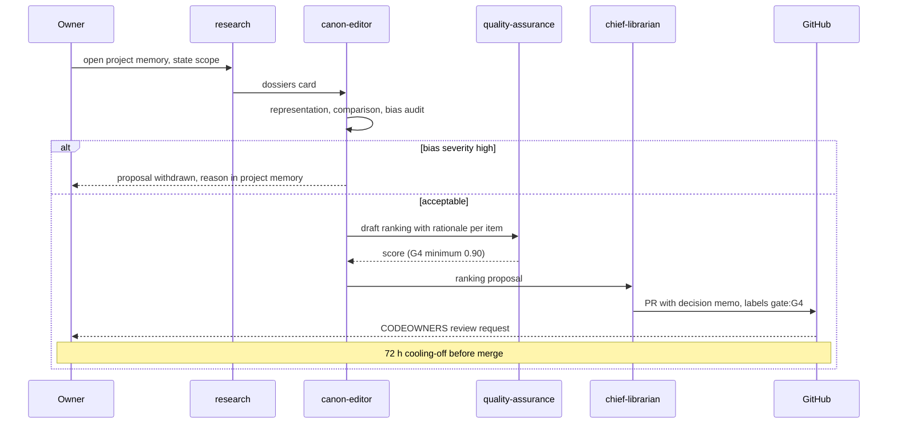
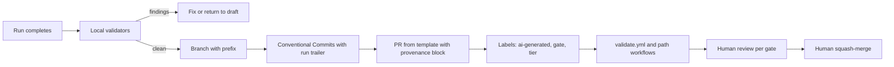

# Workflow Architecture

## Purpose

This document explains how agents are composed into workflows: what starts a
run, which agent and skills run at each step, which review gate the output
must pass, what the run may spend, and how every run ends as a pull request
that a human merges.

Source of truth: `system/registry/workflows.yaml`, with per-run caps in
`system/registry/budgets.yaml` and gates in
`system/registry/review-gates.yaml`.

Related documents: [Agent Registry](02-agent-registry.md),
[Skill Registry](03-skill-registry.md),
[Model Routing Framework](05-model-routing-framework.md),
[Memory Architecture](07-memory-architecture.md),
[Automation Architecture](11-automation-architecture.md),
[Cost Governance Framework](14-cost-governance-framework.md) and
[Human Review Framework](15-human-review-framework.md).

## Workflow Principles

| Principle | Rule |
|---|---|
| Minimum gate per workflow | Every workflow names one `review_gate`, the minimum gate for its PR; items from agents with a stricter declared gate keep that stricter gate (strictest wins); private outputs never enter the PR; nothing reaches `main` without a human merge. |
| One budget per run | Every workflow names a `budget_ref`; a run that would exceed its per-run cap stops and reports. |
| Scripts before models | Steps whose skills are `execution: script` call no model (see [Skill Registry](03-skill-registry.md)). |
| Cards, not transcripts | Agents hand off through cards of at most 300 tokens; raw transcripts are never passed on. |
| One run, one branch, one PR | A run writes only to its own branch and opens at most one PR. |
| Schedules are intentions | Cron triggers describe when a run is due. Until the opt-in agent-run workflow exists, the owner starts runs by hand. |

## Workflow Catalog

The registry defines ten workflows in three groups.

| Workflow | Group | Trigger | Steps | Gate | Budget ref | Per-run cap (USD) |
|---|---|---|---|---|---|---|
| `daily-cycle` | Practice | schedule `0 4 * * *` | 13 | G1 | `daily-cycle` | 0.25 |
| `weekly-cycle` | Practice | schedule `0 5 * * 0` | 5 | G1 | `weekly-cycle` | 1.50 |
| `monthly-cycle` | Practice | schedule `0 6 1 * *` | 7 | G2 | `monthly-cycle` | 5.00 |
| `annual-cycle` | Practice | schedule `0 6 2 1 *` | 6 | G4 | `annual-cycle` | 25.00 |
| `book-ingestion` | Content | manual | 7 | G2 | `book-ingestion` | 0.60 |
| `canon-revision` | Content | manual | 7 | G4 | `canon-revision` | 12.00 |
| `reading-path-build` | Content | manual | 5 | G4 | `reading-path-build` | 1.50 |
| `graph-enrichment` | Content | event: metadata records merged | 3 | G2 | `graph-enrichment` | 1.00 |
| `quran-study-session` | Content | manual | 6 | G3 | `quran-study-session` | 1.20 |
| `methodology-change` | Governance | manual | 4 | G4 | `methodology-change` | 10.00 |

All cron expressions are UTC. `daily-cycle` is the only workflow marked
`batch: true` and the only member of `essential_workflows` in
`budgets.yaml`.

## Practice Cycles

### Daily Cycle

| # | Agent | Skills | Does |
|---|---|---|---|
| 1 | `daily-wisdom` | `daily-selection` | Read theme calendar and history; plan the bundle |
| 2 | `daily-word` | `daily-selection`, `vocabulary-analysis` | Word of the Day |
| 3 | `daily-concept` | `daily-selection`, `concept-explanation` | Concept of the Day |
| 4 | `daily-book` | `daily-selection`, `knowledge-compression` | Book of the Day |
| 5 | `daily-thinker` | `daily-selection`, `knowledge-compression` | Thinker of the Day |
| 6 | `daily-poem` | `daily-selection`, `poetry-analysis` | Poem of the Day |
| 7 | `daily-civilization` | `daily-selection`, `knowledge-compression` | Civilization of the Day |
| 8 | `daily-question` | `reflection-prompting` | Question of the Day |
| 9 | `daily-life-principle` | `daily-selection`, `wisdom-extraction` | Life Principle of the Day |
| 10 | `memory-retention` | `spaced-repetition-scheduling` | Build the day's review queue |
| 11 | `reflection-journal` | `reflection-prompting` | Prepare the private journal prompt |
| 12 | `quality-assurance` | `evaluation-scoring` | Score every entry |
| 13 | `daily-wisdom` | `markdown-formatting` | Open one PR with the day's bundle |

Steps 2 to 9 are independent once step 1 has fixed the plan, so they are
submitted together as one Message Batches request (50% of list price).
Entries are drafted from already reviewed records (`daily-book` compresses
a reviewed summary, never a raw source), which keeps the cycle at G1.



### Weekly, Monthly and Annual Cycles

| Workflow | # | Agent | Skills | Does |
|---|---|---|---|---|
| `weekly-cycle` | 1 | `reflection-journal` | `knowledge-compression` | Private weekly digest |
| | 2 | `memory-retention` | `spaced-repetition-scheduling` | Retention report |
| | 3 | `knowledge-capture` | `study-note-generation` | Empty the capture inbox |
| | 4 | `quality-assurance` | `metadata-validation`, `link-validation` | Repository health |
| | 5 | `daily-wisdom` | `daily-selection` | Next week's theme plan |
| `monthly-cycle` | 1 | `reflection-journal` | `knowledge-compression` | Private monthly digest |
| | 2 | `application-tracker` | `reflection-prompting` | Application summary |
| | 3 | `research` | `research-synthesis` | Coverage gap report |
| | 4 | `knowledge-graph` | `graph-query` | Graph health report |
| | 5 | `risk-management` | `risk-assessment`, `cost-reporting` | Cost and risk report |
| | 6 | `quality-assurance` | `evaluation-scoring` | QA calibration against golden set |
| | 7 | `daily-wisdom` | `daily-selection` | Next month's theme calendar |
| `annual-cycle` | 1 | `reflection-journal` | `knowledge-compression` | Private year in review |
| | 2 | `canon-editor` | `bias-audit`, `representation-check` | Annual canon audit |
| | 3 | `reading-guide` | `reading-path-generation` | Path refresh proposals |
| | 4 | `quran-learning` | `quran-theme-mapping` | Track and level review |
| | 5 | `risk-management` | `risk-assessment` | Risk register review |
| | 6 | `chief-librarian` | `governance-review` | System review and roadmap update |

Private digests (step 1 of each cycle) are written to the personal
reflection store, never to the public branch; the PR carries only the
pseudonymous aggregate allowed by
[Memory Architecture](07-memory-architecture.md).

## Content Pipelines

### Book Ingestion

| # | Agent | Skills | Does |
|---|---|---|---|
| 1 | `metadata` | `duplicate-detection`, `metadata-validation` | Create or match the record |
| 2 | `difficulty-assessor` | `difficulty-assessment` | Difficulty score |
| 3 | `study-notes` | `book-summarization` | Layered summaries |
| 4 | `study-notes` | `study-note-generation`, `concept-explanation` | Concept notes |
| 5 | `knowledge-graph` | `knowledge-graph-generation` | Relationship proposals |
| 6 | `metadata` | `tag-generation` | Tags |
| 7 | `quality-assurance` | `evaluation-scoring`, `citation-verification` | Score and verify citations |



A duplicate match at step 1 that is ambiguous (possible same person or
work) stops the run and asks the owner, per the `metadata` escalation rule.

### Canon Revision

This workflow is the machine form of the canon approval process in
[Governance Model](../02-governance-model.md).

| # | Agent | Skills | Process stage |
|---|---|---|---|
| 1 | `research` | `research-synthesis` | Research proposal and dossiers |
| 2 | `canon-editor` | `representation-check` | Candidate evaluation |
| 3 | `canon-editor` | `comparative-analysis`, `influence-analysis` | Comparative analysis |
| 4 | `canon-editor` | `bias-audit` | Bias review |
| 5 | `canon-editor` | `canon-ranking` | Draft ranking |
| 6 | `quality-assurance` | `evaluation-scoring` | Editorial review (machine part) |
| 7 | `chief-librarian` | `governance-review` | Approval packet for the owner |



Rank movements above 10 places need a Chief Librarian memo in the packet.

### Reading Path Build

| # | Agent | Skills | Does |
|---|---|---|---|
| 1 | `reading-guide` | `graph-query` | Candidate works |
| 2 | `difficulty-assessor` | `difficulty-assessment` | Difficulty per work |
| 3 | `reading-guide` | `reading-path-generation`, `representation-check` | Ordered levels |
| 4 | `learning-coach` | `concept-explanation` | Primers for hard entries |
| 5 | `quality-assurance` | `evaluation-scoring` | Rubric score |

`scripts/validate-reading-paths.py` must pass (beginner 5-15, intermediate
10-25, scholar 20+ works, prerequisite order) before the PR is opened.

### Graph Enrichment

| # | Agent | Skills | Does |
|---|---|---|---|
| 1 | `knowledge-graph` | `graph-query`, `knowledge-graph-generation` | Propose edges around new records |
| 2 | `knowledge-graph` | `citation-verification` | Cite high and moderate edges |
| 3 | `quality-assurance` | `metadata-validation` | Run validators |

The event "metadata records merged" is detected by `knowledge-graph.yml`,
which only rebuilds the graph deterministically. The agent run itself is
started by the owner (or later by the opt-in workflow) with the merged
record IDs as input.

### Quran Study Session

| # | Agent | Skills | Does |
|---|---|---|---|
| 1 | `quran-learning` | `spaced-repetition-scheduling` | Choose passage and tracks for the reader's level |
| 2 | `quran-arabic` | `vocabulary-analysis` | Vocabulary |
| 3 | `quran-root-analysis` | `arabic-root-extraction` | Roots |
| 4 | `quran-traditional-study` | `tafsir-comparison` | At least 3 commentaries |
| 5 | `quran-personal-transformation` | `reflection-prompting` | Reflection and action prompt |
| 6 | `quality-assurance` | `citation-verification` | Verify every citation |

Step 1 is routine scheduling and is downgraded from opus to haiku by the
`forbidden_on_opus` rule. Step 4 is class D and is the only opus call.

### Methodology Change

| # | Agent | Skills | Does |
|---|---|---|---|
| 1 | `research` | `research-synthesis` | Literature review |
| 2 | `chief-librarian` | `methodology-design` | Methodology draft and migration plan |
| 3 | `risk-management` | `risk-assessment` | Risks of the change |
| 4 | `chief-librarian` | `governance-review` | Approval packet |

## Practice Rhythm

| Rhythm | Workflow | When (UTC) | Theme source | Human touch |
|---|---|---|---|---|
| Daily | `daily-cycle` | 04:00 | Weekly theme of the current week | Merge the bundle PR; review flagged and sampled entries (20%) |
| Weekly | `weekly-cycle` | Sunday 05:00 | Plans next week's theme, for example Wisdom Week, Leadership Week, Justice Week, Civilization Week, Learning Week | Read digest; merge health report |
| Monthly | `monthly-cycle` | 1st, 06:00 | Plans next month's theme, for example Rumi Month, Ibn Khaldun Month, Greek Philosophy Month, Islamic Civilization Month | Read every item (G2); act on cost and risk report |
| Annual | `annual-cycle` | 2 January, 06:00 | Year in review | Owner approval (G4) after 72 h cooling-off |

Theme examples come from
[Daily Wisdom and Intellectual Practice](../18-daily-wisdom-and-intellectual-practice.md).
A weekly theme must sit inside the monthly theme or be explicitly
contrasting, and `daily-wisdom` enforces `tradition_balance` (no tradition
above 40% per month) and `repeat_rate_365d` of 0 when planning.

## Orchestration Contract

The orchestrator is the runner that executes a workflow definition. Today
it is the owner driving Claude Code with the reference scripts; later it may
be the opt-in GitHub workflow described in
[Automation Architecture](11-automation-architecture.md). Both obey the same
contract.

### Run Identity

```text
run_id     = <workflow_id>-<YYYYMMDD>T<HHMMSS>Z-<4 hex chars>
run folder = .bayan/runs/<run_id>/          (git-ignored)
ledger     = .bayan/ledger/YYYY-MM.jsonl    (git-ignored)
branch     = <prefix>/<workflow_id>-<date or subject slug>
```

Every ledger line, hand-off card, commit trailer and PR provenance block
carries the `run_id`.

### Run Folder Layout

```text
.bayan/runs/<run_id>/
  run.yaml          workflow_id, inputs, started, status, cost so far
  steps/NN.yaml     route decision, inputs hash, status, attempts
  cards/NN.md       hand-off card (<= 300 tokens)
  outputs/          drafts produced by the step
  qa/NN.yaml        rubric scores and flags
```

### Hand-off Cards

```yaml
run_id: book-ingestion-20261013T091500Z-7c1e
step: 4
agent: study-notes
model: sonnet
goal: Concept notes for book-<slug>
decisions: [Seven concepts kept; two merged as near-duplicates]
open_questions: [Is concept-x the same as concept-y?]
files_touched: [drafts/notes/...]
qa_flags: []
tokens: {input: 18400, output: 3900}
next: knowledge-graph step 5 (relationship proposals)
```

The full card format and its rules are defined in
[Memory Architecture](07-memory-architecture.md). The next step reads
only the newest cards (session memory, at most 2,000 tokens in total),
plus whatever its own retrieval ladder assembles.

### Step Execution Algorithm

```text
for step in workflow.steps:
    if step.status == done and inputs_hash unchanged: skip   # resumable
    route = scripts/route-task.py(step)                      # class, model
    if spent + route.estimated_cost > per_run_cap: stop("budget_cap")
    if monthly spend >= hard_stop and workflow not essential:
        stop("monthly_cap")
    for attempt in 1..2:
        out = run(step, route)
        qa = score(out) if step produces content
        if qa passes: break
        if attempt == 1: retry on same model with QA reasons
    if still failing:
        if ladder has a higher rung and justification recorded:
            escalate one rung (qa_failures >= 2) and run once more
        else: mark step returned_to_draft; continue if optional
    write card, outputs, ledger lines
open_pull_request(run)          # or report-only for tier-1 outputs
```

### Contract Rules

| Concern | Rule |
|---|---|
| Retries | One retry on the same model with the QA failure reasons appended; never more than two attempts per rung. |
| Escalation | One rung at a time (`haiku` -> `sonnet` -> `opus`), justification written to `steps/NN.yaml`; spends the escalation reserve. |
| Budget stop | Before each call, projected spend is checked against the per-run cap; on breach the run stops with status `stopped_budget` and still reports what it has. |
| Monthly stop | At 100% of the USD 60 cap non-essential runs pause; `daily-cycle` may continue to 110%. |
| Idempotency | A step is keyed by `(run_id, step, inputs_hash)`; rerunning with unchanged inputs reuses outputs and calls no model. |
| Resumability | `run.yaml` status `stopped_*` or `failed` can be resumed with the same `run_id`; completed steps are skipped. |
| Determinism | Script steps must produce byte-identical output for identical input. |
| Isolation | A run writes only to its branch, its run folder and the ledger. |
| Privacy | Steps with a `personal-reflection` grant write only to the private store. |

## From Run to Pull Request



| Workflow | Branch prefix | Base branch | Commit type and scope |
|---|---|---|---|
| `daily-cycle` | `feature/` | `develop` | `feat(daily-wisdom)` |
| `weekly-cycle`, `monthly-cycle` | `docs/` | `develop` | `docs(quality-assurance)`, `docs(risk-management)` |
| `annual-cycle` | `research/` | `develop` | per step agent |
| `book-ingestion` | `feature/` | `develop` | `feat(study-notes)`, `feat(metadata)` |
| `canon-revision` | `research/` | `develop` | `feat(canon-editor)` |
| `reading-path-build` | `feature/` | `develop` | `feat(reading-guide)` |
| `graph-enrichment` | `feature/` | `develop` | `feat(knowledge-graph)` |
| `quran-study-session` | `feature/` | `develop` | `feat(quran-learning)` |
| `methodology-change` | `docs/` | `develop` | `docs(chief-librarian)` |

Branch, commit and PR conventions are defined in
[GitHub Architecture](10-github-architecture.md). Tier-1 agents
(`quality-assurance`, `risk-management`) never write files; their reports
are committed by the orchestrator under the workflow's PR.

## Workflow Summary

Ten registry workflows turn agents and skills into repeatable runs. Each
run has an ID, a run folder, hand-off cards, a per-run cap and a minimum
review gate that stricter agents can only raise. Steps retry once, escalate
one rung with justification, and stop on budget rather than overspend.
Every run ends as a single pull request with a provenance block, and only a
human merges it.
