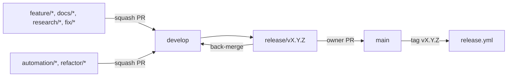

# GitHub Architecture

## Purpose

This document defines how the multi-agent system lives in GitHub: the
repository layout, branches, commits, pull requests, ownership, branch
protection, labels, releases, and how the repository scales to 10,000+
books and survives for 50 years.

Source of truth: `system/registry/permissions.yaml` (write paths per tier)
and `system/registry/review-gates.yaml` (G0-G4), together with
[Repository Architecture](../06-repository-architecture.md) and
[Git Workflow and Branching](../11-git-workflow-and-branching.md), which
this document extends rather than repeats.

Related documents: [Permission Model](04-permission-model.md),
[Workflow Architecture](09-workflow-architecture.md),
[Automation Architecture](11-automation-architecture.md) and
[Human Review Framework](15-human-review-framework.md).

## Repository Layout

The planned content folders of docs/06 stay unchanged. The architecture
adds five locations.

```text
the-bayan-library/
├── .github/            workflows, CODEOWNERS, PR and issue templates
├── .bayan/             runtime only, git-ignored (runs, ledger)
├── assets/  authors/  book-lists/  canon/  civilizations/  data/
├── daily/              daily practice entries (docs/18)
├── docs/               specifications; docs/architecture/ for this set
├── drafts/             tier-2 agent drafts awaiting promotion
├── ebooks/             public-domain or openly licensed only (see below)
├── metadata/           records, sharded per type; generated index
├── notes/  poetry/  quotations/  quran/  reading-paths/
├── scripts/            CLI entry points
│   └── bayan/          shared Python package
├── study-guides/  summaries/  templates/  themes/  timelines/
├── system/             registries, schemas, generated catalogs, reports
├── tests/              unittest suites and fixtures
├── README.md
└── LICENSE
```

### Added Locations

| Path | Contents | Committed | Writable by tier |
|---|---|---|---|
| `system/registry/` | Machine-readable registries (models, routing, agents, skills, gates) | yes | 5 |
| `system/schemas/` | JSON Schemas for registries and metadata | yes | 5 |
| `system/generated/` | `agent-catalog.md`, `skill-catalog.md`, `routing-matrix.md` | yes, generated | 3 (regenerated catalogs only) |
| `system/reports/cost/` | Monthly cost reports `YYYY-MM.md` | yes | 5 |
| `system/memory/projects/` | Project memory, one file per project | yes | 2 |
| `scripts/bayan/` | `common`, `registry`, `metadata`, `links`, `graph`, `index`, `router`, `retrieval`, `cost`, `catalog` | yes | 3 |
| `tests/` | 47 unittest tests, fixtures in `tests/fixtures/library/`, suggested `tests/golden/<skill-id>/` | yes | 3 |
| `drafts/` | Tier-2 drafts, promoted by a tier-3 agent or a human | yes | 2 |
| `.bayan/runs/<run-id>/` | Run logs, hand-off cards, session memory | no | orchestrator |
| `.bayan/ledger/YYYY-MM.jsonl` | Usage ledger, one line per model call | no | orchestrator |

Root files: `requirements.txt` pins the only Python dependencies
(`PyYAML==6.0.3`, `jsonschema==4.26.0`; no model SDK), and `.gitignore`
excludes `build/` and `.bayan/`. Tier write paths are cumulative, so tier 5
also writes everything listed for tiers 2 and 3.

## Branch Model

The model is the modified Git Flow of
[Git Workflow and Branching](../11-git-workflow-and-branching.md).



| Branch | Base | Merges into | Who creates it |
|---|---|---|---|
| `main` | none | none | protected; release merges only |
| `develop` | `main` | `main` via `release/*` | protected |
| `feature/*` | `develop` | `develop` | humans and agents |
| `docs/*` | `develop` | `develop` | humans and agents |
| `research/*` | `develop` | `develop` once validated | humans and agents |
| `refactor/*` | `develop` | `develop` | humans and tier-3+ agents |
| `automation/*` | `develop` | `develop` | humans and `automation` |
| `fix/*` | `develop` (or `main` for hotfix) | `develop` and `main` | humans and agents |
| `release/*` | `develop` | `main`, back to `develop` | owner only |

### AI Branch Naming

Agent branches use the same prefixes as human branches, so that every
branch reads the same way in history. The workflow ID and a subject slug
identify the run; the full `run_id` lives in commits and the PR.

```text
<prefix>/<workflow_id>-<subject-slug>

feature/daily-cycle-2026-10-13
feature/book-ingestion-muqaddimah
research/canon-revision-top-100-2027
feature/graph-enrichment-ibn-sina
docs/monthly-cycle-2026-10
automation/index-sharding
```

Rules: lowercase, hyphens, at most 60 characters, one run per branch, the
branch is deleted after merge.

## Commit Conventions

Conventional Commits, with the producing agent's `agent_id` as scope for
agent commits and the content scope of docs/11 for human commits.

```text
<type>(<agent_id or content scope>): <imperative summary>

<body: what and why, wrapped at 72>

Bayan-Run: <run_id>
Bayan-Agent: <agent_id>
Bayan-Model: <model class>/<model_id>
Co-Authored-By: <model name> <noreply@anthropic.com>
```

| Type | Use |
|---|---|
| `feat` | New content or capability |
| `fix` | Correction of content, metadata or code |
| `docs` | Specifications and documentation |
| `refactor` | Structure change without meaning change |
| `chore` | Regenerated index, catalogs, reports |
| `test` | Tests and golden sets |
| `ci` | `.github/` changes (always G4) |

Examples: `feat(study-notes): add layered summary for book-muqaddimah`,
`chore(metadata): regenerate retrieval index`,
`feat(canon-editor): propose top-100 revision 2027`.

## Pull Request Template

`.github/pull_request_template.md` keeps the five sections required by
docs/11 and adds a review gate checklist and an AI provenance block that
every agent PR must fill.

```text
## Summary
## Purpose
## Files Changed
## Knowledge Impact
## Future Opportunities

## Review Gate
- [ ] G0 automated checks ... - [ ] G4 owner approval

## AI Provenance
- agent_id:
- workflow_id:
- run_id:
- model:
- permission_tier:
- tokens (input / output):
- estimated cost (USD):
- escalations and justification:
```

Human PRs delete the provenance block. On a PR labelled `ai-generated`, the
`agent permissions` job reads the `agent_id:` line with
`scripts/check-permissions.py`; a missing agent ID fails the check.

## Ownership and Protection

### CODEOWNERS

```text
/canon/                 @mtafseerhaider
/reading-paths/         @mtafseerhaider
/docs/                  @mtafseerhaider
/system/                @mtafseerhaider
/.github/               @mtafseerhaider
/scripts/               @mtafseerhaider
/README.md              @mtafseerhaider
/LICENSE                @mtafseerhaider
```

These cover the G4 paths (canon, reading paths, methodology and governance
documents, registries, automation) plus the tooling in `scripts/` and the
root `README.md` and `LICENSE`. A PR touching any of them cannot merge
without the owner's approval.

Agent PRs must be opened by a separate machine identity (a GitHub App or a
dedicated bot account), never with the owner's own token. GitHub does not
let authors approve their own PRs, so this both makes owner approval
possible and proves that no agent approved its own work.

### Branch Protection Settings

| Setting | `main` | `develop` |
|---|---|---|
| Require a pull request | yes | yes |
| Required approvals | 1 | 1 |
| Require review from Code Owners | yes | yes |
| Dismiss stale approvals on new commits | yes | yes |
| Required status checks | `markdownlint`, `registry`, `content`, `unit tests`, `agent permissions` | same |
| Require branches up to date | yes | no |
| Require linear history (squash) | yes | yes |
| Require conversation resolution | yes | yes |
| Allow force pushes | no | no |
| Allow deletions | no | no |
| Restrict pushes | owner only, through release PRs | owner and machine identity, PRs only |
| Allow auto-merge | no | no |

Required checks are the job names of `.github/workflows/validate.yml`.
`agent permissions` runs only on PRs labelled `ai-generated`; on other PRs
it is skipped, which GitHub counts as satisfied. When a job is renamed, the
protection rule must be updated in the same PR.

| Workflow file | Job names | Artifact |
|---|---|---|
| `validate.yml` | `markdownlint`, `registry`, `content`, `unit tests`, `agent permissions` (conditional) | none |
| `metadata.yml` | `metadata` | none |
| `knowledge-graph.yml` | `knowledge graph` | `knowledge-graph` |
| `index.yml` | `retrieval index` | `retrieval-index` |
| `release.yml` | `validate release`, `publish release` | release assets |

## Labels

| Label | Meaning | Applied by |
|---|---|---|
| `ai-generated` | Produced by an agent run | orchestrator |
| `gate:G0` ... `gate:G4` | Strictest gate the change demands | orchestrator; reviewer may raise |
| `tier:1` ... `tier:5` | Permission tier of the producing agent | orchestrator |
| `needs-scholarly-review` | G3 content: religious interpretation, historical claims, comparative theology | orchestrator or QA |
| `needs-owner-approval` | G4 change awaiting owner | orchestrator |
| `cooling-off` | Inside the 72-hour G4 window | orchestrator, removed by owner |
| `qa-flagged` | QA score below gate minimum or flagged for review | `quality-assurance` |
| `degraded` | Produced on a fallback model | orchestrator |
| `budget-stopped` | Run stopped at its per-run cap; partial output | orchestrator |
| `drift` | Generated file out of date | CI |

## Issue Templates

Suggested forms under `.github/ISSUE_TEMPLATE/`.

| Template | Fields | Typical follow-up |
|---|---|---|
| `book-request.yml` | title, author, edition, rights status | `book-ingestion` run |
| `content-correction.yml` | record ID, claim, source | `fix/*` branch |
| `canon-proposal.yml` | canon ID, candidate, rationale | `canon-revision` run |
| `reading-path-request.yml` | goal, level, constraints | `reading-path-build` run |
| `agent-defect.yml` | agent ID, run ID, expected vs actual | evaluation case, see [Evaluation Framework](13-evaluation-framework.md) |
| `methodology-change.yml` | document, problem, proposal | `methodology-change` run |
| `risk-report.yml` | category, signal, severity | risk register entry |

## Releases and Versioning

Releases follow the semantic versioning of docs/11 and docs/02.

| Bump | Triggers in this architecture |
|---|---|
| MAJOR | Governance change, architecture redesign, breaking schema migration, major canon revision, model registry generation change that alters routing classes |
| MINOR | New canon, new reading paths, new agents or skills, new metadata types, significant content batches |
| PATCH | Metadata repairs, link fixes, regenerated indexes, documentation clarifications |

```text
develop -> release/vX.Y.Z -> validation and changelog -> PR to main
        -> owner merge -> tag vX.Y.Z -> release.yml builds artifacts
```

The changelog uses the sections Added, Changed, Fixed, Removed and Future
Work. Release artifacts (graph, index, catalogs) are attached to the
GitHub release, so each tagged state is reproducible without rebuilding.

## Scaling to 10,000+ Books

### Metadata Sharding

Small types may stay as `metadata/<type>.yaml` lists. Any type expected to
exceed about 500 records moves to one record per file, which
`scripts/validate-metadata.py` already reads.

```text
metadata/books/<2-char shard>/<id>.yaml
metadata/books/wa/book-war-and-peace.yaml
metadata/authors/ib/author-ibn-sina.yaml
metadata/index.yaml              manifest (generated)
metadata/index/<type>.jsonl      one card per record (generated)
```

The shard is the first two characters of the slug after the type prefix.
One record per file keeps diffs small, avoids merge conflicts between
parallel agent runs, and lets reviewers see exactly one record per change.

### Scale Budget

| Dimension | Target | Pressure point | Response |
|---|---|---|---|
| Metadata files | 150,000+ records | Directory listing and checkout time | 2-char shards, at most ~1,000 files per folder |
| CI time | under 10 minutes on PR | Full validation of all records | Validate changed files plus referential index; full run nightly and on release |
| Index size | about 100,000 cards | `metadata/index/notes.jsonl` grows past 50 MB | Split per type and shard; index stays line-oriented |
| Graph size | many thousands of edges | `build/graph/graph.json` in memory | Per-map files; graph is an artifact, never committed |
| Git history | decades of commits | Clone time | Squash merges; generated artifacts kept out of git |

### Large Files

Git LFS is not needed: the library is plain text, and generated graph and
index builds are release artifacts, not commits. Images in `assets/` stay
small and optimised.

### Ebooks Policy

| Rule | Detail |
|---|---|
| Allowed | Public-domain or openly licensed texts with the licence recorded in metadata |
| Preferred | A metadata pointer (identifier, edition, stable source) instead of the file |
| Not allowed | Copyrighted books without rights, per [Security and Privacy Guidelines](../14-security-and-privacy-guidelines.md) |
| Large collections | A separate archive repository or storage bucket, linked from metadata, so the main repository stays text-only |

## Repository Longevity

| Practice | Why it protects 50 years |
|---|---|
| Plain text: Markdown, YAML, JSON, JSONL, CSV, BibTeX | Readable without any specific tool |
| Open schemas in `system/schemas/` | Data can be re-validated by any JSON Schema implementation |
| Model classes, not model IDs, in registries | A model generation change edits only `models.yaml` |
| Generated files rebuildable from records | Losing an artifact loses nothing |
| Mirrors on at least two independent hosts | Survives a host outage or account loss |
| Tagged releases archived with artifacts | Each version is a self-contained snapshot |
| Annual export of metadata and graph | Restorable outside Git if needed |
| Private reflection store kept outside this repository | Publishing the repository never exposes it |

## GitHub Architecture Summary

The repository keeps the docs/06 layout and adds `system/`, `scripts/bayan/`,
`tests/`, `drafts/` and the git-ignored `.bayan/`. Agents work on the same
branch prefixes as humans, commit with agent scopes and run trailers, and
open PRs that carry a provenance block and gate and tier labels.
CODEOWNERS and branch protection make the owner the only party who can
approve G4 paths, and nothing auto-merges. One record per file, generated
artifacts outside git and plain open formats let the repository grow past
10,000 books and stay readable for decades.
