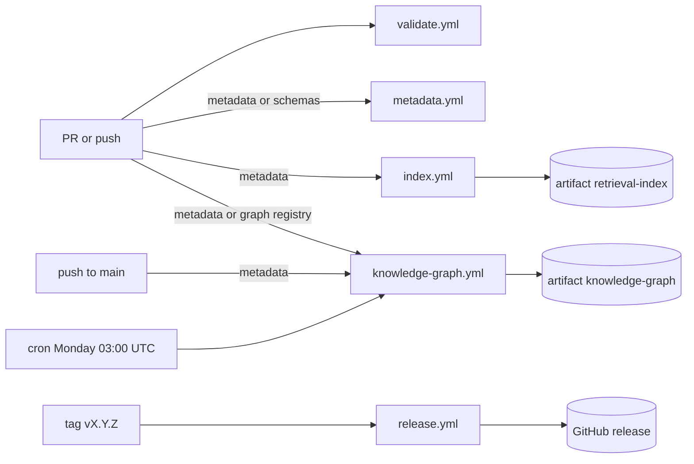

# Automation Architecture

## Purpose

This document defines the deterministic automation of The Bayan Library:
the GitHub workflows, the validation, metadata, graph and index pipelines,
the generation pipelines that end in agent-written pull requests, the
command-line scripts and their contracts, the security posture, and the
future opt-in workflow that may one day run agents in CI.

Source of truth: `system/registry/routing.yaml` (`execution: script`
task types), `system/registry/skills.yaml` (script and hybrid skills),
`system/registry/budgets.yaml` (caps an agent run must respect) and the
`automation` agent in `system/registry/agents/core.yaml`.

Related documents: [Workflow Architecture](09-workflow-architecture.md),
[GitHub Architecture](10-github-architecture.md),
[Quality Assurance Framework](12-quality-assurance-framework.md),
[Cost Governance Framework](14-cost-governance-framework.md) and
[Security and Privacy Guidelines](../14-security-and-privacy-guidelines.md).

## Automation Principles

| Principle | Rule |
|---|---|
| Deterministic first | Anything a script can decide is never sent to a model (`execution: script`). |
| No paid model calls in CI | No current workflow calls a model API or holds a model key. |
| No auto-merge | Workflows report and build; a human merges every PR. |
| Least privilege | `contents: read` everywhere except `release.yml` (`contents: write`). |
| Same result everywhere | Every script runs identically on a laptop and in CI. |
| Generated means rebuildable | Generated files are either drift-checked or shipped as artifacts. |

## GitHub Workflows

| Workflow | Job names | Triggers | Permissions | Outputs |
|---|---|---|---|---|
| `validate.yml` | `markdownlint`, `registry`, `content`, `unit tests`, `agent permissions` (only on PRs labelled `ai-generated`) | `pull_request` (opened, synchronize, reopened, labeled, unlabeled, so a label added after opening still runs the permission check); `push` to `main` and `develop`; `workflow_dispatch` | `contents: read` | Check results (required status checks) |
| `metadata.yml` | `metadata` | `pull_request` on `metadata/**`, `system/schemas/**`, `system/registry/knowledge-graph.yaml`; `push` to `main` on `metadata/**`, `system/schemas/**`; `workflow_dispatch` | `contents: read` | Findings in the job summary |
| `knowledge-graph.yml` | `knowledge graph` | `pull_request` and `push` to `main` on `metadata/**`, `system/registry/knowledge-graph.yaml`; weekly cron `0 3 * * 1` (Monday 03:00 UTC); `workflow_dispatch` | `contents: read` | Artifact `knowledge-graph` (`build/graph/`) |
| `index.yml` | `retrieval index` | `pull_request` on `metadata/**`, `summaries/**`, `scripts/bayan/index.py`; `push` to `main`; `workflow_dispatch` | `contents: read` | Drift result; artifact `retrieval-index` |
| `release.yml` | `validate release`, `publish release` | `push` of tags `v*.*.*` | `contents: read`; `contents: write` for `publish release` only | GitHub release with graph, index, catalogs and registry bundles |

### Validate

| Job | Command | Fails when |
|---|---|---|
| `markdownlint` | `npx --yes markdownlint-cli2@0.14.0 "**/*.md"` with `.markdownlint.jsonc` | any lint error |
| `registry` | `python scripts/validate-registry.py` | schema or cross-check finding |
| `registry` | `python scripts/generate-registry-docs.py --check` | `system/generated/` out of date |
| `content` | `python scripts/validate-metadata.py` (IDs permanent against the base branch) | critical or major finding |
| `content` | `python scripts/validate-knowledge-graph.py` | signature, evidence or integrity finding |
| `content` | `python scripts/validate-reading-paths.py` | membership, size or order finding |
| `content` | `python scripts/validate-links.py` | broken link or anchor |
| `content` | `python scripts/build-index.py --check` | `metadata/index*` out of date |
| `unit tests` | `python -m unittest discover -s tests -t tests -v` (62 tests, fixtures in `tests/fixtures/library/`) | any failing test |
| `agent permissions` | `python scripts/check-permissions.py --pr-body-env PR_BODY --base origin/<base>` | a changed file outside the agent's tier or on a protected path |

The job names in `validate.yml` are the required status checks of
[GitHub Architecture](10-github-architecture.md); renaming a job and
updating branch protection happen in the same PR.

### Metadata, Graph, Index and Release



| Workflow | Jobs in order | Notes |
|---|---|---|
| `metadata.yml` | job `metadata`: `validate-metadata.py` (fail on major), minor findings to the job summary, `build-index.py --check` | Narrow, fast feedback for record PRs |
| `knowledge-graph.yml` | job `knowledge graph`: `validate-knowledge-graph.py`; `generate-knowledge-graph.py --out build/graph`; summary; upload artifact `knowledge-graph` | Graph is never committed; the Monday run catches slow drift |
| `index.yml` | job `retrieval index`: `build-index.py --check`; rebuild in the checkout; upload artifact `retrieval-index` | Committed index must match the build |
| `release.yml` | `validate release`: full validation and tests; `publish release`: build graph, index, catalog and registry bundles, `gh release create` | Only job with write permission |

## Pipelines

### Deterministic Pipelines

| Pipeline | Steps | Model calls |
|---|---|---|
| Validation | lint, registry, metadata, links, graph, paths, drift, tests | none |
| Metadata | parse lists and shards, schema check, ID rules, reference resolution, severity | none |
| Graph | load records, check signatures, materialise inverses, split maps, render previews | none |
| Index | one card per record, token estimates per retrieval layer, manifest, JSONL per type | none |
| Catalogs | registries to `agent-catalog.md`, `skill-catalog.md`, `routing-matrix.md` | none |
| Cost report | ledger JSONL to monthly Markdown report vs `budgets.yaml` | none |

### Generation Pipelines That End in a PR

These need judgement, so they are agent workflows. Each wraps
deterministic scripts around the model steps and ends in one PR.

| Pipeline | Agent workflow | Deterministic before | Model steps | Deterministic after | Gate |
|---|---|---|---|---|---|
| Reading-path generation | `reading-path-build` | `graph-query`, `build-context.py` | ordering, levels, primers | `validate-reading-paths.py`, `validate-links.py` | G4 |
| Canon generation | `canon-revision` | index lookups, `graph-query` | dossiers, comparison, bias audit, ranking, packet | `validate-metadata.py`, rationale presence check | G4 |
| Documentation generation | ad hoc `documentation` agent run (no registry workflow yet) | `generate-registry-docs.py`, `validate-links.py` | READMEs, cross-links, glossing | markdownlint, `--check` drift | G1 |
| Graph enrichment | `graph-enrichment` | `graph-query` | edge proposals, citations | `validate-knowledge-graph.py` | G2 |

Generated catalogs in `system/generated/` are pure script output and need
no agent at all; a `chore(documentation)` PR regenerates them.

## Scripts

All scripts are Python 3.11+ (CI runs 3.12) with the two dependencies
pinned in `requirements.txt` (`PyYAML==6.0.3`, `jsonschema==4.26.0`), share
code in `scripts/bayan/`, and are tested by 62 stdlib unittest tests under
`tests/` with fixtures in `tests/fixtures/library/`.

### Exit Codes

| Code | Meaning |
|---|---|
| 0 | Success, no findings |
| 1 | Findings (validation failures, drift, budget breach) |
| 2 | Usage error (bad arguments, missing file, unreadable input) |

### Script Contracts

| Script | Purpose | Inputs | Outputs |
|---|---|---|---|
| `scripts/validate-registry.py` | Registries vs schemas plus cross-checks | `system/registry/**`, `system/schemas/registry/` | Findings on stdout |
| `scripts/validate-metadata.py` | Records vs metadata schemas | `metadata/<type>.yaml`, `metadata/<type>/**/*.yaml`, `system/schemas/metadata/` | Findings classified critical, major, minor |
| `scripts/validate-links.py` | Internal Markdown links and anchors | All `*.md` | Broken links with file and line |
| `scripts/validate-knowledge-graph.py` | Graph integrity | Records, `knowledge-graph.yaml` | Signature, evidence, dangling, duplicate, self-loop findings |
| `scripts/validate-reading-paths.py` | Path rules | Path records, graph | Membership, level size, order findings |
| `scripts/build-index.py` | Retrieval index; `--check` for drift | `metadata/**` | `metadata/index.yaml`, `metadata/index/<type>.jsonl` |
| `scripts/generate-knowledge-graph.py` | Graph build | Records, `knowledge-graph.yaml` | `build/graph/graph.json`, one JSON per map, Mermaid previews |
| `scripts/generate-registry-docs.py` | Catalogs; `--check` for drift | `system/registry/**` | `system/generated/*.md` |
| `scripts/route-task.py` | Reference router | Task spec (YAML or JSON) | Decision: class, model id, effort, budgets, escalation justification, downgrade, gate, batch eligibility |
| `scripts/build-context.py` | Retrieval-ladder context assembly | Target IDs, token budget | Context pack and token count |
| `scripts/cost-report.py` | Monthly cost report | `.bayan/ledger/YYYY-MM.jsonl`, `budgets.yaml` | `system/reports/cost/YYYY-MM.md` |
| `scripts/check-permissions.py` | Agent write paths vs permission tier | Agent from `--agent` or the `agent_id:` line of the PR body (`--pr-body-env`); changed files from arguments or `--base` git diff | Fails on out-of-tier or protected writes; notes G4 paths |

Registry cross-checks in `validate-registry.py`: every agent in exactly one
tier; default model matches class (A to haiku, B and C to sonnet, D and E to
opus); token budgets within model caps; referenced skills and agents
exist; skill dependencies acyclic; opus never assigned to a
`forbidden_on_opus` task type; envelopes sum to the monthly cap; memory
grants name declared layers.

### Ledger Line

```json
{"ts": "2026-10-13T04:02:11Z", "run_id": "daily-cycle-...",
 "workflow_id": "daily-cycle", "agent_id": "daily-word",
 "skill_id": "vocabulary-analysis", "model": "claude-haiku-5-5",
 "input_tokens": 3100, "output_tokens": 640, "cache_read_tokens": 2400,
 "task": "vocabulary_analysis", "batch": true, "escalated": false,
 "accepted": true}
```

## Security Posture

| Control | Implementation |
|---|---|
| Least privilege | Top-level `permissions: contents: read`; only the `publish release` job of `release.yml` grants `contents: write` |
| Pinned actions | Third-party actions pinned to a full commit SHA with the version in a comment; updates by reviewed PR |
| No secrets in validation | `validate.yml`, `metadata.yml`, `knowledge-graph.yml` and `index.yml` read no secrets |
| Safe triggers | `pull_request`, never `pull_request_target`; fork PRs run without secrets |
| No paid model calls | No workflow holds `ANTHROPIC_API_KEY` today |
| No auto-merge | Auto-merge disabled in settings; no workflow merges or approves |
| Change control | `.github/**` and `scripts/**` are owned by the owner in CODEOWNERS |
| Bounded runs | `timeout-minutes` on every job; `concurrency` group per ref cancels stale runs |
| Dependencies | `requirements.txt` pins `PyYAML==6.0.3` and `jsonschema==4.26.0`; markdownlint-cli2 pinned at 0.14.0 |

## Future Opt-in Agent-Run Workflow

Running agents from GitHub is deferred. When the owner enables it, it
follows this design and nothing looser.

```yaml
# .github/workflows/agent-run.yml (design, not yet created)
on:
  workflow_dispatch:
    inputs:
      workflow_id: {required: true}    # must exist in workflows.yaml
      inputs_ref: {required: true}     # issue number or record IDs
      spend_cap_usd: {required: true}  # <= per_run_cap of workflow_id
permissions:
  contents: write        # push the run branch only
  pull-requests: write   # open a draft PR
jobs:
  run:
    environment: agent-runs   # protected, owner is required reviewer
    timeout-minutes: 60
    steps:
      - checkout (pinned SHA)
      - python scripts/validate-registry.py
      - orchestrator run with ANTHROPIC_API_KEY from the environment
      - python scripts/cost-report.py on this run's ledger lines
      - push branch, open DRAFT PR with provenance block
```

| Safeguard | Detail |
|---|---|
| Manual start | `workflow_dispatch` only at first; any later schedule still waits on environment approval |
| Required reviewer | Environment `agent-runs` requires the owner to approve each run |
| Secret scope | `ANTHROPIC_API_KEY` is an environment secret, unreadable by other workflows |
| Spend cap | Effective cap is the smaller of `spend_cap_usd` and the workflow's `per_run_cap`; the orchestrator stops at it |
| Monthly cap | The run refuses to start when month-to-date spend is at or above USD 60 (110% for `daily-cycle`) |
| Output | A draft PR only; never a push to `develop` or `main`, never a merge |
| Audit | Ledger lines and run folder uploaded as a run artifact |

## Idempotency and Determinism Rules

| Rule | Check |
|---|---|
| Same input, same bytes | Generators sort keys, records and edges; fixed float formatting |
| No timestamps in committed generated files | Timestamps live in artifacts and the ledger only |
| Drift is a finding | `--check` modes exit 1 when the committed output differs |
| Re-running is safe | Validators never write; builders overwrite their own outputs only |
| Offline by default | Scripts need no network; external citation checks are agent work |
| Stable ordering of findings | Findings sorted by file, line, rule so diffs are reviewable |
| Agent steps keyed by inputs | `(run_id, step, inputs_hash)` reuse rule from [Workflow Architecture](09-workflow-architecture.md) |

## Automation Summary

Five GitHub workflows validate, build and release the library with
read-only permissions (write only for releases), pinned actions, no
secrets and no model calls. Twelve scripts with a shared exit-code contract
make every deterministic step reproducible locally and in CI. Work that
needs judgement runs as agent workflows that end in a pull request, and a
future agent-run workflow, if enabled, is manual, owner-approved,
spend-capped and limited to draft PRs.
