# Quality Assurance Framework

## Purpose

This document defines how quality is enforced for every agent output: the
quality contract each agent declares, the layers of checks an output
passes, how errors are classified and corrected, how failures climb a
fixed ladder, which changes always need human review, the checklists per
content type, and how the Quality Assurance Agent itself is calibrated.

Source of truth: the `quality` and `evaluation_metrics` fields of every
agent in `system/registry/agents/*.yaml`, `system/registry/review-gates.yaml`
and the `mandatory_review` list in `system/registry/permissions.yaml`. It
extends [Quality Assurance and Validation](../13-quality-assurance-and-validation.md).

Related documents: [Agent Registry](02-agent-registry.md),
[Automation Architecture](11-automation-architecture.md),
[Evaluation Framework](13-evaluation-framework.md) and
[Human Review Framework](15-human-review-framework.md).

## Per-Agent QA Contract

Every one of the 44 agents declares the same five quality fields. The
registry schema makes them mandatory, so an agent without a contract
cannot be merged.

```yaml
evaluation_metrics:            # what is measured, with targets
  - {metric: fidelity_score, target: ">= 0.9 (rubric)"}
quality:
  validation: [Template conformance, citations to pages or sections]
  failure_handling: [Return to draft, flag unsupported statements]
  review_gate: G2              # G0-G4
  human_approval: every_item   # none | sampled | every_item | required
```

| Field | Enforced by | When |
|---|---|---|
| `evaluation_metrics` | `quality-assurance` scoring; monthly scorecards in [Evaluation Framework](13-evaluation-framework.md) | Every run; monthly |
| `validation` | Scripts named in the field (for example `scripts/validate-metadata.py`) run in the step and again in CI | Before the PR and on the PR |
| `failure_handling` | Orchestrator applies the agent's declared action after the ladder below | On QA failure |
| `review_gate` | Orchestrator labels the PR `gate:Gn`: each item starts at its agent's gate, is raised by change classes or a degraded fallback (never lowered), and the PR takes the strictest item gate with the workflow `review_gate` as minimum; CODEOWNERS adds owner approval on protected paths | PR creation |
| `human_approval` | Branch protection, CODEOWNERS and the sampling rule of the gate | Merge |

### Agents by Gate

| Gate | Human approval | Count | Agents |
|---|---|---|---|
| G0 | none | 3 | `quality-assurance`, `memory-retention`, `application-tracker` |
| G1 | sampled (20%) | 15 | `metadata`, `documentation`, `daily-wisdom`, `daily-word`, `daily-concept`, `daily-book`, `daily-thinker`, `daily-poem`, `daily-civilization`, `daily-question`, `daily-life-principle`, `register-analyst`, `difficulty-assessor`, `quran-root-analysis`, `quran-personal-transformation` |
| G2 | every item | 15 | `knowledge-graph`, `research`, `learning-coach`, `study-notes`, `poetry`, `automation`, `risk-management`, `reflection-journal`, `learning-how-to-learn`, `knowledge-capture`, `wisdom-extractor`, `author-decoder`, `language-analyst`, `voice-analyst`, `quran-arabic` |
| G3 | every item, sources open | 7 | `islamic-civilization`, `quran-traditional-study`, `quran-comparative-religion`, `quran-philosophical-reflection`, `quran-scientific-reflection`, `quran-civilizational-study`, `quran-future-studies` |
| G4 | owner approval | 4 | `chief-librarian`, `canon-editor`, `reading-guide`, `quran-learning` |

An agent's gate is a floor, not a ceiling. A G1 agent editing a G4 path
(for example `automation` touching `.github/**`) gets G4.

## Quality Layers

Checks run from cheapest to most expensive; a later layer runs only when
the earlier ones pass.

| # | Layer | Tool | Model cost | Blocking at |
|---|---|---|---|---|
| 1 | Schema | `scripts/validate-registry.py`, `scripts/validate-metadata.py` | none | all gates |
| 2 | Referential | `scripts/validate-metadata.py` (IDs unique, immutable, prefix matches type, references resolve) | none | all gates |
| 3 | Graph | `scripts/validate-knowledge-graph.py` (signatures, evidence, dangling, duplicates, self loops) | none | all gates |
| 4 | Links | `scripts/validate-links.py` | none | all gates |
| 5 | Lint | markdownlint-cli2 with `.markdownlint.jsonc` | none | all gates |
| 6 | Rubric | `evaluation-scoring` skill (sonnet for class B-D outputs) | sonnet | G1-G4 (score below gate minimum blocks) |
| 7 | Citations | `citation-verification` skill (hybrid: script then sonnet) | sonnet | G3, G4; G2 when citations are present |
| 8 | Human | Review per gate | none | G1 sample, G2-G4 all |

Gate minimum rubric scores: G1 0.85, G2 0.80, G3 0.85, G4 0.90.

## Error Classification

Severity follows [Quality Assurance and Validation](../13-quality-assurance-and-validation.md).

| Severity | Definition | Examples in this architecture | Action | Deadline |
|---|---|---|---|---|
| Critical | Broken repository functionality or invalid relationships | Duplicate or changed ID, dangling reference, failing registry check, fabricated citation, private reflection content in a public path, G4 change without owner approval | Block merge; revert if merged; open issue; root-cause note | Same day |
| Major | Significant structural problem or missing required information | Missing template section, uncited high or moderate edge, unlabelled interpretation, score below gate minimum, missing provenance block, budget overrun without justification | Block merge; return to draft with findings | Before next run of the workflow |
| Minor | Formatting, typography, non-critical inconsistency | Line length, heading style, tag casing, weak but correct phrasing | Fix in the same PR or batch into a weekly `fix/*` PR | Weekly cycle |

### Corrective Action Record

```yaml
finding_id: <run_id>-<n>
severity: major
layer: citations
artifact: summaries/by-book/<id>.md
description: Two claims cite no page or section.
root_cause: Retrieval returned executive summary only.
correction: Re-run step with full-text excerpt for chapters 3-4.
revalidated: true
recorded_in: system/memory/projects/<id>.md   # when part of a project
```

Critical and recurring major findings become regression cases in
`tests/golden/<skill-id>/` (see [Evaluation Framework](13-evaluation-framework.md)).

## Failure Handling Ladder

```mermaid
flowchart TD
    F[QA failure] --> R1[Retry once on same model with QA reasons]
    R1 -- pass --> OK[Continue]
    R1 -- fail --> E{Higher rung available and budget left?}
    E -- yes --> R2[Escalate one rung with justification]
    R2 -- pass --> OK
    R2 -- fail --> D[Return to draft with findings]
    E -- no --> D
    D --> H[Human decides: fix, rerun, or drop]
```



| Rung | Action | Cost source | Recorded in |
|---|---|---|---|
| 1 | Retry once, same model, QA reasons appended | Agent envelope | `steps/NN.yaml`, ledger |
| 2 | Escalate one rung (`qa_failures >= 2` trigger in `routing.yaml`) | Escalation reserve (USD 8) | Justification field, ledger `escalated: true` |
| 3 | Return to draft; apply the agent's `failure_handling` | none | PR not opened or opened as draft with `qa-flagged` |
| 4 | Human decision | none | PR review or issue |

Opus outputs cannot escalate further; they go from rung 1 to rung 3. A run
on a fallback model (for example `chief-librarian` on sonnet) is labelled
`degraded` and blocked until rerun or waived by the owner.

## Sampling for G1

G1 outputs are reviewed by sample plus every flagged item. The sample is
deterministic so that it can be audited and cannot be steered by the
producing agent.

```text
for item in pr.items:
    if item.qa_score < 0.85 or item.flags: review(item)      # always
    elif sha256(run_id + item.id) mod 100 < 20: review(item)  # 20% sample
    else: no human read required; CI and QA still apply
if any sampled item fails human review:
    review every item of this PR and raise the agent's sample to 100%
    for the next 7 runs
```

## Mandatory Review

These change classes always take the listed gate, whoever proposes them and
whatever files they touch (`permissions.yaml`, `mandatory_review`).

| Change class | Gate | Extra requirements |
|---|---|---|
| `canon_change` | G4 | Rationale per item, bias audit, 72 h cooling-off |
| `ranking_change` | G4 | Chief Librarian memo for moves above 10 places |
| `governance_change` | G4 | Decision memo with options and risks |
| `quran_methodology_change` | G4 | Scholarly grounding cited; disagreement shown |
| `architecture_change` | G4 | Includes any `.github/**` or `system/**` change |
| `religious_interpretation` | G3 | Label as interpretation; competing views represented |
| `historical_claim` | G3 | Source cited for every claim |

## Content-Type Checklists

The QA agent scores against these; human reviewers use the same lists.

| Content type | Producing agent | Checklist |
|---|---|---|
| Book summary | `study-notes` | Template sections of docs/12; layered levels present; claims cite chapter or page; no invented quotations; facts and interpretation separated |
| Study note | `study-notes`, `knowledge-capture` | Note type declared; source cited; at least 3 graph links for permanent notes; terms glossed |
| Author or poet profile | `poetry`, `author-decoder` | Dates and places sourced; works linked by ID; influence edges have evidence levels |
| Graph edge | `knowledge-graph` | Signature valid; evidence level set; citation for high and moderate; not a duplicate; inverse not stored |
| Reading path | `reading-guide` | Level sizes within limits; prerequisites ordered; outcomes stated; representation checked |
| Canon proposal | `canon-editor` | Weights sum to 100; every item scored on every criterion; bias audit attached; changelog entry |
| Quran note | `quran-*` agents | Passage reference exact; at least 3 commentaries where views differ; reflection labelled as reflection; no forced scientific readings |
| Daily entry | daily agents | Template of docs/18; source attributed; not repeated within 365 days; tradition balance respected |
| Metadata record | `metadata` | Schema valid; ID immutable and prefixed; references resolve; controlled vocabularies |
| Script or workflow | `automation` | Unit test present; least privilege; pinned actions; exit codes 0/1/2 |

## Golden Set and QA Calibration

The QA agent is itself checked every month in step 6 of `monthly-cycle`.

| Item | Rule |
|---|---|
| Golden set | Human-reviewed outputs with human scores and known defects, per skill, in `tests/golden/<skill-id>/` |
| Size | At least 20 items per scored skill, of which at least 5 contain a seeded defect |
| Procedure | QA scores the set blind; scores compared with human scores |
| Pass | `agreement_with_human_reviewers` >= 0.85 and every seeded critical defect caught |
| On fail | Rubric revised or QA scoring moved up one rung for that skill until it passes again |
| Drift | Set refreshed quarterly with new escaped defects; old items kept for regression |

## Quality Dashboard

Reported monthly with the cost report and reviewed in `monthly-cycle`.

| Metric | Source | Target |
|---|---|---|
| CI pass rate on `main` (`ci_success_rate_main`) | GitHub checks | >= 0.98 |
| Schema pass rate on `main` | `validate-metadata.py` | 1.0 |
| Duplicate and orphan reference count | `validate-metadata.py` | 0 |
| Broken links | `validate-links.py` | 0 |
| Orphan node rate | `validate-knowledge-graph.py` | < 2% |
| Edge citation rate (high and moderate) | graph validator | 1.0 |
| First-pass QA rate | QA reports | >= 0.9 |
| `rework_rate` | ledger | <= 0.1 |
| `escaped_defect_rate` | issues on merged items | < 2% |
| QA agreement with humans | calibration | >= 0.85 |
| Mean time to fix critical findings | issues | <= 1 day |
| Open G3 and G4 PRs older than 14 days | GitHub | 0 |

## Quality Assurance Summary

Every agent carries a five-field quality contract enforced by schema, CI,
the QA agent and branch protection. Outputs pass eight layers from schema
to human review, findings are classified critical, major or minor with
fixed actions, and failures climb one ladder: retry once, escalate one
rung, return to draft, then a human decides. Canon, ranking, governance,
Quran methodology and architecture changes always need the owner, and the
QA agent is calibrated monthly against a human-scored golden set.
