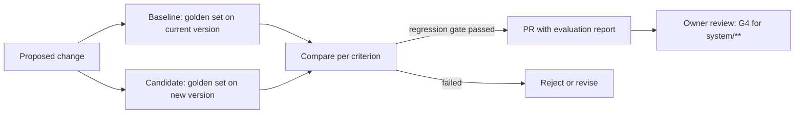

# Evaluation Framework

## Purpose

This document defines how agents, skills and routing decisions are
evaluated: rubric-based model-graded scoring, golden sets, agreement with
human reviewers, offline evaluation before any change, routing
experiments, monthly scorecards, regression gates, and the downgrade
experiment that keeps the Golden Rule true over time.

Source of truth: the `evaluation_metrics` of every agent in
`system/registry/agents/*.yaml`, the `evaluation-scoring` skill in
`system/registry/skills.yaml`, the escalation and downgrade rules in
`system/registry/routing.yaml`, and the metrics in
`system/registry/budgets.yaml`.

Related documents: [Quality Assurance Framework](12-quality-assurance-framework.md),
[Model Routing Framework](05-model-routing-framework.md),
[Skill Registry](03-skill-registry.md) and
[Cost Governance Framework](14-cost-governance-framework.md).

## What Is Evaluated

| Subject | Question | Evidence |
|---|---|---|
| Skill | Does the procedure produce outputs that pass its rubric? | Golden-set scores per skill |
| Agent | Does the agent meet its declared `evaluation_metrics`? | Monthly scorecard |
| Route | Is the assigned class the smallest that passes reliably? | Routing A/B and downgrade experiments |
| QA agent | Does model grading agree with humans? | Calibration against the golden set |
| Change | Does a new model, prompt or skill version regress? | Offline evaluation before merge |

## Model-Graded Scoring

Scoring uses the `evaluation-scoring` skill: class B, `execution: model`,
recommended model sonnet (fallback opus), budget 12,000 input and 1,500
output tokens. Input is the output, its rubric and reference material;
output is per-criterion scores, an overall score and failure reasons.

```text
score(output, rubric, refs):
    for criterion in rubric.criteria:
        s[criterion] = grade 0.0-1.0 with one-line reason
    if any criterion.critical and s[criterion] < criterion.floor:
        return FAIL (critical)
    overall = sum(weight * s) / sum(weight)
    return PASS if overall >= gate_minimum else FAIL
```

| Rule | Detail |
|---|---|
| Grader independence | The grader never sees the producing agent's reasoning, only the output, rubric and references |
| Grader rung | The grader runs at least at the class of the output it grades (sonnet for B-D); opus outputs are graded by sonnet plus human review |
| Reference-based | Where a reviewed reference exists (summary, lexicon, commentary), it is passed as reference material |
| Output format | Fixed YAML so that `scripts/cost-report.py` and scorecards can aggregate it |

## Golden Sets

```text
tests/golden/<skill-id>/
  cases/<case-id>.yaml     input spec and reference IDs
  expected/<case-id>.yaml  human scores per criterion, known defects
  README.md                provenance, reviewer, date, licence of sources
```

| Rule | Detail |
|---|---|
| Coverage | Every `execution: model` or `hybrid` skill has a golden set before its first unsupervised use |
| Size | At least 20 cases; at least 5 with seeded defects; at least 3 cases per civilization or tradition the skill touches |
| Provenance | Every case is reviewed by a human at the skill's gate level; G3 cases with sources open |
| Growth | Every escaped defect and every critical finding adds a case |
| Stability | Cases are append-only; retired cases move to `retired/` with a reason |
| Cost | Evaluation runs are paid from the `oversight` envelope and logged in the ledger like any run |

## Human Agreement

| Measure | Definition | Target |
|---|---|---|
| Pass/fail agreement | Share of cases where grader and human give the same verdict | >= 0.85 (`agreement_with_human_reviewers`) |
| Score error | Mean absolute difference of overall scores | <= 0.08 |
| Critical recall | Share of seeded critical defects the grader fails | 1.0 |
| Classification agreement | For labelling agents (`register-analyst`, `difficulty-assessor`) | >= 0.85 and >= 0.8 respectively |

## Offline Evaluation Before Change

No model, prompt, rubric or skill change merges without an offline run.



| Change | Evaluation required |
|---|---|
| New model ID in `models.yaml` | Every skill whose class maps to that model |
| Prompt or rubric change | That skill's golden set |
| New skill | New golden set; first 10 production outputs reviewed by a human |
| Routing class change | Downgrade or A/B procedure below |

## Regression Gates

| Gate | Threshold |
|---|---|
| Mean overall score | Candidate >= baseline - 0.02 |
| Per-criterion score | No critical criterion falls by more than 0.05 |
| Critical defects | Zero new critical failures on any case |
| Gate pass rate | >= 0.95 of cases meet the skill's gate minimum |
| Cost | Mean cost per case not higher, unless the change is a deliberate escalation with written justification |

## Routing A/B

The question is always: can a smaller class pass?

| Step | Detail |
|---|---|
| 1. Select | A task type with first-pass QA >= 0.95 for three months and at least 30 accepted outputs |
| 2. Split | Golden set run twice: current class and one rung down (never more than one rung) |
| 3. Compare | Regression gates above, plus human blind review of 10 paired outputs |
| 4. Decide | Pass: open a routing change PR. Fail: record the result; retest after 6 months or a model change |

Only one rung is tested at a time, mirroring the escalation ladder
`haiku -> sonnet -> opus`.

## Downgrade Experiment

The Golden Rule says to use the smallest model with the smallest context
that can reliably solve the task. Models improve, so a task that needed
opus last year may now pass on sonnet. The downgrade experiment runs every
quarter and after every model generation change in `models.yaml`.

```text
candidates = task types and skills where
    class in (B, C, D)                          # A has no lower rung
    and first_pass_qa >= 0.95 over 90 days
    and escalation_rate for the task <= 0.05
for each candidate (largest spend first, max 3 per quarter):
    run golden set on current model and on next lower model
    also try a smaller context budget (one retrieval layer lower)
    apply regression gates
    if passed:
        shadow run: next 10 production tasks scored on both, human reads
        if shadow passes: PR to routing.yaml or skills.yaml (G4)
    record result in system/reports/evaluation/ (see Scorecards)
```

| Protection | Rule |
|---|---|
| Contested scholarship | D tasks (`canon_ranking`, `bias_audit`, `tafsir_comparison`, `comparative_theology`, `islamic_philosophy`, `civilizational_analysis`) may be tested but move only with owner approval and a G3 review of the shadow outputs |
| Strategic work | E tasks are not downgraded by experiment; the owner decides |
| Reversal | If `rework_rate` for the moved task exceeds 0.1 in the next month, the change is reverted |

## Metrics From the Registry

Every agent declares its own metrics; a selection follows.

| Agent | Metric | Target |
|---|---|---|
| `chief-librarian` | `owner_acceptance_rate` | >= 0.8 |
| `canon-editor` | `representation_balance_index` | >= 0.7 |
| `canon-editor` | `ranking_volatility` | <= 5% of items per annual review |
| `knowledge-graph` | `edge_rejection_rate` | < 15% |
| `study-notes` | `fidelity_score` | >= 0.9 (rubric) |
| `study-notes` | `link_density` | >= 3 graph links per permanent note |
| `research` | `claim_citation_rate` | >= 0.95 |
| `quality-assurance` | `escaped_defect_rate` | < 2% |
| `daily-wisdom` | `repeat_rate_365d` | 0 |
| `quran-traditional-study` | `commentator_diversity` | >= 3 commentaries, more than one school where they differ |
| `quran-root-analysis` | `root_accuracy` | >= 0.99 against lexicon |
| `memory-retention` | `recall_rate_30d` | >= 0.8 |

Targets marked "tracked; no fixed target" or "tracked by owner" appear on
the scorecard without pass or fail.

## Scorecards

One scorecard per month, produced in `monthly-cycle` and reviewed by the
owner.

| Column | Content |
|---|---|
| Agent | `agent_id`, class, default model |
| Runs and outputs | Count, accepted count |
| Metrics | Each `evaluation_metrics` entry with target, actual, trend |
| QA | First-pass rate, mean score, rework rate |
| Routing | Escalation rate, downgrades applied, fallback runs |
| Cost | Spend, `cost_per_accepted_artifact`, `tokens_per_artifact` |
| Status | green (all targets), amber (one miss), red (critical miss or two months amber) |

A red agent gets a remediation item: rubric revision, golden-set growth,
prompt change (with offline evaluation) or a temporary one-rung escalation
paid from the escalation reserve.

The registries do not yet name a location for scorecards and evaluation
reports; `system/reports/evaluation/YYYY-MM.md` is proposed, next to
`system/reports/cost/`.

## Rubric Templates

Weights sum to 100. Criteria marked critical fail the item when below 0.5,
whatever the total.

### Summary Rubric

```yaml
rubric: book-summary
criteria:
  - {id: fidelity, weight: 30, critical: true}      # matches the source
  - {id: coverage, weight: 20}      # main arguments and structure
  - {id: citation, weight: 15, critical: true}      # chapter or page refs
  - {id: fact_vs_interpretation, weight: 15}
  - {id: layers_complete, weight: 10}   # every compression level present
  - {id: clarity, weight: 10}
```

### Study Note Rubric

```yaml
rubric: study-note
criteria:
  - {id: fidelity, weight: 30, critical: true}
  - {id: atomicity, weight: 15}     # one idea per permanent note
  - {id: links, weight: 20}         # >= 3 typed links, all resolve
  - {id: glossing, weight: 15}      # terms explained at stated level
  - {id: source, weight: 20, critical: true}
```

### Graph Edge Rubric

```yaml
rubric: graph-edge
criteria:
  - {id: signature_valid, weight: 15, critical: true}
  - {id: evidence_level_justified, weight: 30, critical: true}
  - {id: citation_supports_claim, weight: 30}  # high and moderate only
  - {id: direction_correct, weight: 15}
  - {id: not_redundant, weight: 10}
```

### Canon Rationale Rubric

```yaml
rubric: canon-rationale
criteria:
  - {id: criteria_scored, weight: 25, critical: true}  # all criteria
  - {id: evidence, weight: 25}
  - {id: comparison, weight: 15}    # against nearest alternatives
  - {id: representation, weight: 20, critical: true}
  - {id: change_explained, weight: 15}  # movement vs previous version
```

### Quran Note Rubric

```yaml
rubric: quran-note
criteria:
  - {id: reference_exact, weight: 20, critical: true}
  - {id: traditional_grounding, weight: 25, critical: true}
  - {id: views_represented, weight: 20}  # >= 3 commentaries if differing
  - {id: labelled_reflection, weight: 15, critical: true}
  - {id: no_forced_reading, weight: 10, critical: true}
  - {id: clarity, weight: 10}
```

### Daily Entry Rubric

```yaml
rubric: daily-entry
criteria:
  - {id: template, weight: 20}      # docs/18 sections present
  - {id: accuracy, weight: 30, critical: true}
  - {id: attribution, weight: 20, critical: true}
  - {id: freshness, weight: 15}     # no repeat within 365 days
  - {id: insight, weight: 15}       # memorable, practical
```

## Evaluation Summary

Agents and skills are evaluated by sonnet-graded rubrics, checked against
human-scored golden sets in `tests/golden/<skill-id>/`, and reported on a
monthly scorecard built from each agent's own metrics. No model, prompt or
skill changes without an offline run that passes the regression gates,
and every quarter the downgrade experiment tests whether a task can move
one rung down, so the system keeps using the smallest model that reliably
does the job.
