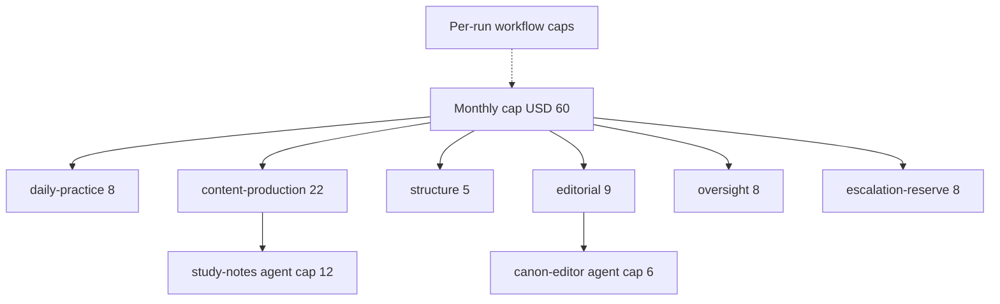

# Cost Governance Framework

## Purpose

This document defines how model spending in The Bayan Library is budgeted,
enforced, recorded, reported and reduced. Spending is a governance concern:
an affordable library can be run for fifty years, and every dollar should
buy reviewed knowledge rather than repeated or oversized model calls.

Source of truth: `system/registry/budgets.yaml` (monthly cap, envelopes,
escalation budget, workflow and agent caps, metrics) and
`system/registry/models.yaml` (prices and discounts). Reporting is
implemented by `scripts/cost-report.py` (shared code in
`scripts/bayan/cost.py`).

Related documents: [Model Routing Framework](05-model-routing-framework.md),
[Token Optimization Framework](06-token-optimization-framework.md),
[Workflow Architecture](09-workflow-architecture.md),
[Automation Architecture](11-automation-architecture.md) and the
[Risk Register](../16-risk-register.md).

## Cost Principles

| Principle | Rule |
| --- | --- |
| Hard cap | USD 60.00 per month across all model calls |
| Pre-flight enforcement | The orchestrator refuses a call that would exceed a hard cap; it does not discover overruns afterwards |
| Every call on the ledger | One JSONL line per model call; no ledger line, no call |
| Escalation is paid separately | Calls escalated above an agent's default model draw on a dedicated reserve |
| No paid calls from CI | No GitHub workflow calls a paid model API; model-calling automation is a future, opt-in, owner-approved step with its own spend cap |
| Reports are committed | Monthly reports are versioned under `system/reports/cost/` |

## Budget Hierarchy



A call must fit, in order: the per-call token budget, the per-run workflow
cap, the agent's monthly cap (if any), its envelope, and the monthly cap.

### Monthly Budget and Envelopes

| Envelope | Cap USD | Covers |
| --- | --- | --- |
| `daily-practice` | 8.00 | daily (family), daily-wisdom |
| `content-production` | 22.00 | study-notes, poetry, learning (family), learning-coach, quran (family), quran-learning |
| `structure` | 5.00 | metadata, knowledge-graph, documentation, automation |
| `editorial` | 9.00 | canon-editor, reading-guide, research, islamic-civilization |
| `oversight` | 8.00 | chief-librarian, quality-assurance, risk-management |
| `escalation-reserve` | 8.00 | escalations |
| Total | 60.00 | `scripts/validate-registry.py` checks the sum |

`covers` lists agent families and agent IDs. `scripts/cost-report.py`
charges a ledger line to the envelope that names its `agent_id`; only when
no envelope names the agent does its family decide. That is how the core
agents `daily-wisdom`, `learning-coach` and `quran-learning` are charged to
the practice and content envelopes rather than by family.

The `oversight` and `editorial` caps were rebalanced from 5 and 12 to 8 and
9 after the estimate below showed that model-graded QA of about 100 book
ingestions alone costs about USD 5 a month, while editorial work needs
about USD 2 in an ordinary month.

### Agent Budgets

Per-call token budgets are declared on every agent (see
[Agent Registry](02-agent-registry.md)). Six agents also have monthly caps
inside their envelope; the rest share it.

| Agent | Monthly cap USD | Envelope |
| --- | --- | --- |
| `chief-librarian` | 3.00 | oversight |
| `canon-editor` | 6.00 | editorial |
| `islamic-civilization` | 4.00 | editorial |
| `quran-learning` | 3.00 | content-production |
| `study-notes` | 12.00 | content-production |
| `metadata` | 1.00 | structure |

### Workflow Budgets

A run that would exceed its per-run cap stops and reports instead of
continuing (status `stopped_budget` in `run.yaml`).

| Workflow | Per-run cap USD | Estimated per run USD |
| --- | --- | --- |
| `daily-cycle` | 0.25 | 0.075 (batched) |
| `weekly-cycle` | 1.50 | 0.20 |
| `monthly-cycle` | 5.00 | 0.63 |
| `annual-cycle` | 25.00 | not estimated |
| `book-ingestion` | 0.60 | 0.18 |
| `canon-revision` | 12.00 | 2.33 |
| `reading-path-build` | 1.50 | not estimated |
| `graph-enrichment` | 1.00 | not estimated |
| `quran-study-session` | 1.20 | not estimated |
| `methodology-change` | 10.00 | not estimated |

Every workflow has its own `budget_ref` in `workflows.yaml`.

### Escalation Budget

| Rule | Value |
| --- | --- |
| Reserve envelope | `escalation-reserve`, USD 8.00 |
| Charged amount | The full cost of each escalated call |
| Maximum escalation share | 25% of all spend |
| Maximum opus share | 35% of all spend |
| Justification | Required on every escalated call (record format in [Model Routing Framework](05-model-routing-framework.md)) |
| Reserve exhausted | Further escalations need owner approval for the rest of the month |

## Cost Reporting

### Usage Ledger

`.bayan/ledger/YYYY-MM.jsonl`, git-ignored, one line per model call. Script
steps write no line. Shown wrapped here; stored as one line.

```json
{"ts": "2026-10-13T04:12:09Z",
 "run_id": "daily-cycle-20261013T040000Z-5d0e",
 "workflow_id": "daily-cycle", "agent_id": "daily-poem",
 "skill_id": "poetry-analysis", "model": "claude-sonnet-5-5",
 "input_tokens": 7820, "output_tokens": 1410,
 "cache_read_tokens": 1500, "task": "poetry_analysis",
 "batch": true, "escalated": false, "accepted": true}
```

| Field | Meaning |
| --- | --- |
| `ts` | UTC timestamp of the call |
| `run_id`, `workflow_id` | Run identity (see [Workflow Architecture](09-workflow-architecture.md)) |
| `agent_id`, `skill_id` | Registry IDs |
| `model` | Model ID as called (a class name is also accepted); mapped to its class and prices through `models.yaml` at report time |
| `input_tokens`, `output_tokens`, `cache_read_tokens` | Billed token counts |
| `task` | Optional task type from `routing.yaml`; used to decide batch eligibility. A line without it counts as eligible |
| `batch` | Sent through the Message Batches API |
| `escalated` | Routed above the agent's default model |
| `accepted` | Output merged (set when the PR merges; false until then) |

Cost per line is computed, not stored:

```text
rate     = models[model].pricing
uncached = input_tokens - cache_read_tokens
cost     = (uncached * rate.input + cache_read_tokens * rate.cache_read
            + output_tokens * rate.output) / 1e6
if batch: cost *= discounts.batch_api_multiplier      # 0.5
```

### Monthly Report

`scripts/cost-report.py` reads the month's ledger and `budgets.yaml` and
writes `system/reports/cost/YYYY-MM.md`, committed through a PR at G0
(reports are automated checks only). It is run by `risk-management` in the
`monthly-cycle` (`cost-reporting` skill, script, no model).

| Section | Contents |
| --- | --- |
| Summary | Total spend vs cap, share of cap, alerts raised, projection to month end |
| Envelopes | Spend vs cap per envelope |
| Workflows | Runs, mean and max cost per run vs per-run cap, stopped runs |
| Agents | Spend per agent vs monthly cap where set |
| Models | Spend and tokens per model class; opus share |
| Metrics | Every metric below vs target, with last month's value |
| Escalations | Count, cost, share, top reasons, reserve remaining |
| Overruns | Calls above token budget, with or without justification |
| Top runs | Ten most expensive runs with run IDs |
| Recommendations | Proposed routing, budget or envelope changes for owner review |

## Cost Optimization Metrics

| Metric | Definition | Target |
| --- | --- | --- |
| `cost_per_accepted_artifact` | Spend divided by merged outputs | Trend down; reported monthly |
| `opus_share` | Share of spend on opus | <= 0.35 |
| `escalation_rate` | Share of calls escalated above default | <= 0.15 |
| `cache_hit_rate` | Cached input tokens over total input | >= 0.5 |
| `batch_share` | Batch calls over batch-eligible calls (lines whose `task` is in `batch_eligible`, or that carry no `task`) | >= 0.8 |
| `budget_overrun_count` | Calls that exceeded a token budget | 0 unjustified |
| `tokens_per_artifact` | Mean input and output tokens per merged output | Trend down |
| `rework_rate` | Outputs rerun after QA failure | <= 0.1 |

## Alert Thresholds

`alert_thresholds: [0.5, 0.8, 1.0]` of the monthly cap, checked before every
call against the ledger total.

| Threshold | Spend | What happens |
| --- | --- | --- |
| 50% | USD 30.00 | Informational alert in the run output and the next report; projection checked |
| 80% | USD 48.00 | Warning: escalations require owner approval; batch-eligible work is batch only; new `canon-revision` and `annual-cycle` runs need owner confirmation |
| 100% | USD 60.00 | Hard stop: new non-essential runs pause; running steps finish their current call and stop |
| 110% | USD 66.00 | `daily-cycle`, the only essential workflow, pauses too |

Other triggers:

| Trigger | Action |
| --- | --- |
| Envelope reaches its cap | Workflows charged to that envelope pause; the owner may move headroom between envelopes for the month |
| Agent monthly cap reached | That agent's calls are refused; its workflow steps stop and report |
| Per-run cap reached | Run stops with `stopped_budget`; resumable after owner review |
| Escalation reserve spent | Escalations need owner approval |
| `opus_share` above 0.35 or escalation share above 0.25 | Flagged in the report; routing review at the next monthly cycle |

## Worked Monthly Estimate

Prices per million tokens: haiku 0.10 in / 0.50 out, sonnet 2.00 / 10.00,
opus 4.00 / 20.00; Batch API at 50%. Token figures are the planned per-call
sizes from the skill budgets; cache savings are excluded to stay
conservative.

### Daily Cycle

The whole `daily-cycle` runs overnight through the Batch API.

```text
haiku  calls: daily-wisdom plan 3,000/300, daily-word 5,000/800,
       daily-book 5,000/800, daily-thinker 6,000/900,
       daily-civilization 6,000/900, daily-quote 4,000/600
                                             = 29,000 in / 4,300 out
       29,000 x 0.10/1e6 + 4,300 x 0.50/1e6  = 0.0029 + 0.0022 = 0.0051
sonnet calls: daily-concept 8,000/1,500, daily-poem 8,000/1,500,
       daily-question 4,000/400, daily-life-principle 5,000/600,
       daily-verse 6,000/1,000, reflection-journal 4,000/800,
       QA scoring 12,000/1,500               = 47,000 in / 7,300 out
       47,000 x 2.00/1e6 + 7,300 x 10.00/1e6 = 0.0940 + 0.0730 = 0.1670
script: memory-retention queue, formatting   = 0
per run  = (0.0051 + 0.1670) x 0.5 batch     = 0.0861   (cap 0.25)
month    = 30 x 0.0861                       = 2.58
```

### Book Ingestion

Per book, from the worked example in
[Token Optimization Framework](06-token-optimization-framework.md):

```text
chunk digests (haiku, batch)   0.0093
layered summaries (sonnet)     0.0514
2 concept notes (sonnet)       0.0440
graph proposals (sonnet)       0.0220
tags, difficulty (batch)       0.0006
record and duplicates (haiku)  0.0007
QA scoring + citations         0.0500
per book                       0.178    (cap 0.60)
100 books                      17.80
study-notes share 0.1047 x 100 = 10.47  (agent cap 12.00)
```

### Canon Revision

```text
research dossiers   sonnet 3 x (30,000/5,000)      = 0.330
representation      sonnet 10,000/2,000            = 0.040
comparative         sonnet 30,000/5,000            = 0.110
influence           sonnet 25,000/4,000            = 0.090
bias audit          opus   40,000/6,000            = 0.280
draft ranking       opus   80,000/10,000           = 0.520
ranking rerun after one QA failure (allowance)     = 0.520
QA scoring          sonnet 12,000/1,500            = 0.039
approval packet     opus   60,000/8,000            = 0.400
per run                                            = 2.329  (cap 12.00)
```

### Other Cycles and Oversight

```text
weekly-cycle  4 x 0.1955 (digest, 5 capture notes, theme plan) = 0.78
monthly-cycle digest 0.06, coverage gaps 0.11, risk 0.055,
              QA calibration 20 x 0.02 = 0.40, small haiku calls  = 0.63
chief-librarian monthly decision memo, opus 60,000/8,000         = 0.40
escalation allowance (charged to escalation-reserve)             = 1.50
```

### Monthly Total

| Line | USD |
| --- | --- |
| Daily cycle (30 runs) | 2.58 |
| Weekly cycle (4 runs) | 0.78 |
| Monthly cycle | 0.63 |
| Book ingestion (100 books) | 17.80 |
| Canon revision (1 run) | 2.33 |
| Oversight memo | 0.40 |
| Escalation allowance | 1.50 |
| Total | 26.01 (43% of cap) |

At the owner's chosen pace of 12 books a month (decision D-013), book
ingestion is `12 x 0.178 = 2.14` and the same month totals about USD 10.35
(17% of cap). The 100-book month above is the capacity the cap is sized
for, not the expected spend.

Opus spend is `0.28 + 0.52 + 0.52 + 0.40 + 0.40 = 2.12`, an `opus_share` of
0.08 against the 0.35 limit. In January the `annual-cycle` (cap 25.00) can
take the month past the 80% alert; it should be scheduled with the owner.

### Envelope Check

| Envelope | Estimated USD | Cap USD | Status |
| --- | --- | --- | --- |
| `daily-practice` | 2.22 | 8.00 | ok |
| `content-production` | 11.13 | 22.00 | ok |
| `structure` | 2.29 | 5.00 | ok |
| `editorial` | 2.00 | 9.00 | ok; room for a second canon revision or a methodology change |
| `oversight` | 6.88 | 8.00 | ok, 86%; QA on 100 books is 5.00 of it |
| `escalation-reserve` | 1.50 | 8.00 | ok |

Every envelope fits. `oversight` is the tightest because `qa_review` and
`citation_verification` are class B skills: `quality-assurance` is a class A
agent, but a skill always runs on its own recommended model, so each QA
step is a sonnet call charged to `quality-assurance`. Running the hybrid
QA checks as scripts first, so that the model scores only the residue, is
the main lever if ingestion volume grows beyond about 100 books a month.

Without the framework the same month would not fit: sending full text to
sonnet for every ingestion step costs about 1.55 USD per book, or 155 USD
for 100 books.

## Levers

| Lever | Effect | Where |
| --- | --- | --- |
| Batch API | 50% off every batch-eligible call; the whole daily cycle runs batched (saves 2.58 per month) | `routing.yaml` `batch_eligible`, workflow `batch: true` |
| Prompt caching | Stable prefix billed at the cache-read rate (sonnet 0.20 instead of 2.00) | Prefix ordering in [Token Optimization Framework](06-token-optimization-framework.md) |
| Retrieval ladder | Cards and summaries instead of full text; about 94% fewer sonnet input tokens per book | `scripts/build-context.py` |
| Chunk digests on haiku | Long works compressed at haiku prices before sonnet writes | `knowledge_compression` task |
| Downgrades | Forbidden types never run on opus | `downgrade_rules` |
| Scripts before models | 5 task types are script-only, 9 are hybrid | `execution` in the routing matrix |
| Output reuse | Accepted summaries, cards and digests reused; semantic cache avoids repeat calls | Run cache, repository |
| Escalation discipline | Justified, one rung at a time, separately budgeted | [Model Routing Framework](05-model-routing-framework.md) |

## Cost Governance Summary

Spend is bounded at USD 60 per month, partitioned into six envelopes, and
further limited per run, per agent and per call. Every model call is a
ledger line, checked before it is made, and summarised each month into a
committed report with metrics and targets. A realistic month of daily
practice, about 100 book ingestions, one canon revision and oversight costs
about USD 26, with every envelope inside its cap; at the owner's chosen
pace of 12 books it is about USD 10.
Batch processing, caching, the retrieval ladder, downgrades and reuse keep
the library affordable as it grows.
