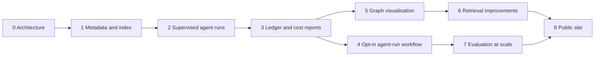

# Future Roadmap

## Purpose

This document sets out how the multi-agent architecture is brought into
use, phase by phase, from this architecture to a public site, with exit
criteria for each phase, long horizons of 5, 20 and 50 years, and a
decision log of what is deliberately deferred.

Source of truth: [Implementation Roadmap](../15-implementation-roadmap.md)
for the library's content phases, and the registries in
`system/registry/` for every capability named here. This roadmap only
sequences the agent and automation layer that serves those phases.

Related documents: [System Architecture Overview](01-system-architecture-overview.md),
[Automation Architecture](11-automation-architecture.md),
[Evaluation Framework](13-evaluation-framework.md),
[Cost Governance Framework](14-cost-governance-framework.md) and
[Risk Analysis](16-risk-analysis.md).

## Roadmap Principles

| Principle | Consequence |
|---|---|
| Organization before expansion | Metadata, schemas and index come before content volume |
| Supervised before automated | Every workflow runs by hand under watch before any scheduling |
| Measured before scaled | Ledger, cost reports and golden sets exist before throughput grows |
| Reversible steps | Each phase can be paused without breaking the previous one |
| Smallest model first | Every phase starts on default classes and tests downgrades |

## Phase Overview

| Phase | Name | Aligns with docs/15 | Status |
|---|---|---|---|
| 0 | Architecture | Phase 1 Foundation | done |
| 1 | Metadata seeding and index | Phase 2 Core Content Framework; Phase 10 Automation Platform (validation, index) | next |
| 2 | First agent runs, manual and supervised | Phases 3-6 (canon, Islamic civilization, poetry, authors) begin | planned |
| 3 | Ledger and cost reports | Phase 10 Automation Platform | planned |
| 4 | Opt-in agent-run workflow | Phase 10 Automation Platform | planned |
| 5 | Graph visualisation | Phase 9 Knowledge Graph Generation | planned |
| 6 | Retrieval improvements | Phase 11 Research Infrastructure | planned |
| 7 | Evaluation golden sets at scale | Phase 12 Advanced Analytics | planned |
| 8 | Public site | Phase 13 Repository Maturity | planned |

Phases 3 and 5 can run in parallel; phase 4 must not start before phase 3.

## Phase 0: Architecture

| Item | Detail |
|---|---|
| Objective | An implementation-ready, human-supervised multi-agent architecture |
| Deliverables | Registries in `system/registry/`, schemas in `system/schemas/`, this document set, reference scripts in `scripts/` and `scripts/bayan/`, tests, five GitHub workflows, CODEOWNERS, PR template |
| Exit criteria | `scripts/validate-registry.py` exits 0; `validate.yml` green on `develop`; architecture docs merged at G4 |

## Phase 1: Metadata Seeding and Index

| Item | Detail |
|---|---|
| Objective | Real records for a first slice of the library, and a retrieval index agents can read instead of files |
| Deliverables | Metadata schemas in `system/schemas/metadata/`; seed records for priority figures and works of docs/15 (sharded one record per file); `metadata/index.yaml` and `metadata/index/<type>.jsonl` from `scripts/build-index.py`; folder READMEs |
| Exit criteria | At least 100 books, 50 authors and poets, 13 civilizations and 20 themes as valid records; `validate-metadata.py` 0 critical and 0 major findings; `build-index.py --check` clean; index card average under 120 tokens |

## Phase 2: First Agent Runs, Manual and Supervised

| Item | Detail |
|---|---|
| Objective | Prove each workflow end to end with the owner watching every step |
| Order | `book-ingestion` -> `daily-cycle` -> `graph-enrichment` -> `reading-path-build` -> `quran-study-session` -> `weekly-cycle` and `monthly-cycle` -> `canon-revision` |
| Method | Owner runs the orchestrator locally (Claude Code with `scripts/route-task.py` and `scripts/build-context.py`); every run opens a PR from the machine identity |
| Deliverables | First merged outputs per workflow; minimal golden set (at least 20 cases) for each skill used; project memory for the first canon revision |
| Exit criteria | Each workflow completed 3 times within its per-run cap; first-pass QA >= 0.8; zero critical findings after merge; owner review time per PR recorded |

## Phase 3: Ledger and Cost Reports

| Item | Detail |
|---|---|
| Objective | Every model call measured, every month reported |
| Deliverables | Ledger lines in `.bayan/ledger/YYYY-MM.jsonl` for all runs; `scripts/cost-report.py` producing `system/reports/cost/YYYY-MM.md`; alert thresholds at 50%, 80% and 100% of USD 60 |
| Exit criteria | Two consecutive monthly reports with all eight budget metrics; spend within cap; `batch_share` >= 0.8 and `cache_hit_rate` >= 0.5, or a written plan to reach them |

## Phase 4: Opt-in Agent-Run Workflow

| Item | Detail |
|---|---|
| Objective | Let GitHub run approved workflows without weakening any control |
| Deliverables | `agent-run.yml` as designed in [Automation Architecture](11-automation-architecture.md): `workflow_dispatch`, protected environment with the owner as required reviewer, `ANTHROPIC_API_KEY` as environment secret, per-run spend cap, draft PR output |
| Exit criteria | Owner G4 approval of the workflow; 30 days of `daily-cycle` runs with zero cap breaches and zero writes outside the run branch; security review per [Security and Privacy Guidelines](../14-security-and-privacy-guidelines.md) |

## Phase 5: Graph Visualisation

| Item | Detail |
|---|---|
| Objective | Make the seven maps readable by people, not only by agents |
| Deliverables | Static renderings from `build/graph/` per map (influence, civilization, theme, canon, Quran, poetry, reading path); Mermaid previews in release artifacts; graph health section in the monthly report |
| Exit criteria | Every map renders under 500 visible nodes by default with drill-down; `orphan_node_rate` < 2%; `edge_citation_rate` 1.0 for high and moderate edges |

## Phase 6: Retrieval Improvements

| Item | Detail |
|---|---|
| Objective | Smaller, better context for every call as the library grows |
| Deliverables | Card quality checks; shard-aware index loading; optional local embeddings built offline from index cards, stored as a release artifact, never a hosted vector service; hybrid lookup (filters first, embeddings second) in `scripts/build-context.py` |
| Exit criteria | `tokens_per_artifact` down at least 20% from the phase 3 baseline at equal QA scores; retrieval works fully without embeddings (they stay optional) |

## Phase 7: Evaluation Golden Sets at Scale

| Item | Detail |
|---|---|
| Objective | Every model-using skill is measured, and routing is tested downward |
| Deliverables | Golden sets in `tests/golden/<skill-id>/` for every `model` and `hybrid` skill; monthly scorecards; quarterly downgrade experiments per [Evaluation Framework](13-evaluation-framework.md) |
| Exit criteria | QA `agreement_with_human_reviewers` >= 0.85 for three months; at least one downgrade experiment completed per quarter; `escaped_defect_rate` < 2% |

## Phase 8: Public Site

| Item | Detail |
|---|---|
| Objective | A readable public library built from the repository |
| Deliverables | Static site generated from Markdown, index and graph artifacts on release; no private content; contributor guide linked to docs/10 |
| Exit criteria | Site build is deterministic and reproducible from a tag; privacy check proves no `notes/reflections/**` content; link validation clean on the built site |

## Long Horizons

### Five Years

| Area | Expected state |
|---|---|
| Library | 2,000+ books with layered summaries; Top 100 and domain canons stable; all eight Quran tracks active each year |
| Agents | Most class B work proven; several tasks moved down a rung by experiment |
| Operations | Monthly spend within cap; delegated editors for G2 reviews |
| Infrastructure | Public site live; mirrors on two hosts; annual exports |

### Twenty Years

| Area | Expected state |
|---|---|
| Library | 10,000+ books, 5,000+ authors, 100,000+ notes, 20,000+ concepts |
| Agents | Several model generations replaced through `models.yaml` only; golden sets are the continuity across generations |
| Governance | Succession plan for the owner role; editors with G3 and G4 delegation defined in docs/02 |
| Infrastructure | Index and graph sharded further; formats still Markdown, YAML and JSON |

### Fifty Years

| Area | Expected state |
|---|---|
| Library | A multi-generational archive whose canonical memory has been reviewed by people, not only produced by models |
| Agents | Whatever runs them, the registries' concepts (classes, tiers, gates, budgets) still describe the work |
| Continuity | Plain-text archive readable without any of today's tools; releases and exports held in independent archives |
| Character | The guiding chain Information -> Knowledge -> Understanding -> Wisdom -> Action -> Character remains the test of every feature |

## Decision Log

Decisions deferred, declined or settled by the owner, with the condition
for reopening them. New entries are added by G4 PR.

| ID | Decision | Status | Reason | Reopen when |
|---|---|---|---|---|
| D-001 | Model API calls inside GitHub Actions | Deferred to phase 4 | Cost and secret exposure before ledger and caps are proven | Phase 3 exit criteria met |
| D-002 | Auto-merge of agent PRs, at any gate | Declined | Every merge is a human act (permissions universal rules) | Not planned |
| D-003 | Hosted vector database | Declined | Vendor dependency and cost; local optional embeddings suffice | Retrieval quality fails with local embeddings at 20,000+ concepts |
| D-004 | Graph database server | Deferred | JSON per map is enough at current scale | Graph build over 5 minutes after per-map split |
| D-005 | Git LFS | Declined | Library is plain text; artifacts live in releases | Binary assets become necessary in the main repository |
| D-006 | Storing ebook files | Deferred | Copyright risk; pointers preferred | A licensed open collection needs archiving (separate repository) |
| D-007 | Scheduled agent runs without per-run approval | Deferred | Human supervision first | Twelve months of phase 4 with no incidents |
| D-008 | Fine-tuned or self-hosted models | Deferred | Routing classes cover the need; golden sets not yet mature | Phase 7 complete and a cost or continuity case exists |
| D-009 | Open contributor programme | Deferred | Owner review capacity (R-048) | Delegated editors in place |
| D-010 | Daily quote and verse agents | Adopted (owner, 2026-10-13) | Specified in docs/18; `daily-quote` and `daily-verse` added to `daily-cycle` at G1 | Either feature is retired |
| D-011 | Registry location for evaluation reports | Open | Not yet in any registry; `system/reports/evaluation/` proposed | Phase 7 starts |
| D-012 | Monthly cost cap | Kept at USD 60 (owner, 2026-10-13) | A typical month is estimated at USD 10 to 26 | Two consecutive months above the 80% alert |
| D-013 | Book ingestion pace | 12 a month (owner, 2026-10-13) | Owner review time, about 3.5 hours a week, sets the pace rather than cost | Owner chooses to review more, or delegated editors exist |
| D-014 | Haiku cache-read price | Kept as a marked assumption (owner, 2026-10-13) | Affects estimates only, by cents | Published price confirmed |
| D-015 | Action pinning | Adopted (owner, 2026-10-13) | Workflows use full commit SHAs with the tag in a comment | Not planned |

## Roadmap Summary

The architecture (phase 0) is done. Next come real metadata and an index,
then every workflow run by hand under supervision, then measurement of
every call, and only after that an opt-in, owner-approved GitHub runner.
Graph visualisation, leaner retrieval, evaluation at scale and a public
site follow. Over 5, 20 and 50 years the library grows by orders of
magnitude while its formats, registries and human review stay the same,
and the decision log records what was held back and why.
